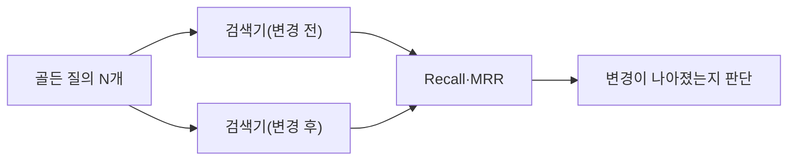
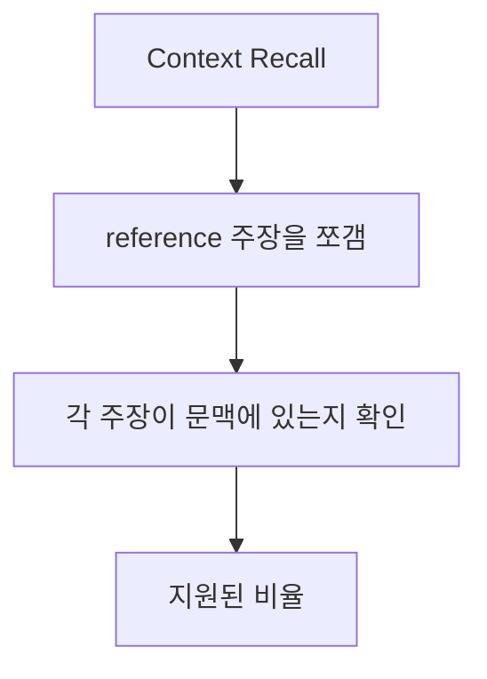

# 골든 질의 세트

> 질의와 그에 대한 정답 문서(또는 정답 답변)를 짝지어 둔 소규모 평가 세트다. 임베딩 모델 교체, 재색인, 최신성 가중 같은 RAG 변경 전후의 검색 품질을 같은 기준으로 비교하는 데 쓴다.

## 쉽게 말하면
이사 전후에 같은 질문 목록으로 도서관 사서가 제대로 찾아주는지 시험하는 표준 문제집이다. 문제집이 고정되어 있어야 "나빠졌는지"를 말할 수 있다.

## 자세히
(Ragas Context Recall 문서를 직접 열어 확인. 이 페이지는 "골든 데이터셋"을 직접 언급하지 않는다. 골든 세트의 구성·운영 방식은 이 지도의 제안이다.)
- **평가 지표 예(Ragas Context Recall)**: 검색된 문맥이 **정답 기준(reference)**의 주장을 얼마나 뒷받침하는지 비율로 잰다. Context Recall = (검색된 문맥이 뒷받침하는 reference 주장 수) ÷ (reference 전체 주장 수). 항상 reference 답변이 필요하며 LLM 기반 지표는 `reference_contexts` 주석이 번거로워 `reference`를 대신 쓴다.
- **변형**: Non-LLM(`NonLLMContextRecall`, 문자열 비교로 `reference_contexts`와 비교, 문서 예시 0.5), ID 기반(`IDBasedContextRecall`, 문서 ID 비교, 예시 0.25).
- **예**: "에펠탑은 어디에 있나?" — 문맥 "Paris is the capital of France.", reference "The Eiffel Tower is located in Paris" → 문서의 점수 1.0.
- **구성(제안)**: 질의 50~200개, 정답 문서 ID 또는 정답 답변, 질의 유형(사실·절차·최신 정보) 분포를 실제 로그와 맞춘다. 변경 때마다 같은 세트로 Recall@k, MRR 등을 비교.
- **운영(제안)**: 정답 문서가 삭제·갱신되면 세트도 갱신하고 버전을 기록한다. 세트가 학습·튜닝 데이터와 섞이지 않게 분리.

## 그림으로 보기

## 예시
- 임베딩 모델을 바꾸기 전 골든 질의 100개로 Recall@5를 비교.
- 교육 활용: 내 업무 질문 20개로 작은 골든 세트 만들어 보기.

## 헷갈리는 것과 비교
| 개념 | 차이 |
|---|---|
| 골든 질의 세트 | 고정 평가 세트 |
| 학습 데이터 | 모델을 학습시키는 데이터 |
| [MTEB](#mteb-benchmark) | 일반 임베딩 벤치마크 |

## 더 읽을거리
- [Ragas: Context Recall](https://docs.ragas.io/en/stable/concepts/metrics/available_metrics/context_recall/) — 지표 정의와 변형.
