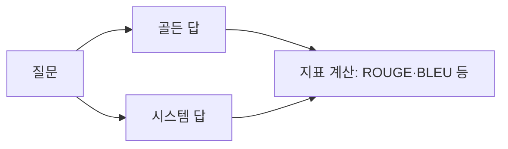

# 골든 레퍼런스 세트

> 평가 질문마다 **알려진 좋은 답(정답 기준)을 짝지어 고정해 둔 세트**다. 지표를 더 다양하고 섬세하게 계산할 수 있게 한다.

## 쉽게 말하면
시험 문제지와 모범 답안지를 한 벌로 묶어 두는 것이다. 답안지가 있으면 학생의 답이 얼마나 가까운지 여러 방식으로 채점할 수 있다.

## 자세히
(Google Cloud 블로그 "Optimizing RAG retrieval"(2024-12-19)을 직접 읽었다.)
- **정의(블로그)**: "골든" 레퍼런스 데이터셋은 알려진 좋은 출력의 모음이다. 이것이 있으면 **더 폭넓고 섬세한 평가 지표**를 쓸 수 있으나 일부 지표는 레퍼런스 없이도 돌릴 수 있다.
- **붙이는 법(블로그)**: 어떤 지표를 계산하느냐에 따라 질문마다 레퍼런스 답을 단다. **ROUGE·BLEU** 같은 계산 기반 지표는 출력을 이 정답과 비교한다.
- **고정 원칙(블로그)**: 실행 사이에 평가 질문·레퍼런스 답·시스템 설정을 바꾸지 않는다. 같은 시험을 변경할 때마다 반복한다.
- **구성 권고(블로그)**: 데이터의 넓은 범위를 덮고 표현·복잡도를 다양하게, 이해관계자와 검증.
- **한계**: 이 글의 출처는 보류(held-out) 세트를 다루지 않는다. 튜닝에 쓴 세트로 최종 점수를 내면 과적합될 수 있다(일반 상식, 출처 외).

## 그림으로 보기

## 예시
- 사내 규정 Q&A 50개에 담당자가 쓴 모범 답을 붙여 두고 챗봇 변경 때마다 같은 세트로 점수를 비교(제안).

## 헷갈리는 것과 비교
| 개념 | 차이 |
|---|---|
| 골든 레퍼런스 | 질문별 정답 기준 |
| [회귀 평가 골든 세트](#golden-dataset-versioning) | 회귀 방지용 문항 세트의 버전 관리 |
| 레퍼런스 없는 지표 | 정답 없이 계산하는 지표 |

## 더 읽을거리
- [Google Cloud — Optimizing RAG retrieval](https://cloud.google.com/blog/products/ai-machine-learning/optimizing-rag-retrieval) — 직접 읽음.
