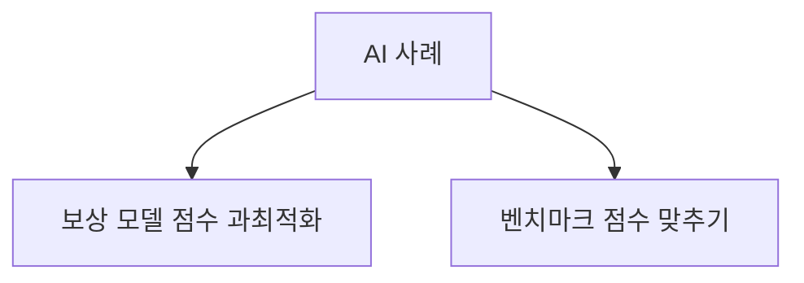

# 굿하트의 법칙

> **"측정값이 목표가 되면 좋은 측정값이 아니게 된다."** 지표를 통제 수단으로 삼으면 지표와 실제 목적 사이의 관계가 무너진다는 경구다. AI에서는 보상 모델·벤치마크 점수 최적화에서 자주 인용된다.

## 쉽게 말하면
학생에게 "숙제 제출 횟수"로 평가하겠다고 하면 질 낮은 숙제를 많이 내는 학생이 생긴다. 지표를 올리는 일이 목적이 되어 버린다.

## 자세히
(Wikipedia 열람 2026-11-28.)
- 기원: 찰스 구드하트(Charles Goodhart)가 1975년 영국 통화정책 논문에서 제시한 아이디어: "관찰된 통계적 규칙성은 통제 목적으로 압력이 가해지면 무너지는 경향이 있다."
- 흔한 짧은 형태: 인류학자 마릴린 스트래선(Strathern, 1997)이 키스 호스킨의 문장을 인용한 **"측정이 목표가 되면 좋은 측정이 아니게 된다."**
- 관련 법칙: **캠벨의 법칙** — 정량적 사회 지표가 의사결정에 쓰일수록 부패 압력에 노출된다(1969년까지 거슬러 올라가는 정식이 있다는 주장).
- 문서가 드는 사례: h-index가 목표가 되자 과학상과의 연관이 약해짐, 병원이 재원 기간을 과도하게 줄여 응급 재입원이 늘어남, 영국 코로나 검사 목표가 서류상으로만 충족됨, 대처 정부의 통화량 목표.
- AI 연결: [보상 과최적화](#reward-overoptimization) 연구(Gao 외 2022)는 대리 보상을 지나치게 최적화하면 골드 성능이 줄 수 있다고 하며 이를 굿하트의 법칙과 연결한다(초록).
- 한계: 이 페이지는 Manheim & Garrabrant(2018)의 4가지 변형을 설명하지 않았다.

## 그림으로 보기

## 예시
- 챗봇 평가를 "답변 길이"로 하면 모델이 장황해짐([장황함 편향](#verbosity-bias)).
- 교육: 사내 AI 성과 지표(사용 횟수 등)를 정할 때의 부작용을 토론.

## 헷갈리는 것과 비교
| 개념 | 차이 |
|---|---|
| 굿하트의 법칙 | 지표가 목표가 되면 붕괴 |
| 캠벨의 법칙 | 사회 지표가 부패 압력에 노출 |
| [보상 과최적화](#reward-overoptimization) | AI 학습에서의 구체적 사례 |

## 더 읽을거리
- [Goodhart's law (Wikipedia)](https://en.wikipedia.org/wiki/Goodhart%27s_law) — 기원과 사례(읽음).
- [Scaling Laws for Reward Model Overoptimization](https://arxiv.org/abs/2210.10760) — AI 사례(초록 읽음).
