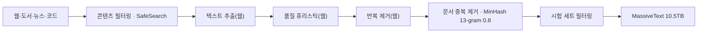
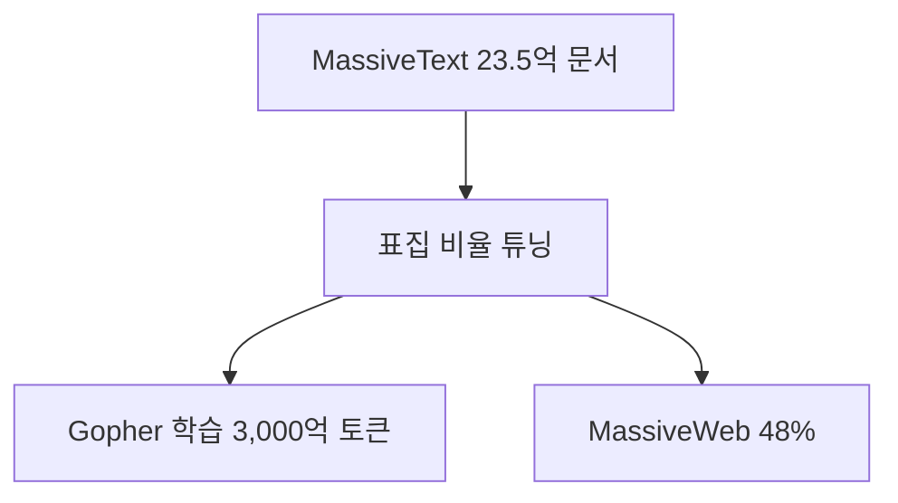

# Gopher·MassiveText

> Gopher는 DeepMind가 2021년 말 발표한 2,800억 파라미터 언어 모델이고, MassiveText는 그 학습에 쓴 영어 중심 대규모 코퍼스(웹·도서·뉴스·코드)다. 논문은 "품질 필터링→반복 제거→중복 제거→시험 세트 제거" 데이터 파이프라인을 상세히 공개해 데이터 정제의 대표 사례가 됐다.

## 쉽게 말하면
재료 손질 과정을 모두 적어 둔 요리책이다. 어떤 재료를 어떤 기준으로 버렸는지, 몇 단계로 씻었는지 순서까지 공개해, 같은 방식으로 따라 할 수 있다.

## 자세히
(Gopher 논문 arXiv 2112.11446의 PDF 본문 3.4절과 부록 A.1을 직접 내려받아 확인.)
- **규모**: MassiveText는 **23.5억 개 문서, 약 10.5TB**. Gopher는 그중 **3,000억 토큰(전체 토큰의 12.8%)**으로 학습하며 하위 집합별 표집 비율을 성능이 최대가 되도록 조정했다. 가장 큰 비중은 선별 웹 텍스트 **MassiveWeb(학습 데이터의 48%)**. 부분집합: 웹·도서·뉴스·코드(GitHub)·C4·위키피디아. 99%가 영어.
- **파이프라인 5단계**(논문 그림 A1): ① 콘텐츠 필터링(모든 부분집합: 비영어 제거, MassiveWeb은 **SafeSearch**로 노골적 콘텐츠 제거) ② 텍스트 추출(MassiveWeb: HTML 태그 구조로 본문 블록 추출, 들여쓰기·줄바꿈·글머리표 보존) ③ 품질 필터링(MassiveWeb) ④ 반복 제거(MassiveWeb) ⑤ 문서 중복 제거(위키·GitHub 제외 모든 부분집합) ⑥ 시험 세트 필터링(모든 부분집합). 논문은 단계가 쌓일수록 하위 성능이 개선된다고 보고한다(부록 A.3.2).
- **단순 휴리스틱 철학**: "정제된 정답 텍스트"(예: 영어 위키피디아, 레딧 링크 페이지)로 품질 분류기를 학습하는 방식은 **특정 인구 집단 쪽으로 편향되거나 방언·사회방언을 지울 수 있어** 쓰지 않고 간단하고 이해하기 쉬운 규칙만 썼다고 밝힌다.
- **품질 규칙(MassiveWeb)**: 단어 수 50~100,000 범위 밖 제거, 평균 단어 길이 3~10자 밖 제거, 해시(#)·말줄임표 대 단어 비율 0.1 초과 제거, 줄의 90% 초과가 글머리표로 시작하거나 30% 초과가 말줄임표로 끝나면 제거, 단어의 80%는 알파벳 포함, 영어 불용어(the, be, to, of, and, that, have, with) 중 2개 이상 없으면 제거.
- **중복 제거**: 정확 중복 제거 후 **13-그램 MinHash 자카드 유사도 > 0.8**이면 하나를 무작위 제거(공백 정규화·문장부호 무시로 재현율 향상)([MinHash·LSH](#minhash-lsh)).
- **시험 세트 필터링**: Wikitext103·C4·Curation Corpus·LAMBADA와 13-그램 자카드 0.8 초과인 학습 문서 제거. 단, Gopher 학습 이후 만들어진 시험 세트(예: The Pile)는 새어 있을 수 있다고 인정한다.
- 후속 사례: [FineWeb](#fineweb)은 규칙 필터와 분류기를 모두 실험했다. 관련 세부는 [SafeSearch vs 금지어 목록](#safesearch-vs-wordlist), [반복 제거 임계값](#repetition-thresholds), [모델 우도 필터링](#model-likelihood-filtering).

## 그림으로 보기

## 예시
- 사내 코퍼스 정제 순서를 설계할 때 이 순서(언어·콘텐츠 → 품질 → 반복 → 중복 → 평가 세트 겹침 제거)를 체크리스트로 쓴다.
- 평가용 질문을 만들었다면 학습 문서와 13-그램 자카드를 계산해 겹침 문서를 미리 빼는 규칙을 둔다([학습-시험 겹침](#train-test-overlap)).

## 헷갈리는 것과 비교
| 개념 | 차이 |
|---|---|
| MassiveText | Gopher 학습 코퍼스(DeepMind, 비공개) |
| [C4](#c4-dataset) | 공개 코퍼스, 간단 규칙. MassiveText에도 C4가 부분집합으로 포함 |
| [FineWeb](#fineweb) | 공개 코퍼스, 분류기 기반 FineWeb-Edu 포함 |
| 분류기 기반 품질 필터 | 편향 위험 때문에 Gopher는 쓰지 않음 |

## 더 읽을거리
- [Scaling Language Models: Methods, Analysis & Insights from Training Gopher (arXiv 2112.11446)](https://arxiv.org/abs/2112.11446) — MassiveText 구성·부록 A 파이프라인(PDF 본문 확인).
