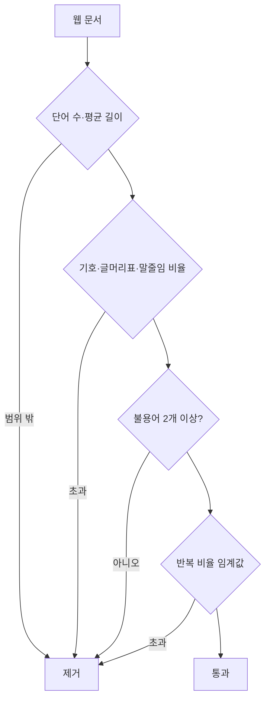
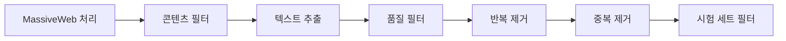

# Gopher 품질 휴리스틱

> DeepMind가 Gopher(2021) 학습 데이터 MassiveWeb에서 저품질 웹 문서를 걸러 낸 단순한 규칙 묶음이다. 모델 점수 대신 "설명하기 쉬운 숫자 규칙"을 쓴 것이 특징이다.

## 쉽게 말하면
원고 심사에서 "분량이 너무 짧거나 길다, 기호만 가득하다, 같은 문장을 반복한다"처럼 누구나 이해할 규칙으로 1차 탈락시키는 것과 같다. 의미를 읽지 않고 겉모습의 통계만 본다.

## 자세히
(Rae 외, "Scaling Language Models: Methods, Analysis & Insights from Training Gopher", arXiv 2112.11446 부록 A.1을 직접 읽고 확인.)
- **품질 필터(MassiveWeb만)**: 다음 중 하나라도 해당하면 문서 제거.
  - 단어 수가 50~100,000개 범위 밖, 평균 단어 길이가 3~10자 밖.
  - `#` 또는 `…`의 기호/단어 비율이 0.1 초과.
  - 줄의 90% 초과가 글머리표로 시작, 또는 30% 초과가 `…`로 끝남.
  - 단어의 80% 미만이 알파벳 문자를 포함.
  - 불용어 필터: the, be, to, of, and, that, have, with 중 **2개 이상** 없으면 제거(영어처럼 보여도 문장이 없는 문서 제거).
- **반복 제거**: 중복 줄·문단 비율 0.30, 중복 줄·문단 문자 비율 0.20, 가장 흔한 2-gram 문자 비율 0.20(3-gram 0.18, 4-gram 0.16), 5~10-gram 중복 문자 비율 0.15→0.10 등 13개 임계값(표 A1)을 넘으면 제거.
- **왜 단순 규칙?** 저자들은 편향을 줄이려고 "단순하고 이해하기 쉬운" 규칙을 썼고, 모델 가능도로 순위를 매기는 방식은 반복 텍스트에 높은 점수를 주고 비용·편향 위험이 있어 쓰지 않았다고 밝힌다.
- **콘텐츠 필터**: 단어 목록 대신 Google SafeSearch를 썼다 — 목록 필터가 소수 집단의 무해한 글을 더 지운다는 연구 때문([블록리스트 필터 편향](#blocklist-filter-bias)).
- 이 규칙은 영어 기준이다. 한국어에 그대로 쓰면 불용어·평균 단어 길이 기준이 맞지 않는다(제안).

## 그림으로 보기

## 예시
- 자사 문서 코퍼스에 평균 단어 길이·기호 비율만 계산해 이상치 문서를 먼저 훑어보기.
- 교육 활용: "AI로 거르기 전에 단순 통계로 거를 수 있는 것은?" 질문으로 데이터 품질 입문.

## 헷갈리는 것과 비교
| 개념 | 차이 |
|---|---|
| Gopher 휴리스틱 | 통계 규칙으로 걸러 설명 가능 |
| 분류기 품질 필터 | 모델이 "좋은 글" 확률을 예측 |
| [중복 제거](#near-duplicate-removal) | 같은·비슷한 문서 제거(품질과 별개) |

## 더 읽을거리
- [Scaling Language Models: Gopher (arXiv 2112.11446)](https://arxiv.org/abs/2112.11446) — 부록 A.1의 필터 규칙·표 A1.
