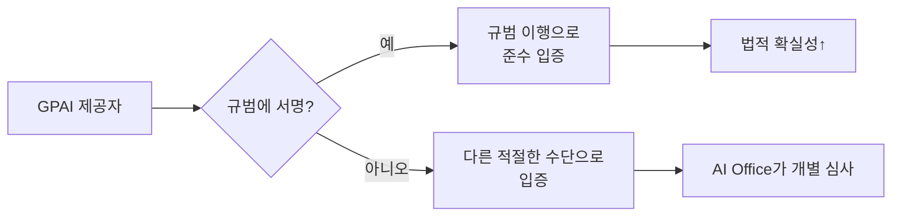

# GPAI 실천 규범

> 2025-07-10 공개된 자발적 이행 도구. 범용 AI 모델 제공자가 AI Act의 GPAI 의무를 지키고 있음을 보이는 방법으로, 투명성·저작권·안전보안 3개 장으로 이뤄진다.

## 쉽게 말하면
법이 "안전하게 만들어라"라고 하면, 실천 규범은 "이렇게 하면 우리는 그렇게 본다"라는 모범 답안이다. 이 답안을 따르면 심사 때 증명 부담이 줄어든다. 따르지 않아도 되지만 다른 방법으로 입증해야 한다.

## 자세히
출처: 집행위 GPAI 규범 페이지(2026-11-15 확인).
- **성격**: 독립 전문가가 다중 이해관계자 과정으로 작성한 자발적 도구. 집행위와 AI Board가 "적절한 자발적 도구"로 확인.
- **3개 장**:
  - **투명성**: 모든 GPAI 제공자 대상(53조). 모델 문서 양식 포함.
  - **저작권**: 모든 제공자 대상(53조). EU 저작권법 준수 정책 수립 방법.
  - **안전·보안**: 최상위 시스템 리스크 모델 제공자만(55조). 시스템 리스크 관리 모범 사례.
- **서명**: 서명 양식을 이메일로 제출. **서명 혜택**: 준수 입증 경로, 행정 부담 감소, 법적 확실성·신뢰 증가.
- **서명사(페이지 기재)**: Amazon, Anthropic, Cohere, Google, IBM, Microsoft, Mistral AI, OpenAI, Aleph Alpha 등. **xAI는 안전·보안 장만** 서명해 나머지는 다른 방식으로 입증해야 한다. 목록은 계속 갱신된다.
- AI Office가 서명사 태스크포스를 운영([AI Office](#ai-office)). 의무 적용 일정은 [시행 일정](#ai-act-enforcement-timeline).

## 그림으로 보기

## 예시
- 모델 제공사가 투명성 장의 모델 문서 양식을 채워 학습 데이터·성능·한계를 제출.
- 오픈 모델 스타트업은 저작권 장의 정책 가이드를 빌려 내부 정책 작성.

## 헷갈리는 것과 비교
| 개념 | 차이 |
|---|---|
| 실천 규범 | 자발적, 모범 답안 |
| AI Act 조문 | 강제 의무 |
| 지침(guidelines) | 집행위의 해석 안내 |
| [GPAI 의무](#eu-ai-act-gpai) | 규범이 이행 방법을 제시하는 대상 |

## 더 읽을거리
- [The GPAI Code of Practice](https://digital-strategy.ec.europa.eu/en/policies/contents-code-gpai) — 구성·서명사·서명 방법
