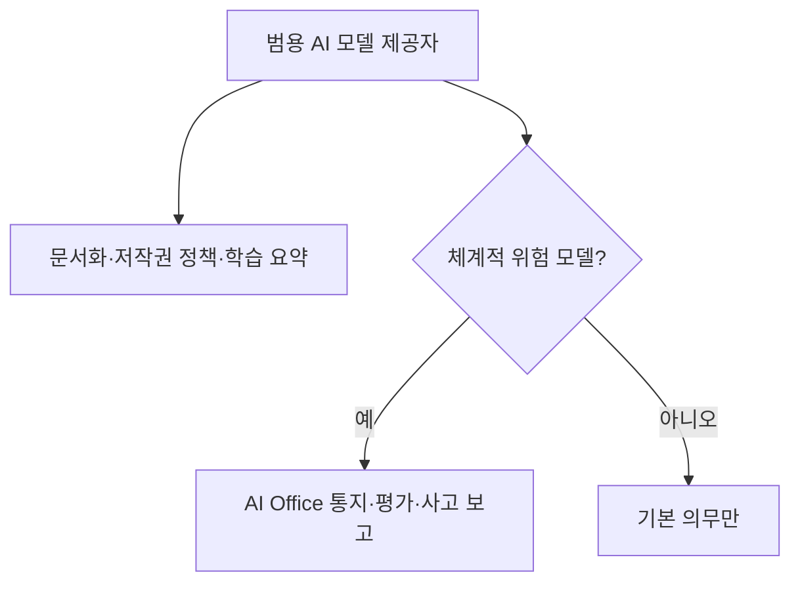
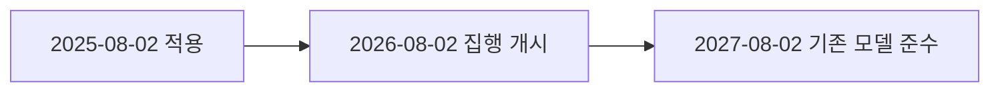

# 범용 AI 모델 의무

> **GPAI(범용 AI 모델) 의무**는 EU AI Act가 ChatGPT·Claude 같은 범용 모델의 제공자에게 요구하는 규칙이다. 2025년 8월 2일부터 적용되기 시작했다.

## 쉽게 말하면
식품 회사가 제품에 원재료·제조 정보를 적어 내야 하듯, 범용 모델을 시장에 내놓는 회사도 모델에 대한 문서와 정책을 갖추라는 요구다. 특히 위험이 큰 최첨단 모델에는 더 무거운 의무가 붙는다.

## 자세히
(EU 집행위원회 GPAI 제공자 지침 페이지 확인)
- **일정**: 2025-08-02 의무 적용 시작 / **2026-08-02** 집행위의 집행 권한(과태료 포함) 개시 / **2027-08-02** 2025-08-02 이전에 출시한 모델 제공자도 준수.
- **체계적 위험 모델**: 가장 진보한 모델은 AI Office에 통지해야 하며, 중대 사고 보고·안전 보안 프레임워크·모델 보고서 등을 제출한다(EU SEND 플랫폼).
- **학습 데이터 요약**: 학습 콘텐츠의 공개 요약을 위한 템플릿이 제공된다(필수 내용은 이 글에서 확인하지 않음).
- **행동 강령(Code of Practice)**: 의무 이행 방법을 설명하는 **자발적** 도구. 서명한 제공자는 AI Office의 지원을 받는다.
- 지침은 법적 구속력은 없지만 집행 해석의 기준이다. **중대한 수정**만 제공자 의무를 다시 일으킨다. 오픈소스 일부 면제는 조건부이며 세부는 확인하지 못했다.
- 저작권 정책, 10^25 FLOP 임계값은 해당 페이지에 없어 확인하지 않았다(일반 지식으로는 널리 거론됨).

## 그림으로 보기

## 예시
- 한국 기업이 EU 시장에 자체 LLM을 제공한다면 모델 문서와 학습 데이터 요약을 준비해야 한다(일반 지식).
- 교육 활용: "AI 규제는 이미 시행 중이고 날짜가 있다"는 사례.

## 헷갈리는 것과 비교
| 개념 | 차이 |
|---|---|
| GPAI 의무 | 모델 제공자 대상 |
| 고위험 AI 시스템 의무 | 특정 용도(채용 등) 시스템 대상(일반 지식) |
| 행동 강령 | 자발적 이행 도구 |
| [ISO/IEC 42001](#iso-42001) | 조직 관리체계 인증 표준 |

## 더 읽을거리
- [EU 집행위원회: GPAI 제공자 지침](https://digital-strategy.ec.europa.eu/en/policies/guidelines-gpai-providers) — 일정과 제출 절차.
