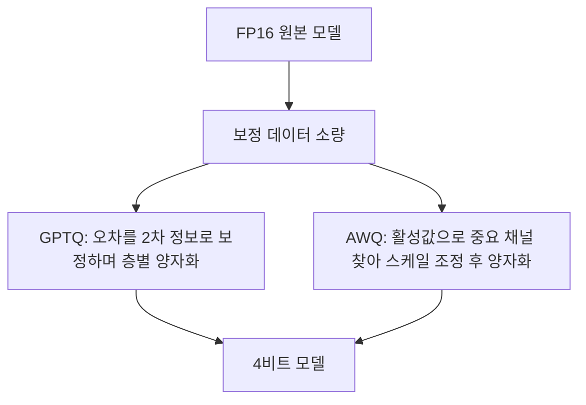

# GPTQ와 AWQ

> GPTQ와 AWQ는 이미 학습된 LLM의 가중치를 4비트 안팎으로 줄이는 대표적인 사후 양자화(PTQ) 방식이다. 재학습 없이 작은 보정 데이터만 쓴다.

## 쉽게 말하면
이삿짐을 작은 상자에 다시 싸는 일이다. GPTQ는 짐을 하나씩 넣을 때마다 "이 짐을 줄이면 나머지 틈이 어떻게 바뀌나"를 계산해 오차를 뒤 짐에 나눠 흡수시키는 방식이다. AWQ는 먼저 "자주 쓰는 중요한 짐"을 골라 포장을 두껍게(스케일 조정) 해 두고 나머지를 압축한다. 둘 다 짐(가중치)을 줄이되 쓸모(정확도)는 지키려는 방법이다.

## 자세히
- **GPTQ**(Frantar 외, 2022, arXiv 2210.17323): 근사 2차(헤시안) 정보를 쓰는 원샷 가중치 양자화. 논문에 따르면 1,750억 파라미터 모델을 GPU 약 4시간에 3~4비트로 줄였고, A100에서 FP16 대비 약 3.25배, A6000에서 약 4.5배 추론 가속을 보고했다.
- **AWQ**(Lin 외, 2023, arXiv 2306.00978): 중요한 가중치는 소수이며, 중요도는 가중치가 아니라 **활성값(activation) 통계**로 찾는다고 본다. 중요 채널을 수학적으로 동등한 스케일 변환으로 키워 오차를 줄인다. 역전파·재구성이 없어 보정 데이터에 과적합이 덜하다고 주장한다. 온디바이스용 추론 프레임워크 TinyChat도 함께 제시(FP16 대비 3배 이상 빠르다고 보고).
- 공통점: 가중치만 양자화(weight-only), 소량의 보정(calibration) 데이터 필요, 4비트가 주력.
- Hugging Face Transformers 호환표 기준 AWQ는 4비트(CPU·CUDA·ROCm·Intel GPU), GPTQ(GPT-QModel)는 2/3/4/8비트를 지원하고 둘 다 PEFT 미세조정과 직렬화가 가능하다. 환경에 따라 선택지가 다르니 Hugging Face의 quantization picker로 확인한다.
- 품질은 방식 이름이 아니라 모델·비트 수·보정 데이터에 좌우된다. 반드시 [양자화 품질 점검](#quantization-quality)으로 확인한다.

## 그림으로 보기

## 예시
- 24GB GPU에 큰 모델을 올리려고 4비트 AWQ 체크포인트를 받아 `from_pretrained`로 로드한 뒤, 업무 질문 20개로 원본과 답을 비교한다([과제 단위 평가](#task-level-eval)).
- 로컬 CPU·Mac에서는 GPTQ·AWQ 대신 GGUF(llama.cpp)가 흔한 선택이다.

## 헷갈리는 것과 비교
| 개념 | 차이 |
| --- | --- |
| GPTQ | 층별로 헤시안 근사로 오차 보정 |
| AWQ | 활성값 기준 중요 채널 스케일 조정, 역전파 없음 |
| bitsandbytes | 보정 없이 즉석 양자화, 간편 |
| GGUF | llama.cpp 전용 포맷, CPU·Apple Silicon에 강함 |
| QAT(양자화 인식 학습) | 학습 중 반영. GPTQ·AWQ는 학습 후 적용 |

## 더 읽을거리
- [GPTQ 논문 초록](https://arxiv.org/abs/2210.17323) — 방법과 속도 수치
- [AWQ 논문 초록](https://arxiv.org/abs/2306.00978) — 활성값 기반 중요 가중치 아이디어
- [Hugging Face Transformers: Quantization overview](https://huggingface.co/docs/transformers/quantization/overview) — 방식별 하드웨어 호환표
