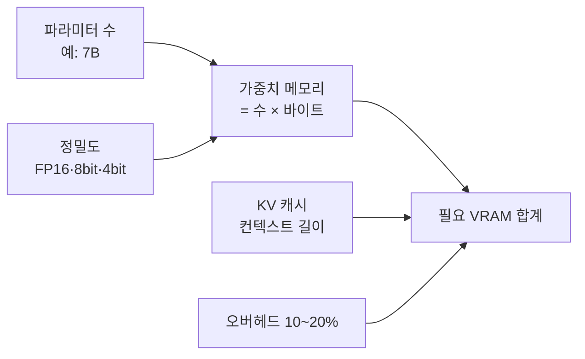

# GPU와 VRAM

> GPU는 비슷한 계산을 수천 개 동시에 하는 칩이고, VRAM은 그 칩 옆의 전용 메모리다. 모델이 VRAM에 들어가는지가 "내 PC에서 돌아가나"를 정한다.

## 쉽게 말하면
CPU는 똑똑한 박사 몇 명, GPU는 단순 계산을 하는 수천 명의 아르바이트생이다. LLM은 곱셈·덧셈을 엄청나게 반복하므로 아르바이트생이 유리하다. VRAM은 작업대 크기다. 재료(모델 가중치)가 작업대에 안 올라가면 일이 시작되지 않는다.

## 자세히
- **가중치 메모리 ≈ 파라미터 수 × 파라미터당 바이트**. FP16/BF16은 2바이트, 8비트는 1바이트, 4비트는 약 0.5~0.57바이트(GGUF Q4_K_M은 메타데이터 때문에 조금 더 큼). 7B 모델은 FP16에서 약 14GB, 4비트면 약 4GB (블로그 집계, 근사치).
- **KV 캐시**: 대화가 길수록 늘어나는 별도 메모리. 70B급 FP16에서 8K 토큰 약 2.6GB, 128K 토큰 약 41GB라는 추정이 있다([컨텍스트 윈도우](#context-window)와 연결).
- 여기에 프레임워크 오버헤드 10~20%를 더해 필요 VRAM을 잡는다.
- MoE 모델은 활성 파라미터가 아니라 **전체** 파라미터만큼 올려야 한다.
- VRAM이 모자라면 일부를 RAM으로 넘기는데(오프로딩) 크게 느려진다.

## 그림으로 보기

## 예시
- 8GB VRAM GPU: 4비트 7~8B 모델은 가능, 14B는 빠듯하고 70B는 불가.
- 같은 모델도 컨텍스트를 8K에서 128K로 늘리면 KV 캐시 때문에 메모리가 부족해질 수 있다.

## 헷갈리는 것과 비교
| 개념 | 차이 |
| --- | --- |
| VRAM | GPU 전용 메모리. 모델 크기 한계 |
| RAM | CPU 메모리. 느리지만 큼 |
| [양자화](#quantization) | 같은 모델을 더 작은 비트로 줄여 VRAM에 맞추는 법 |

## 더 읽을거리
- [LLM VRAM 요구량 가이드 (techsy.io)](https://techsy.io/en/blog/llm-vram-requirements-guide) — 계산식과 양자화별 표(블로그, 근사치)
- [GGUF LLM VRAM calculator (GitHub)](https://github.com/dlsniper/gguf-llm-vram-calculator) — 계산기 오픈소스
