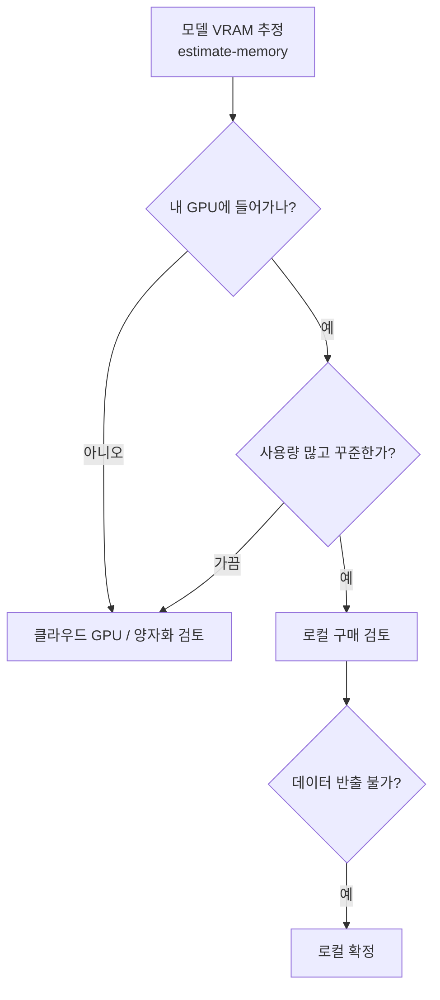

# 클라우드 GPU vs 로컬 GPU

> AI 모델을 돌릴 GPU를 **시간 단위로 빌릴지(클라우드)**, **직접 사서 둘지(로컬)** 고르는 문제. 판단은 ① 모델이 GPU 메모리(VRAM)에 들어가는가, ② 얼마나 오래·자주 쓰는가(손익분기), ③ 데이터·운영 제약(보안, 관리) 순으로 한다.

## 쉽게 말하면
자동차를 렌터카로 쓸지 사서 탈지의 문제와 같다. 가끔 쓰면 렌트가 싸고, 매일 오래 쓰면 사는 편이 싸다. 다만 먼저 "내 짐(모델)이 트렁크(VRAM)에 들어가는가"를 확인해야 한다.

## 자세히
- **1단계 — 메모리가 들어가는가**: Hugging Face Accelerate 문서의 `accelerate estimate-memory`는 모델을 `meta` 장치에 올려 필요한 크기를 추정한다. 예시 표(문서 값): `idefics-80b-instruct`는 float16 약 148.6GB, int8 약 74.3GB, int4 약 37.1GB, **Adam으로 학습하면 float16 기준 약 594GB**(대략 가중치의 4배). 추정은 "모델을 올리는 것"만 계산하며 **추론 시 최대 20% 추가**될 수 있다고 안내한다(EleutherAI 인용).
- **간단 계산**(가중치만, 파라미터×바이트; 직접 계산):

| 파라미터 | fp16(2B/p) | int8(1B/p) | int4(0.5B/p) |
|---|---|---|---|
| 7B | 14GB | 7GB | 3.5GB |
| 13B | 26GB | 13GB | 6.5GB |
| 70B | 140GB | 70GB | 35GB |

  여기에 추론 시 KV 캐시·활성값 등 여유(문서 기준 최대 20%)를 더해야 한다. 양자화는 메모리를 줄이는 대신 품질이 달라질 수 있다([양자화](#quantization)).
- **2단계 — 손익분기**: `손익분기 시간 = 로컬 구매 총비용 ÷ 클라우드 시간당 요금`. 예: 가상의 수치로 구매 총비용 300만 원, 클라우드 시간당 1,500원이면 2,000시간(하루 8시간 약 250일). 전기·관리·감가상각·유휴 시간까지 넣어야 정확하다. **요금은 수시로 바뀌므로 실제 견적으로 다시 계산**한다(위 수치는 설명용 가정).
- **비교**:

| 항목 | 클라우드 | 로컬 |
|---|---|---|
| 초기 비용 | 거의 없음 | 큼 |
| 확장 | 필요할 때 늘림 | 한계 고정 |
| 큰 모델(수십~수백 GB) | 여러 GPU 임대로 가능 | 구매·전력·냉각 부담 |
| 데이터 통제 | 업체 정책·계약 의존 | 외부로 안 나감 |
| 유휴 시간 | 끄면 비용 0 | 놀아도 감가상각 |
| 관리 | 이미지·드라이버 일부 위임 | 직접 |

- **현실적 조합**: 실험·학습은 클라우드, 상시 추론·민감 데이터는 로컬이나 사설 클라우드, 가벼운 작업은 양자화한 소형 모델을 개인 GPU에서.

## 그림으로 보기


## 예시
```bash
pip install accelerate
accelerate estimate-memory <허깅페이스-모델명> --dtypes float16 int8 int4
```
- 사내 문서 요약 챗봇: 7B 모델을 int4로 양자화해 약 3.5GB(+여유)로 소형 GPU에서 상시 구동, 월 1회 미세 조정은 클라우드에서 몇 시간 임대.

## 헷갈리는 것과 비교
| 개념 | 차이 |
|---|---|
| 클라우드 GPU | 임대, 종량제 |
| 로컬 GPU | 구매, 고정비 |
| [GPU 기초](#gpu-basics) | GPU와 VRAM의 기본 개념 |
| [양자화](#quantization) | 모델 크기를 줄여 더 작은 GPU에 맞추는 기법 |

## 더 읽을거리
- [Hugging Face Accelerate: Model memory estimator](https://huggingface.co/docs/accelerate/usage_guides/model_size_estimator) — 모델 메모리 추정 도구와 한계.
