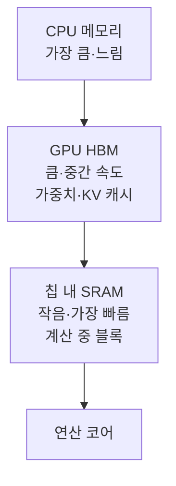

# GPU 메모리 계층 (HBM과 SRAM)

> GPU에는 크지만 느린 메모리(HBM)와 작지만 매우 빠른 칩 내 메모리(SRAM)가 있어, 데이터를 어느 계층에 두고 얼마나 오가느냐가 LLM 속도를 좌우한다.

## 쉽게 말하면
창고(큰데 멀다)와 작업대(작은데 손 닿는다)의 관계다. 부품을 창고에서 작업대로 가져오는 시간이 조립 시간보다 길면, 작업 순서를 바꿔 창고 왕복을 줄이는 것이 핵심이다.

## 자세히
- **HBM(High Bandwidth Memory)**: GPU의 주 메모리. 용량이 크고 모델 가중치·KV 캐시가 여기 있다. 대역폭은 높지만 칩 내부 SRAM보다 느리다.
- **SRAM(칩 내 온칩 메모리)**: 용량이 매우 작고 빠르다. FlashAttention은 타일링으로 계산을 SRAM 안에서 끝내 HBM 왕복을 줄인다(논문 초록, 2026-11 확인).
- **병목 개념**: Hugging Face 글은 LLM 생성이 연산이 아니라 "가중치를 계산 코어로 옮기는" 메모리 대역폭에 막힌다고 설명한다([추측 디코딩](#speculative-decoding) 참고).
- 구체 용량·대역폭 수치는 GPU 모델(A100·H100 등)마다 다르고 이번에 공식 자료로 확인하지 않았으므로 수치는 쓰지 않았다. 필요하면 제조사 사양서를 확인.
- 이 구조가 [FlashAttention](#flash-attention), [KV 캐시](#kv-cache), [PagedAttention](#paged-attention)의 설계 동기다.

## 그림으로 보기

## 예시
- 긴 컨텍스트에서 메모리 부족 → KV 캐시가 HBM을 차지하는 탓. 캐시 CPU 오프로딩(HF `cache_implementation="offloaded"`)은 속도를 대가로 메모리를 확보한다.
- 양자화는 파라미터 크기를 줄여 이동량도 줄이므로 메모리와 속도 모두에 이롭다(HF 최적화 문서).

## 헷갈리는 것과 비교
| 개념 | 차이 |
|---|---|
| HBM | 크고 상대적으로 느림, 모델·캐시 저장 |
| SRAM | 작고 빠름, 계산 블록 |
| 시스템 RAM | GPU 밖, 가장 느림 |
| [IO 인식 알고리즘](#io-aware-algorithms) | 이 계층을 의식한 설계 |

## 더 읽을거리
- [FlashAttention 논문](https://arxiv.org/abs/2205.14135) — HBM·SRAM 관점.
- [Optimize inference (Hugging Face)](https://huggingface.co/docs/transformers/perf_infer_gpu_one) — 캐시 오프로딩·양자화·어텐션 백엔드.
