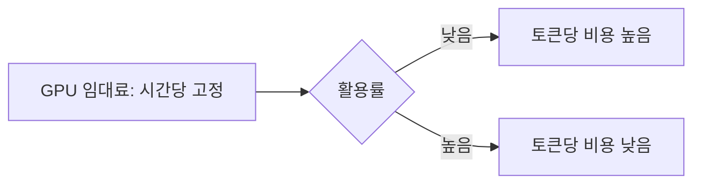
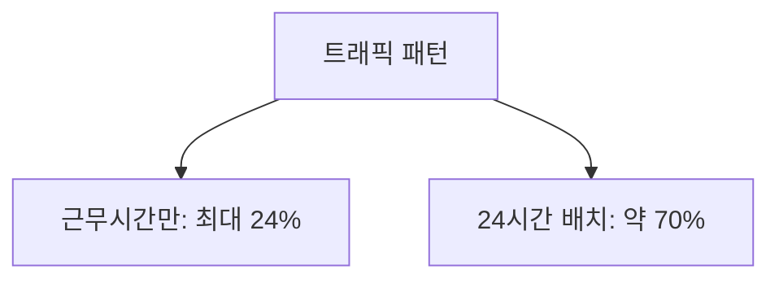

# GPU 활용률

> GPU 임대료는 **일하든 놀든 시간당 똑같이** 나간다. 그래서 GPU가 얼마나 바쁜가(활용률)가 낮을수록 토큰당 실질 단가가 올라간다. (OpenRouter 블로그 열람 2026-11-28, API 중개 업체의 글이므로 이해관계 유의)

## 쉽게 말하면
택시를 월 대여하면 손님이 없는 시간에도 대여료가 나간다. 가동 시간이 길수록 손님당 요금이 내려간다.

## 자세히
- 손익분기 부하: **GPU 시간당 임대료 ÷ 같은 시간 동안 가득 일했을 때 API로 샀다면 드는 비용**. 활용률이 그 값보다 낮으면 API가 더 싸고, 100%를 넘으면 쉬지 않아도 API가 이긴다([호스팅 결정](#hosting-decision-checklist)).
- 활용률의 현실(글의 예): 근무 시간에만 트래픽이 오면(주 168시간 중 40시간) 최대 **24%**, 24시간 배치 파이프라인은 약 **70%**.
- 글의 손익분기 표(일부): Qwen3.8 27B를 RTX 3090 한 장($0.50/시간)에서 짧은 프롬프트로 돌리면 가장 싼 ZDR 엔드포인트 대비 **8%**, 소유한 3090의 전기료만(약 $0.05/시간) 보면 **1%**. DeepSeek V4.1 Flash를 H200 4장($2.90/GPU시간)으로 돌리면 가장 싼 ZDR 대비 **"Never"**(API가 항상 유리), 중간값 대비 82%. B200 2장($3.70)은 가장 싼 ZDR 대비 76%.
- 한 3090 월 임대료 약 $365, 글의 채팅 믹스에서 약 1.7억 출력 토큰을 처리하면 본전. B200 2장 노드는 월 약 $5,402로 가장 싼 ZDR 엔드포인트를 이기려면 약 27억 출력 토큰이 필요.
- 한계(글이 밝힘): 엔지니어링·유지보수 시간은 제외, **피크 대비 여유 용량을 무시**하므로 모든 수치는 하한이다. 3090은 사용자당 초당 약 15토큰이라 채팅·추론용으로는 느리다. 새 ZDR 엔드포인트가 나오면 손익분기가 바뀐다(글: 10월 19일 새 엔드포인트로 3090 짧은 프롬프트 손익분기가 약 29%로 상승).
- 활용률을 올리는 방법(일반 설명): 배치 처리, 여러 서비스 통합, 야간 작업 배치.

## 그림으로 보기

## 예시
- 사내 챗봇이 평일 9~18시에만 쓰이면 GPU 활용률이 낮아 API가 유리할 가능성이 크다. 야간에 문서 일괄 처리를 추가하면 활용률이 오른다.
- 교육: 시간대별 요청 수 그래프로 활용률을 직접 계산.

## 헷갈리는 것과 비교
| 개념 | 차이 |
|---|---|
| GPU 활용률 | GPU가 실제 일하는 시간 비율 |
| 처리량(throughput) | 단위 시간당 처리 토큰 |
| [TCO](#tco-calculation) | 인력·전력·운영 포함 총비용 |

## 더 읽을거리
- [Self-Hosted LLM vs API (OpenRouter)](https://openrouter.ai/blog/insights/self-hosted-llm-vs-api/) — 손익분기 표(읽음, API 중개 업체).
