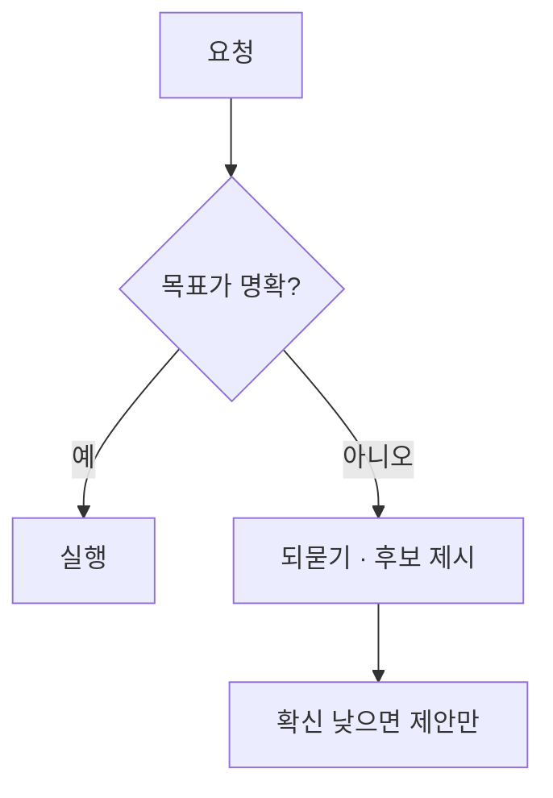

# 불확실할 때 범위 좁히기

> 불확실할 때 범위 좁히기는 HAX G10("목표가 불확실하면 모호성을 해소하거나 서비스를 점잖게 축소하라")의 설계다.

## 쉽게 말하면
식당 점원이 "맵게 드릴까요?"라고 되묻거나, 확실치 않으면 무난한 기본 메뉴만 추천하는 것과 같다. 제멋대로 틀린 주문을 넣지 않는다.

## 자세히
- G10 원문: 사용자의 목표가 불확실할 때 disambiguation(모호성 해소)이나 서비스의 graceful degradation(점진적 축소)을 한다.
- HAX Design Library에 "Disambiguate before acting"(패턴 10A)이 있다.
- 선택: ① 행동 전 되묻기 ② 후보 2~3개 제시 ③ 확신이 낮으면 제안만 하고 실행은 안 함 ④ 안전한 기본값.
- 에이전트에선 되돌리기 어려운 행동(결제·삭제) 전에 확인 단계를 두는 규칙으로 이어진다.

## 그림으로 보기

## 예시
일정 비서: "금요일 회의 잡아 줘"에 금요일이 둘이면 날짜를 되묻고, 참석자 불명확하면 초안만 만든다.

## 헷갈리는 것과 비교
| 개념 | 차이 |
|---|---|
| G10 범위 축소 | 불확실 시 행동 축소 |
| [G9 수정](#hax-when-wrong) | 틀린 뒤 복구 |
| [HAX Toolkit](#hax-toolkit) | 전체 틀 |

## 더 읽을거리
- [Guidelines for Human-AI Interaction (MS Research 블로그)](https://www.microsoft.com/en-us/research/blog/guidelines-for-human-ai-interaction-design) — 18개 지침 원문(직접 확인).
- [HAX Toolkit](https://www.microsoft.com/en-us/haxtoolkit/ai-guidelines/) — 지침·Design Library 안내.
