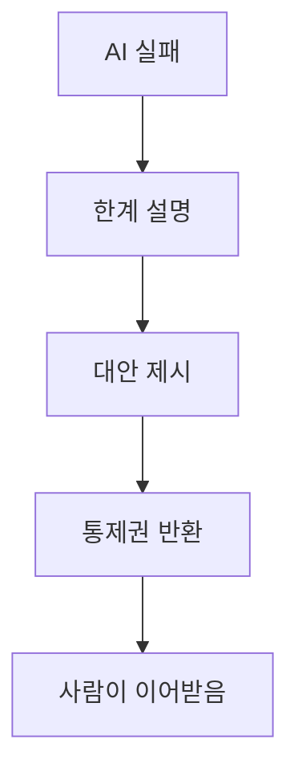

# 우아한 실패 경로

> AI가 실패했을 때 **한계를 설명하고, 대안을 제시하고, 통제권을 사용자에게 돌려주는** 설계다. 실패를 안전하고 자연스러운 제품 경험의 일부로 만든다.

## 쉽게 말하면
식당 종업원이 "콜라는 없는데 펩시도 괜찮으세요?"라고 묻는 것이다. 못 한다고 끝내지 않고, 이유를 말하고 다른 길을 준다.

## 자세히
(Google PAIR "Errors + Graceful Failure" 챕터를 직접 읽었다.)
- **한계를 분명히 설명(PAIR)**: 오류 상태를 AI가 필요로 하는 것과 작동 방식을 알려 줄 기회로 쓴다. 설명 기회를 놓치지 말라고 경고.
- **대안 경로(PAIR)**: 종업원 비유. 고위험 상황에서는 대안이 정말 안전한지 확인(예: 알레르기 성분 없는지).
- **통제권 반환(PAIR)**: AI가 실패하면 사용자가 넘겨받게 하되, 지금 상황·다음 단계·방법을 알려야 한다. 단, 수동 제어가 위험한 맥락도 있다(교통 혼잡 중 내비게이션이 안내를 끊는 경우).
- **악의적 사용 가정(PAIR)**: 실패를 안전하고 밋밋하게. 취약점을 과하게 설명하면 악용될 수 있다(스팸 신고 사용자에게 왜 못 잡았는지 다 설명하면 스패머에게 힌트).
- **인간적으로(PAIR)**: 실수를 겸손하게 인정하고 한계를 설명하며 계속 이어가도록 초대한다.

## 그림으로 보기

## 예시
- 상담 챗봇이 답하지 못할 때: "이 문의는 제가 처리할 수 없습니다. 상담원 연결 또는 FAQ 링크를 드릴까요?"(제안).
- 교육 소재: 같은 실패 메시지를 "에러 발생"과 위 설계로 각각 써 보고 비교.

## 헷갈리는 것과 비교
| 개념 | 차이 |
|---|---|
| 우아한 실패 | 실패 후 대응 경로 설계 |
| [오류 감사](#errors-audit) | 오류 종류를 미리 정리 |
| 오류 방지 | 애초에 틀리지 않게 하는 것 |

## 더 읽을거리
- [Google PAIR — Errors + Graceful Failure](https://pair.withgoogle.com/chapter/errors-failing/) — 직접 읽음.
