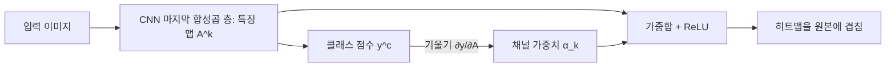
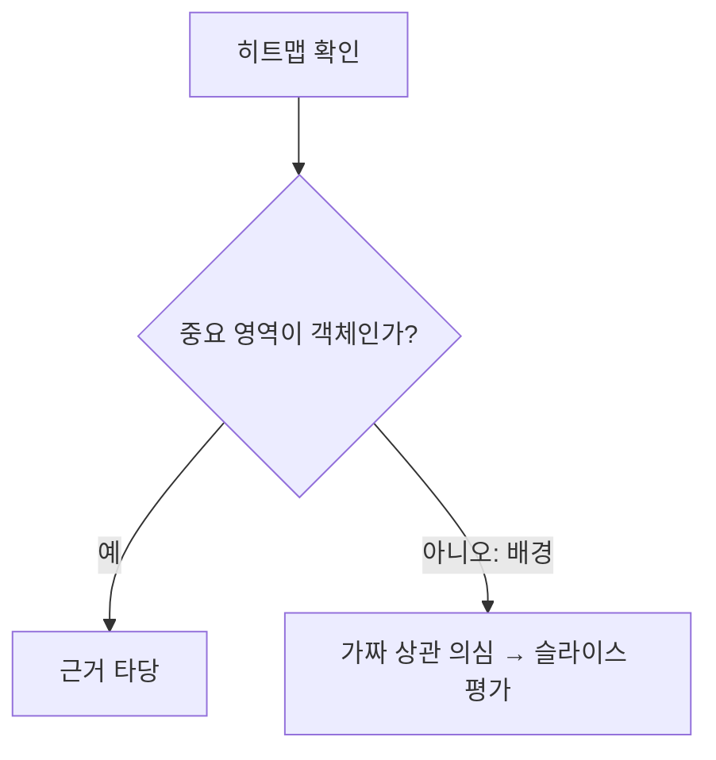

# GradCAM

> **Grad-CAM(Gradient-weighted Class Activation Mapping)** 은 CNN이 특정 클래스를 판단할 때 **이미지의 어느 영역을 중요하게 봤는지**를 히트맵으로 보여 주는 설명 기법이다. 모델 구조를 바꾸거나 재학습하지 않아도 된다.

## 쉽게 말하면
학생이 "이건 고양이입니다"라고 답했을 때 사진 위에 형광펜으로 "답을 고르는 데 중요했던 곳"을 칠해 주는 도구다. 고양이 얼굴에 칠해지면 믿을 만하고, 배경 벽에 칠해지면 이상하다.

## 자세히
- **정의(Selvaraju 외, arXiv 1610.02391, 초록 확인)**: 목표 개념(클래스)의 **기울기가 마지막 합성곱 층으로 흘러 들어가는 정보**를 사용해 중요한 영역을 강조하는 거친(coarse) 위치 지도를 만든다. 구조 변경·재학습이 필요 없고, 완전연결층이 있는 CNN, 구조화 출력 CNN, 멀티모달 입력이나 강화학습 모델에도 쓸 수 있다고 한다. 세밀한 시각화와 결합하면 고해상도 클래스 구분 지도를 얻는다(Guided Grad-CAM).
- **계산 개요(표준 정의, 논문 본문은 이 글에서 직접 열지 않음)**: ① 목표 클래스 점수 y^c를 마지막 합성곱 특징 맵 A^k에 대해 미분 ② 각 맵의 기울기를 공간 평균해 가중치 α_k 계산 ③ 맵들의 가중합 후 ReLU(양의 기여만)로 히트맵 L = ReLU(Σ_k α_k A^k) ④ 입력 크기로 확대해 원본에 겹쳐 표시.
- **논문이 주장하는 용도**: 분류기 실패 양상 파악, 적대적 이미지에 대한 견고함, 기존 방법보다 나은 위치 추정과 모델 충실도, **데이터셋 편향 노출**, 캡셔닝·VQA에서 비어텐션 모델의 입력 위치 확인, 중요한 뉴런 식별. 사람 연구에서 비전문가가 같은 예측을 하는 두 모델 중 더 강한 모델을 구별했다고 한다(모두 논문 주장).
- **데이터 품질 관점**: 가짜 상관을 찾는 첫 도구다. 물새 분류기의 히트맵이 새가 아닌 배경(물)에 붙어 있다면 [가짜 상관](#spurious-correlation) 의심. [AttributionScanner](#attributionscanner)는 이 가중 특징을 군집해 슬라이스를 찾는다.
- **한계**: 마지막 합성곱 층 해상도 때문에 **거칠다**. "모델이 어디를 봤는가"이지 "왜 그렇게 판단했는가"를 인과적으로 증명하지 않는다. 클래스 점수의 기울기 기반이므로 모델·층 선택에 따라 달라진다. 설명 방법의 신뢰성 검증(모델 가중치를 무작위화해도 지도가 같은지 등)이 별도 연구 주제다(일반 지식).

## 그림으로 보기



## 예시
```python
# pytorch-grad-cam 같은 라이브러리 사용 예(개념 코드)
from pytorch_grad_cam import GradCAM
cam = GradCAM(model=model, target_layers=[model.layer4[-1]])
heat = cam(input_tensor=x, targets=None)[0]   # 예측 클래스 기준 히트맵
```
- 제조 결함 검출 모델의 히트맵이 결함이 아니라 부품 모서리의 라벨 스티커에 붙어 있다면 데이터 수집 방식을 점검.

## 헷갈리는 것과 비교
| 방법 | 특징 |
|---|---|
| CAM | 특정 구조(GAP) 필요 |
| Grad-CAM | 구조 변경 없이 기울기 사용 |
| Guided Grad-CAM | 고해상도 결합 |
| 어텐션 맵 | 모델 내부 가중치(설명 충실도는 별개) |

## 더 읽을거리
- [Grad-CAM (arXiv 1610.02391)](https://arxiv.org/abs/1610.02391) — 초록 열어 확인(수식은 표준 정의 기준 서술).
