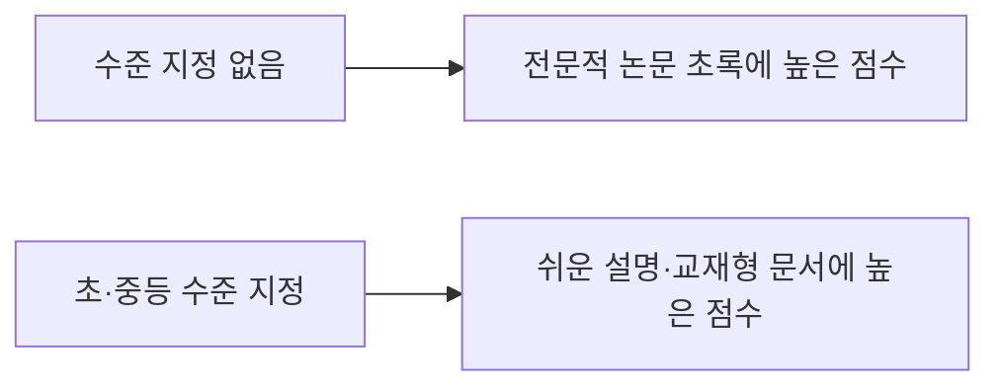
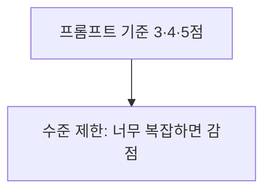

# 수준 지정 지시

> 평가 프롬프트에 **"초등~중등 수준 교육용으로 평가하라"처럼 대상 독자 수준을 명시**하면, LLM이 전문적이고 어려운 문서(논문 초록 등)를 "교육적"이라고 과대평가하는 경향을 줄일 수 있다.

## 쉽게 말하면
"좋은 교재를 골라 주세요"라고만 하면 전문가는 대학원 교재를 고른다. "초등학생이 읽을 교재"라고 대상을 정해 주면 쉬운 설명 위주로 점수를 준다.

## 자세히
- 근거(FineWeb 논문 arXiv 2406.17557, FineWeb-Edu 절): 저자들은 LLM 주석 프롬프트를 시험하다 **"arXiv 초록이나 제출 논문 같은 고도로 기술적인 페이지를 LLM이 선호하는 것을 막기 위해 초·중학교 수준의 지식에 초점을 맞추도록 프롬프트했다"**고 쓴다. 프롬프트에는 "초등부터 중등 수준 교육에 유용한지"를 묻는 문장과, 3·4·5점 기준에 "초등/중등 학생에게 너무 복잡하지 않아야 한다", "초등 수준 이하에 적합하다" 같은 **수준 제한 문구**가 들어 있다([루브릭을 프롬프트로](#rubric-to-prompt)).
- 점수 구조와의 결합: 가산식에서 4점 기준은 "초등 이하 수준에 매우 적합", 5점 기준은 "비교육적이거나 복잡한 내용이 없음"을 요구한다. 즉 **내용이 훌륭해도 수준이 너무 높으면 상위 점수를 못 받도록** 기준 안에 수준 조건을 넣었다.
- 효과의 단서(논문 FineWeb-Edu 분석): 이 필터로 걸러진 데이터는 위키 같은 **백과·교육형 출처에 가깝고**, 학술 콘텐츠(S2ORC, arXiv)에서도 낮은 퍼플렉서티를 보인다고 한다. 즉 수준 지정을 했어도 **학술적 내용에 대한 친화는 여전히 남을 수 있다**(원문 서술을 바탕으로 한 해석).
- 한계·주의(제안):
  - 수준 지정은 **편향을 바꿀 뿐 없애지 않는다**: 초중등 수준으로 맞추면 대학 수준 전문 자료나 직무 전문 문서는 낮게 평가될 수 있다.
  - 도메인·언어에 맞게 조정: 직무 교육(재무·마케팅 입문)이면 "입문자 수준"으로, 전문가용이면 "해당 분야 실무자 수준"으로 대상을 바꿔야 한다.
  - 검증: 수준 문구를 바꿔 같은 표본을 채점하고 결과 분포·상위 문서를 사람이 비교한다([LLM 채점 일관성](#llm-score-consistency)).
- 이번 문서에서는 프롬프트를 직접 실행해 효과를 측정하지는 않았다.

## 그림으로 보기

## 예시
- 신입 직원 교육용 문서 선별 프롬프트: "입문자(해당 직무 경험 1년 미만)가 이해하기 적합한 정도를 가산식으로 평가하라."
- 교육: 같은 문서를 "초등", "대학원" 수준 지정으로 각각 채점해 점수 차이를 보는 실습.

## 헷갈리는 것과 비교
| 개념 | 차이 |
|---|---|
| 수준 지정 | 평가 대상 독자 수준을 명시 |
| 주제 지정 | 어떤 분야를 평가하는지 명시 |
| 난이도 점수 | 문서의 어려움을 점수화(교육 가치와 다름) |

## 더 읽을거리
- [FineWeb 논문 (arXiv 2406.17557)](https://arxiv.org/abs/2406.17557) — 프롬프트 설계 서술과 부록 F.1(읽음).
