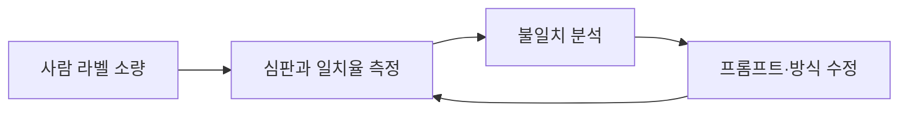
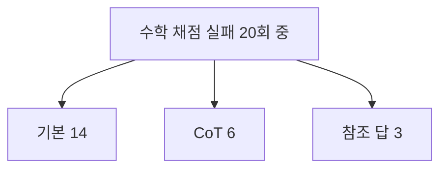

# 채점기 교정

> **심판 LLM을 사람 채점과 맞춰 보고 신뢰할 수 있는지 확인·보정하는 절차.** 일치율을 재고, 편향이 큰 구간을 찾아 프롬프트·방식을 고친다.

## 쉽게 말하면
새로 들인 채점 알바생에게 먼저 같은 답안 몇십 장을 사람 채점관과 함께 채점시켜 보고, 서로 얼마나 일치하는지 본 뒤 기준을 맞추는 것과 같다.

## 자세히
Zheng 외 (arXiv 2306.05685, PDF 본문 직접 읽음):
- **일치율 정의**: 두 종류의 심판이 무작위 질문에서 같은 표를 던질 확률. 무승부·불일치까지 포함하는 S1(무작위 기준 33%)과 비무승부만 보는 S2(무작위 기준 50%).
- 결과(MT-bench): GPT-4와 사람 전문가의 **S2 일치율 85%**로 **사람끼리 일치율(81%)보다 높았다**. 초록은 강한 심판이 80% 넘게 일치해 사람-사람 수준이라고 요약한다.
- 사람이 GPT-4와 다르게 골랐을 때 GPT-4 판단을 보여 주면 **75%에서 합리적**이라고 봤고 **34%에서 선택을 바꿀 의사**를 보였다.
- 한계: 사람끼리의 일치율은 하한 추정일 수 있다고 부록이 설명한다. 이 연구는 2023년 모델과 특정 데이터(MT-bench, Chatbot Arena)에 한정된다.
- 교정 절차(내 정리): ① 사람 라벨 소량(수십~수백) 확보 ② 심판과 일치율 측정 ③ 불일치 사례를 분류(위치·길이·수학 오류) ④ [순서 교환](#position-swap-judging), CoT·참조 답 포함 등으로 완화 ⑤ 모델·프롬프트 바꿀 때마다 재측정.
- 논문의 완화책: 수학·추론 채점은 **참조 답을 주는 방식**이 효과적이었다(10개 수학 문제 시험에서 기본 14/20 실패, CoT 6/20, 참조 3/20).

## 그림으로 보기

## 예시
- 자사 고객응대 답변 100개를 사람 2명과 심판 LLM이 채점해 일치율이 낮은 유형(길이 긴 답)을 찾아 지침 보강.
- 교육: 수강생이 직접 20개 답변을 채점해 AI 심판과 일치율을 구해 보는 실습.

## 헷갈리는 것과 비교
| 개념 | 차이 |
|---|---|
| 채점기 교정 | 심판을 사람과 맞춤 |
| 모델 평가 | 대상 모델의 품질 측정 |
| [자기 선호 편향](#self-preference-bias) | 교정 때 점검하는 편향 중 하나 |

## 더 읽을거리
- [Judging LLM-as-a-Judge (arXiv 2306.05685)](https://arxiv.org/abs/2306.05685) — 4장 일치율, 3.4절 완화(읽음).
