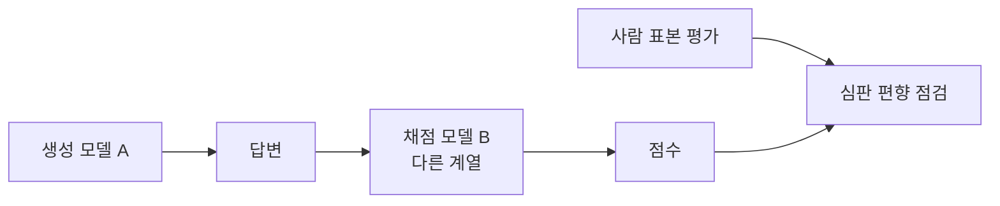
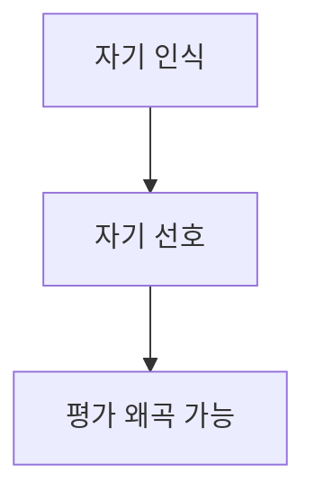

# 채점 모델 분리

> 답을 만든 모델과 그 답을 채점하는 모델을 서로 다른 모델(가능하면 다른 계열)로 두는 평가 설계. LLM이 자기가 쓴 글을 알아보고 더 좋게 평가하는 경향이 보고됐기 때문이다.

## 쉽게 말하면
시험 문제를 낸 선생님이 자기 제자의 답안을 채점하면 후해질 수 있다. 다른 선생님이 채점하면 공정성이 올라가는 것과 같은 이치다.

## 자세히
출처는 Panickssery·Bowman·Feng(2024) "LLM Evaluators Recognize and Favor Their Own Generations"(arXiv 2404.13076, 초록 열람)와 Zheng 외(arXiv 2306.05685, 본문 열람)다.
- **자기 선호(Panickssery 등)**: LLM 평가자는 사람이 동등하다고 본 경우에도 자기 출력을 다른 출력보다 높게 평가하는 경우가 많다고 보고한다.
- **자기 인식**: 별도 학습 없이도 GPT-4와 Llama 2는 자기 글을 다른 LLM·사람의 글과 우연보다 잘 구별한다. 미세조정 실험에서 자기 인식 능력과 자기 선호 강도는 선형 관계를 보였고, 통제 실험은 자기 인식이 자기 선호를 일으킨다는 것을 시사하며 단순 교란 요인에 대해 견고하다고 한다. 저자들은 이것이 공정한 LLM 평가를 해칠 수 있고 더 넓은 AI 안전 우려도 낳는다고 본다(저자 주장).
- **다른 연구의 결과는 엇갈림**: Zheng 등은 GPT-4가 자기에게 10%, Claude-v1이 자기에게 25% 높은 승률을 주었으나 GPT-3.5는 자기를 선호하지 않았고 데이터가 적어 자기 선호 편향이 있는지 단정할 수 없다고 했다([자기 선호 편향](#self-enhancement-bias)).
- **설계 지침(이 글의 해석)**: 생성 모델과 심판을 다른 모델 계열로 두고, 여러 모델이 서로 평가하는 교차 설계를 하며, 사람이 평가한 표본으로 심판의 편향을 정기 점검한다. 채점 모델 분리는 편향을 줄일 가능성이 있는 한 가지 수단이지 완전한 해결책이 아니다. 위치 편향·장황함 편향은 별도로 다뤄야 한다.
- **한계**: 두 연구의 모델은 2023~2024년 기준이라 현재 모델에서 효과 크기는 다를 수 있다. 서로 다른 계열이어도 학습 데이터가 겹치면 닮은 선호를 보일 수 있다는 점은 확인하지 못했다.

## 그림으로 보기

## 예시
- A 모델로 요약을 만들고 B 모델로 품질 점수를 매기며, A로도 점수를 매겨 두 점수 차이를 본다.
- 교육 실습: 두 모델의 답을 두 심판 모델이 각각 채점해 "자기 답 선호"가 보이는지 표로 정리.

## 헷갈리는 것과 비교
| 개념 | 차이 |
|---|---|
| 채점 모델 분리 | 심판을 다른 모델로 |
| 자기 선호 편향 | 분리가 완화하려는 대상 |
| [판정 일관성 측정](#judge-consistency) | 순서 편향 점검 |
| 사람 표본 평가 | 심판 자체를 검증 |

## 더 읽을거리
- [LLM Evaluators Recognize and Favor Their Own Generations (arXiv 2404.13076)](https://arxiv.org/abs/2404.13076) — 자기 선호와 자기 인식(초록 열람)
- [Judging LLM-as-a-Judge (arXiv 2306.05685)](https://arxiv.org/abs/2306.05685) — 승률 비교(본문 열람)
