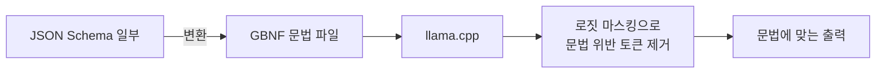

# GBNF 문법 제약 (llama.cpp)

> GBNF는 llama.cpp에서 출력 형식을 문법으로 정의해, 모델이 그 문법에 맞는 문자열만 생성하도록 강제하는 형식이다(예: 항상 유효한 JSON).

## 쉽게 말하면
"문장은 이런 틀로만 쓸 수 있다"는 작문 규칙집을 모델에게 쥐여 주는 것이다. 규칙에 없는 글자는 아예 쓸 수 없다.

## 자세히
llama.cpp grammars README(2026-11 확인):
- 규칙은 `name ::= ...` 형식, 규칙 이름은 소문자와 대시. `root` 규칙이 전체 출력을 정의, 주석은 `#`. 선택 `|`, 묶음 `( )`, 반복 `* + ? {m,n}`, 유니코드와 부정 범위 `^`.
- 특정 토큰을 ID(`<[1000]>`)나 텍스트(`<think>`)로 매칭 가능.
- 성능 팁: `x?`를 N번 잇기보다 `x{0,N}`이 좋다(샘플링이 매우 느려질 수 있음).
- 사용: `--grammar`/`--grammar-file`(llama-cli·llama-completion), llama-server는 `grammar` 필드.
- **JSON Schema 변환**: 일부 스키마를 GBNF로 변환(`-j`/`--json`, 서버의 `json_schema`·`response_format`). 스키마는 출력을 제약만 하고 **프롬프트에는 들어가지 않으므로** 프롬프트에도 구조를 설명해야 한다. `additionalProperties` 기본 false, `patternProperties`·`prefixItems`·중첩 `$ref`·`not` 등은 미지원·부분 지원, 숫자 min/max는 정수만 적용.
- 디버깅: gbnf-validator 도구, Python 변환기의 경고.

## 그림으로 보기


## 예시
```
root ::= "{" ws "\"answer\"" ws ":" ws ("\"yes\"" | "\"no\"") ws "}"
ws ::= [ \t\n]*
```
→ `{"answer": "yes"}` 또는 `{"answer": "no"}`만 출력.

## 헷갈리는 것과 비교
| 개념 | 차이 |
|---|---|
| GBNF | 로컬(llama.cpp) 문법 기반 제약 |
| [JSON 스키마 출력](#json-schema-output) | 클라우드 API의 strict 스키마 보장 |
| [로짓 마스킹](#logit-masking) | GBNF가 쓰는 하위 원리 |

## 더 읽을거리
- [llama.cpp grammars README](https://github.com/ggml-org/llama.cpp/blob/master/grammars/README.md) — 문법·옵션·스키마 변환 제약.
