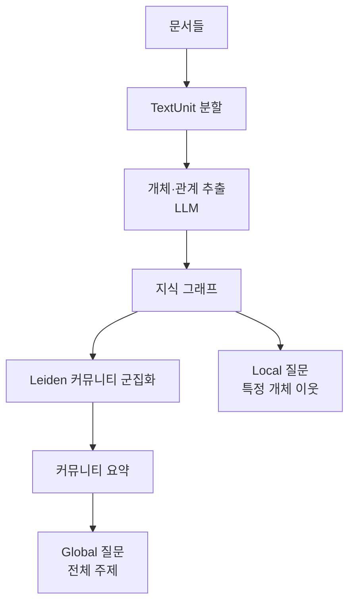

# GraphRAG

> 문서 더미에서 **개체·관계를 뽑아 지식 그래프**를 만들고, 서로 가까운 개체끼리 **커뮤니티(묶음)** 로 나눠 미리 요약해 두는 RAG 방식. 조각 몇 개를 찾아 붙이는 일반 RAG가 못하는 **"이 자료 전체의 핵심 주제는?"** 같은 전역 질문에 강하다. Microsoft Research가 2024년 제안했다.

## 쉽게 말하면
일반 RAG는 도서관에서 "관련 있어 보이는 쪽"을 몇 장 찾아 오는 사서다. GraphRAG는 먼저 책 전체의 인물·장소·관계를 인물 관계도로 그려 두고, 비슷한 인물끼리 묶어 "이 그룹은 이런 이야기"라는 요약 카드를 만들어 둔 사서다. 그래서 "책 전체의 주제가 뭐야?"에도 답할 수 있다.

## 자세히
- **논문**(Edge et al., "From Local to Global: A Graph RAG Approach to Query-Focused Summarization", arXiv 2404.16130): 일반 RAG는 구체적 사실 질문엔 강하지만 코퍼스 전체에 관한 **전역(global) 질문**(주요 주제 등)에는 약하다. 약 100만 토큰 규모 데이터에서 GraphRAG가 일반 RAG보다 답의 **포괄성·다양성**에서 크게 앞섰다고 보고한다(저자 평가 결과).
- **인덱싱 단계**(Microsoft GraphRAG 문서): ① 문서를 TextUnit으로 분할, ② LLM으로 개체·관계·주장 추출, ③ Leiden 기법으로 그래프를 계층적 커뮤니티로 군집화, ④ 커뮤니티별 요약을 아래에서 위로 생성.
- **질의 모드**: Global(커뮤니티 요약으로 전체 질문), Local(특정 개체의 이웃 탐색), DRIFT(국소 탐색+커뮤니티 맥락), Basic(일반 벡터 검색).
- **트레이드오프**(주의): 인덱싱에서 문서 전체를 LLM으로 여러 번 처리하므로 일반 RAG보다 **비용·시간이 크다**(문서에는 비용 수치가 없다. 규모가 크면 직접 측정할 것). 데이터가 자주 바뀌면 재인덱싱 부담도 있다. 문서는 기본 프롬프트 대신 **프롬프트 튜닝**을 권장하고, 버전 사이에 설정이 덮어써질 수 있다고 경고한다.
- **언제 쓰나**: 보고서·연구 논문·회의록 묶음 같은 "전체를 아우르는 질문"이 중요할 때. 단순 FAQ·특정 사실 검색은 일반 RAG로 충분하다.

## 그림으로 보기


## 예시
```bash
pip install graphrag
graphrag init --root ./project
graphrag index --root ./project
graphrag query --root ./project --method global --query "이 자료의 핵심 주제는?"
```
- 사내 고객 인터뷰 200건에서 "고객이 공통으로 불만인 영역은?"을 묻는 경우(전역 질문)에 적합. "A 고객이 말한 환불 정책은?"은 일반 RAG가 낫다.
- 명령어 형식은 버전에 따라 달라질 수 있으니 공식 문서를 확인한다.

## 헷갈리는 것과 비교
| 개념 | 차이 |
|---|---|
| GraphRAG | 그래프+커뮤니티 요약, 전역 질문에 강함, 인덱싱 비용 큼 |
| [RAG](#rag) | 조각 검색 후 생성, 사실 질문에 강함 |
| [에이전틱 RAG](#agentic-rag) | 에이전트가 검색 전략을 반복·선택 |
| [긴 컨텍스트 vs RAG](#long-context-vs-rag) | 통째로 넣을지 검색할지의 선택 |

## 더 읽을거리
- [From Local to Global: A Graph RAG Approach to Query-Focused Summarization (arXiv 2404.16130)](https://arxiv.org/abs/2404.16130) — 원 논문.
- [Microsoft GraphRAG 공식 문서](https://microsoft.github.io/graphrag/) — 파이프라인과 질의 모드.
