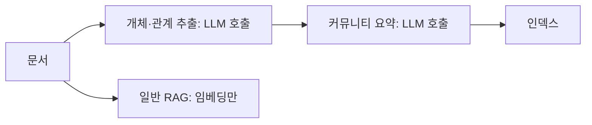
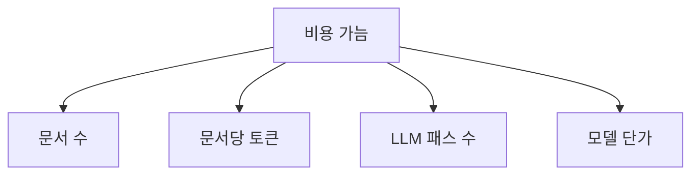

# GraphRAG 인덱싱 비용

> GraphRAG는 문서마다 LLM으로 개체·관계를 뽑고 요약까지 만들어야 해서 **일반 RAG의 임베딩 인덱싱보다 훨씬 비싸다.** 비용을 가늠하려면 LLM 호출 수와 토큰 수를 센다.

## 쉽게 말하면
도서관 책을 "제목 카드만 만들기"(임베딩)와 "모든 책을 읽고 인물 관계도·요약을 손으로 작성하기"(GraphRAG)의 차이다. 후자는 사서의 노동 시간(LLM 호출)이 훨씬 든다.

## 자세히
(검색 결과로 확인한 수치이며 데이터셋·모델·설정이 달라 직접 비교는 어렵다. 자릿수로만 읽는다. 열람 2026-11-28.)
- 비용의 원천: Microsoft의 비용 설명에 따르면 **LLM 호출이 비용 대부분**을 차지하고, 일반 RAG의 임베딩은 훨씬 싸다(소설 한 권 전체 벡터화가 $0.0056이라는 예).
- 한 연구의 구축 비용 추정: 10만 문서 규모에서 MS-GraphRAG(gpt-4o API 가정) **약 $10,000** vs 소형 도메인 모델 기반 RAGU 약 $100. 다른 추정은 MS-GraphRAG가 **문서당 약 4만 토큰, 약 $0.10**.
- 같은 코퍼스("Mix") 토큰: GraphRAG 7,707,566, LightRAG 5,111,680, FG-RAG 4,863,801(논문 보고).
- 호출 수(의료 벤치마크): MS-GraphRAG 구축 **17,638회(28분)**, LightRAG 4,423회로 **약 4배**.
- LightRAG도 항상 싸지는 않다: 프롬프트가 약 10⁴ 토큰, MS-GraphRAG(global)는 최대 4×10⁴ 토큰.
- 비-LLM 대안: LLM 없이 색인하는 방식도 제안됐다. LLM 기반 시스템은 문서당 평균 약 1만 토큰이 든다고 한 논문은 주장.
- Microsoft GraphRAG 인덱싱 문서(열람)에는 비용 경고나 호출 수 추정이 없었다.
- 가늠하는 법(내 정리): 문서 수 × 문서당 토큰 × (추출 + 요약 패스 수) × 모델 단가. 먼저 소량 샘플로 실측하고 확장한다. 작은 모델·캐시·예산 설정이 비용을 크게 바꾼다.

## 그림으로 보기

## 예시
- 문서 1,000개 샘플로 실제 토큰 사용량을 재고, 문서당 비용에 전체 문서 수를 곱해 예산 산정.
- 교육: 전역 질문이 정말 필요한지(일반 RAG로 충분한지) 도입 전 비용-효용을 따지는 사례.

## 헷갈리는 것과 비교
| 개념 | 차이 |
|---|---|
| GraphRAG 인덱싱 | LLM 다수 호출, 비쌈 |
| 임베딩 인덱싱 | 임베딩만, 훨씬 쌈 |
| [지식 그래프](#knowledge-graph) | 만들어지는 구조 자체 |

## 더 읽을거리
- [GraphRAG costs explained (Microsoft)](https://techcommunity.microsoft.com/blog/azure-ai-foundry-blog/graphrag-costs-explained-what-you-need-to-know/4207978) — 비용 구조(검색 요약으로 확인).
- [When to use Graphs in RAG](https://arxiv.org/pdf/2506.05690) — 그래프 RAG 효용 분석(검색 결과 확인).
