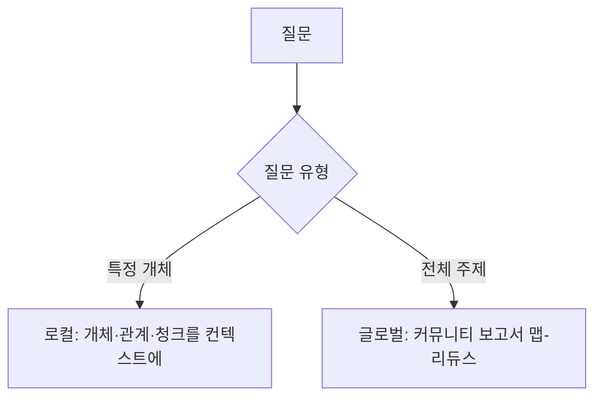
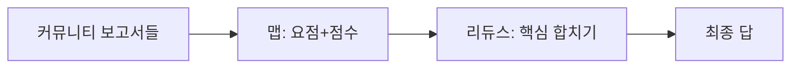

# GraphRAG 로컬 vs 글로벌 검색

> GraphRAG는 질문 유형에 따라 **로컬 검색**(특정 개체 중심)과 **글로벌 검색**(데이터셋 전체 주제·요약)을 나눠 쓴다. 글로벌은 커뮤니티 보고서를 **맵-리듀스**로 훑어 비싸지만 전체 질문에 강하다.

## 쉽게 말하면
"이 사람의 경력은?"은 그 사람 파일철만 펴 보면 되지만(로컬), "이 회사 전체의 주요 갈등 주제 5가지는?"은 모든 부서 보고서를 모아 읽고 요약해야 한다(글로벌).

## 자세히
(Microsoft GraphRAG 쿼리 문서 확인)
- **로컬 검색**: AI가 추출한 **지식 그래프** 데이터와 원문 텍스트 청크를 결합해 답한다. 질의와 의미상 관련된 **개체**를 찾고, 연결된 개체·관계·공변량·커뮤니티 보고서·관련 청크를 순위화·필터링해 **정해진 크기의 컨텍스트 창**에 넣는다. 특정 개체 질문(예: 카모마일의 효능)에 적합.
- **글로벌 검색**: 모든 **AI 생성 커뮤니티 보고서**를 **맵-리듀스**로 검색. 맵 단계가 점수 매긴 요점이 담긴 중간 답을 만들고, 리듀스 단계가 중요한 요점을 합쳐 최종 답을 낸다. 일반 RAG가 못하는 "데이터의 상위 5개 주제는?" 같은 **집계형 질문**에 쓴다. 자원이 많이 들며, 계층의 **낮은 수준(더 상세한 보고서)** 일수록 더 철저하지만 시간·LLM 비용이 커진다. `allow_general_knowledge`(기본 False)를 켜면 외부 지식을 더하지만 환각이 늘 수 있다.
- 그 밖에 DRIFT 검색, 기본(벡터 RAG, top-k 청크) 검색, 질문 생성이 문서에 나온다.
- **경험칙**: 이름이 있는 개체 질문 → 로컬, 데이터 전체의 주제·가치 질문 → 글로벌.

## 그림으로 보기

## 예시
- "계약서 A의 해지 조건은?" → 로컬. "100개 계약서에서 반복되는 위험 조항 유형은?" → 글로벌.

## 헷갈리는 것과 비교
| 방식 | 잘하는 질문 | 비용 |
|---|---|---|
| 기본 벡터 RAG | 가까운 청크 찾기 | 낮음 |
| 로컬 | 특정 개체 | 중간 |
| 글로벌 | 전체 요약·주제 | 높음 |
| [GraphRAG](#graph-rag) | 이 모두를 아우르는 방식 | 인덱싱 비용 큼 |

## 더 읽을거리
- [GraphRAG 쿼리 개요](https://microsoft.github.io/graphrag/query/overview/)
- [글로벌 검색](https://microsoft.github.io/graphrag/query/global_search/)
- [로컬 검색](https://microsoft.github.io/graphrag/query/local_search/)
