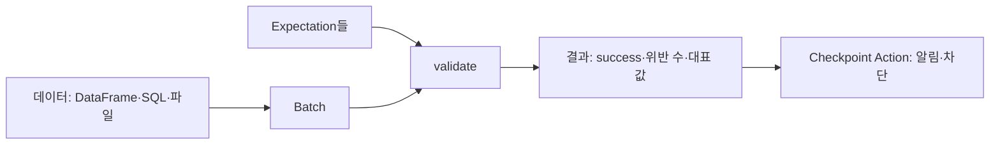
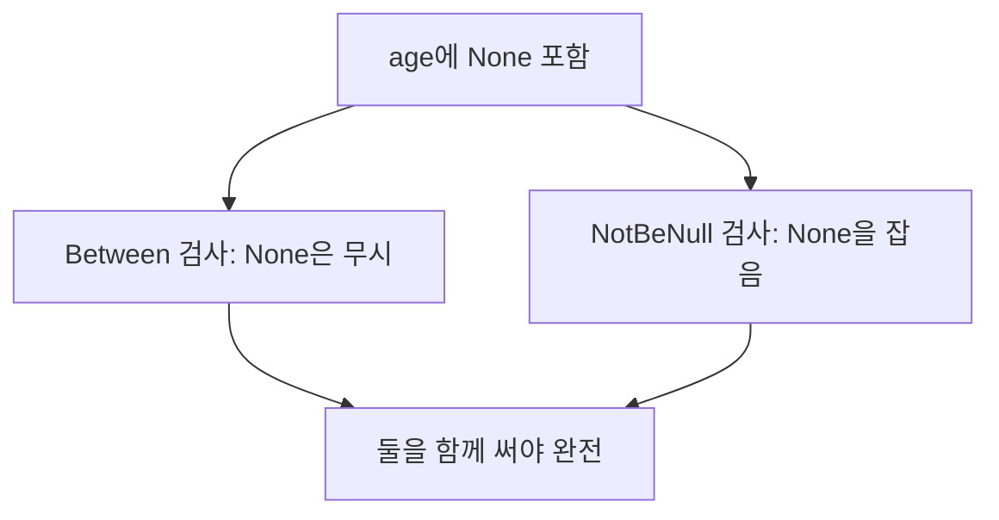

# Great Expectations

> 데이터에 대한 기대 조건("고객 ID는 유일해야 한다", "나이는 0~120")을 코드로 적고 데이터가 지키는지 자동 검사하는 Python 오픈소스 라이브러리(GX Core)다. 단위 테스트의 assert를 데이터에 적용한 것에 가깝다.

## 쉽게 말하면
공장 입고 검수표다. 부품이 들어올 때마다 "규격서에 적힌 항목을 지켰는가"를 자동으로 재고, 어긴 항목과 문제가 된 값을 알려 준다. 사람이 눈으로 훑는 것보다 항상 같은 기준으로 빠르게 본다.

## 자세히
(공식 GX Core 개요 문서를 읽고, 이 세션 환경에서 **직접 설치·실행**해 결과를 확인했다: great_expectations 1.25.0, Python 3 venv, pandas DataFrame.)
- **구성 요소(공식 문서)**: Expectation(검증 가능한 주장) → Expectation Suite(묶음) → Validation Definition(어떤 데이터를 어떤 Suite로 검사할지) → Checkpoint(운영에서 실행하고 알림 같은 Action을 건다) → Data Docs(사람이 읽는 결과 페이지).
- **직접 실행한 결과**: 5행짜리 고객 DataFrame(`customer_id=[1,2,3,3,5]`, `age=[25,41,130,29,None]`, `email` 1개 결측)에 세 개의 Expectation을 개별 실행했다.
  - `ExpectColumnValuesToBeUnique(column="customer_id")` → `success=False`, 위반 2건, 값 `[3, 3]`.
  - `ExpectColumnValuesToBeBetween(column="age", min_value=0, max_value=120)` → `success=False`, 위반 1건, 값 `[130.0]`. **`None`인 나이는 위반으로 세지 않았다** — 범위 검사는 결측을 무시하므로 결측은 따로 `ExpectColumnValuesToNotBeNull`로 잡아야 한다.
  - `ExpectColumnValuesToNotBeNull(column="email")` → `success=False`, 위반 1건.
  - 결과 객체에서 `r.success`, `r.result["unexpected_count"]`, `r.result["partial_unexpected_list"]`로 위반 개수와 대표 값을 읽을 수 있었다.
- **세션에서 쓴 최소 코드 흐름(실제 작동 확인)**: `gx.get_context(mode="ephemeral")` → `context.data_sources.add_pandas(...)` → `add_dataframe_asset(...)` → `add_batch_definition_whole_dataframe(...)` → `batch_definition.get_batch(batch_parameters={"dataframe": df})` → `batch.validate(expectation)`.
- **주의(실행 중 관찰)**: 검증 실행 때마다 진행률 표시와 경고가 터미널에 많이 출력된다. 버전 1.x에서는 API 이름이 0.x와 다르므로 옛 튜토리얼을 그대로 따르면 안 맞을 수 있다(일반적 주의).
- **한계**: 도구는 규칙을 대신 정해 주지 않는다. 무엇이 정상인지는 사람이 정해야 한다. 이번 실행은 로컬 DataFrame 한 건이며 Checkpoint·Data Docs·DB 연결은 시험하지 못했다.

## 그림으로 보기



## 예시
직접 실행한 코드(요약):
```python
import pandas as pd, great_expectations as gx
df = pd.DataFrame({"customer_id":[1,2,3,3,5], "age":[25,41,130,29,None]})
ctx = gx.get_context(mode="ephemeral")
asset = ctx.data_sources.add_pandas("pd").add_dataframe_asset("customers")
batch = asset.add_batch_definition_whole_dataframe("whole").get_batch(batch_parameters={"dataframe": df})
r = batch.validate(gx.expectations.ExpectColumnValuesToBeUnique(column="customer_id"))
print(r.success, r.result["partial_unexpected_list"])   # False [3, 3]
```
교육 소재: "나이 130"과 "중복 ID"를 일부러 넣어 규칙이 잡아내는지 직접 확인하는 실습.

## 헷갈리는 것과 비교
| 개념 | 차이 |
|---|---|
| Expectation | 데이터에 대한 검증 가능한 주장 하나 |
| Checkpoint | 운영에서 검증 묶음을 실행하고 Action 연결 |
| [TensorFlow Data Validation](#tfdv) | TFX 파이프라인용, 스키마·편향·드리프트 중심 |
| [데이터 검증 도구](#data-validation-tools) | 두 도구를 포함한 상위 개념 |

## 더 읽을거리
- [GX Core 개요](https://docs.greatexpectations.io/docs/core/introduction/gx_overview) — Expectation·Suite·Checkpoint(직접 열어 확인).
