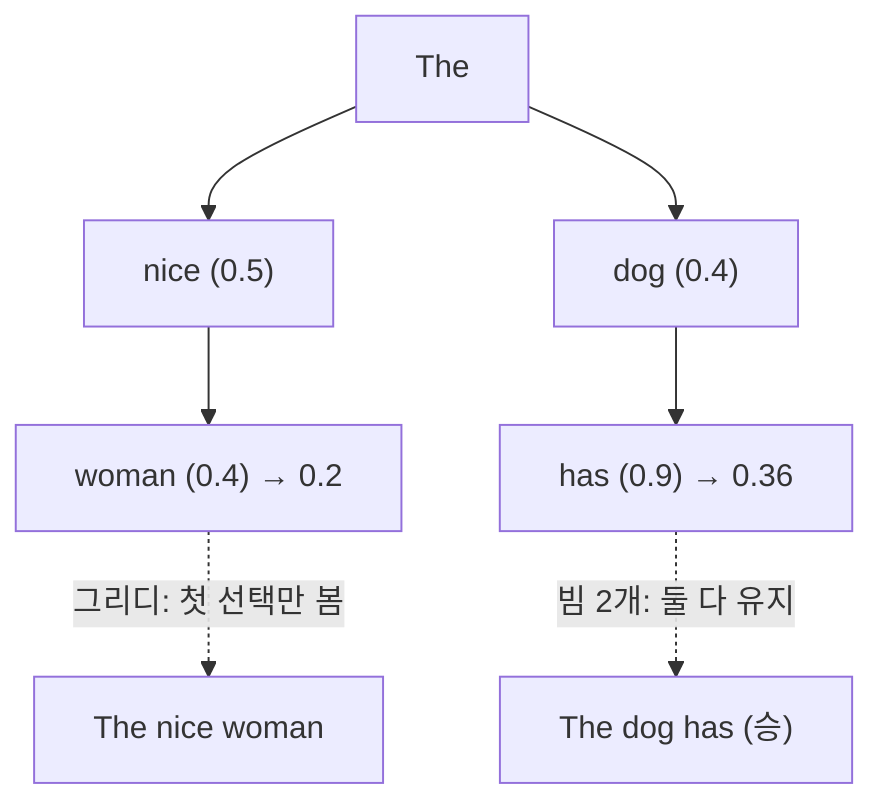

# 그리디·빔 서치

> 그리디는 매 단계에서 확률이 가장 높은 토큰 하나만 고르는 디코딩이고, 빔 서치는 후보 경로 `num_beams`개를 동시에 들고 가며 전체 확률이 가장 높은 문장을 찾는 디코딩이다. 둘 다 무작위가 없는 결정적 방식이다.

## 쉽게 말하면
길 찾기와 같다. 그리디는 갈림길마다 "지금 보이는 제일 넓은 길"로만 간다. 빨리 가지만 막다른 길에 들어설 수 있다. 빔 서치는 일행 몇 명이 각자 다른 길을 조금씩 가 보다가, 가장 좋아 보이는 일행만 계속 따라간다. 더 좋은 길을 찾을 확률이 높지만 사람(계산)이 더 든다.

## 자세히
- **그리디**: 매 단계 argmax. 가장 빠르고 단순하지만 "지금은 낮은 확률이지만 뒤가 좋은" 경로를 놓친다. Hugging Face 예시에서 그리디는 "The nice woman"(확률 0.2)을 골라 "The dog has"(0.36)를 놓쳤다.
- **빔 서치**: 각 단계에서 상위 `num_beams`개 가설을 유지한다. 그리디보다 같거나 높은 확률의 문장을 찾지만 **최적을 보장하지는 않는다.**
- 계산량은 대략 빔 수에 비례해 늘고, 빔마다 KV 캐시가 필요해 메모리도 는다.
- 반복 문제: 두 방식 모두 같은 구절을 되풀이하기 쉽다. `no_repeat_ngram_size`로 막을 수 있지만 고유명사(New York)까지 한 번만 나오게 하는 부작용이 있다.
- 잘 맞는 곳: 출력 길이가 예측 가능한 번역·요약. 안 맞는 곳: 대화·이야기처럼 열린 생성 — 사람이 쓴 글은 "항상 높은 확률의 단어"를 고르지 않아 빔 결과는 밋밋하고 반복적이다. 이래서 챗봇은 대개 [온도·top-p 샘플링](#sampling-temperature-topp)을 쓴다.
- 온도 0은 사실상 그리디다(구현에 따라 동점 처리가 달라 완전 동일 출력이 보장되지는 않는다).

## 그림으로 보기


## 예시
```python
# transformers
out = model.generate(**inputs, num_beams=5, early_stopping=True,
                     no_repeat_ngram_size=2, max_new_tokens=60)
```
번역 모델은 `num_beams=4~5`가 흔한 기본값이고, 창작 문장은 `do_sample=True, top_p=0.9`로 바꾼다.

## 헷갈리는 것과 비교
| 개념 | 차이 |
| --- | --- |
| 그리디 | 한 줄기, 가장 빠름, 반복에 취약 |
| 빔 서치 | 여러 줄기, 확률 높은 문장 탐색, 다양성 낮음 |
| [샘플링](#sampling-temperature-topp) | 확률대로 뽑음, 다양하고 가끔 엉뚱함 |
| [소프트맥스](#softmax) | 후보 확률을 만드는 단계 — 디코딩은 그 다음 |

## 더 읽을거리
- [How to generate text (Hugging Face)](https://huggingface.co/blog/how-to-generate) — 그리디·빔·샘플링을 GPT-2 예시로 비교
