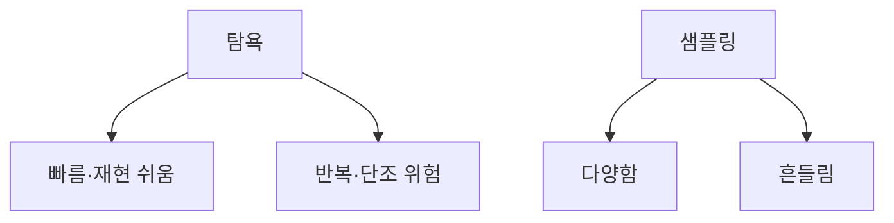

# 탐욕 디코딩

> 매 단계에서 **확률이 가장 높은 토큰 하나만 고르는** 가장 단순한 문장 생성 방식. 온도 0과 같은 동작이다.

## 쉽게 말하면
길을 갈 때 교차로마다 "지금 가장 좋아 보이는 쪽"만 고르는 것이다. 빠르고 예측 가능하지만, 나중에 막다른 길일 수도 있다.

## 자세히
- 동작: 모델이 각 위치에서 다음 토큰의 확률 분포를 내면 `argmax`를 고른다. 이론상 같은 입력엔 같은 출력(실제로는 [수치적 비결정성](#nondeterminism-llm)이 남을 수 있다).
- 약점: 지금 최선이 전체 최선이 아닐 수 있다. 또한 Holtzman 외(2019, arXiv 1904.09751)의 초록에 따르면 **우도를 최대화하는 디코딩은 따분하고 이상하게 반복되는 글**을 만든다. 같은 모델이어도 디코딩 전략만으로 품질이 크게 달라진다.
- 대안: 확률 분포에서 뽑는 샘플링(온도, [top-k](#top-k-sampling), nucleus/top-p). 논문은 확률 분포의 "동적 핵(nucleus)"에서만 뽑아 신뢰도 낮은 꼬리를 자르면서 다양성을 유지하는 방법을 제안했다.
- 쓰임: 분류·추출·코드 같은 **정답이 하나에 가까운 작업**에서 안정적. 창작에는 반복 위험.
- 참고: 최신 추론 모델 API는 temperature 같은 샘플링 설정을 제한하는 경우가 있어 모델 문서를 확인한다(이 글의 출처에서는 확인하지 않음).

## 그림으로 보기

## 예시
- "이 문장의 감정을 긍정/부정으로" 같은 분류는 탐욕이 적합.
- 교육: 같은 프롬프트를 탐욕과 샘플링으로 돌려 비교하는 실습.

## 헷갈리는 것과 비교
| 개념 | 차이 |
|---|---|
| 탐욕 디코딩 | 한 번에 하나, 최고 확률만 |
| [빔 서치](#beam-search) | 여러 후보 경로를 유지 |
| [top-k 샘플링](#top-k-sampling) | 상위 k개 중에서 확률적으로 선택 |

## 더 읽을거리
- [The Curious Case of Neural Text Degeneration](https://arxiv.org/abs/1904.09751) — 우도 최대화 디코딩의 반복 문제와 nucleus 샘플링(초록 읽음).
