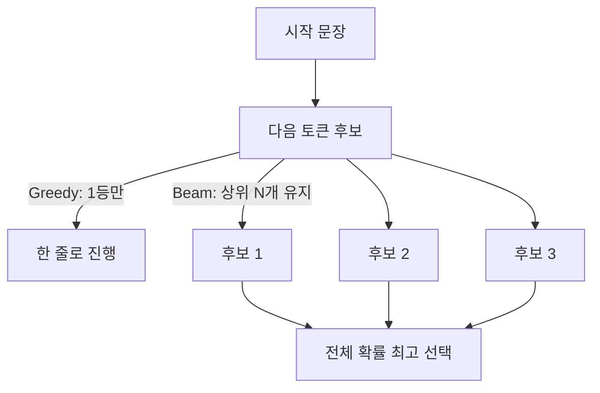
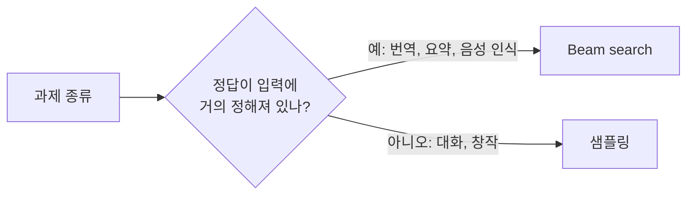

# Greedy와 Beam search

> Greedy는 매 단계 가장 확률 높은 토큰 하나만 고르는 디코딩이고, Beam search는 후보 문장 여러 개(beam)를 동시에 들고 가다 전체 확률이 가장 높은 것을 고르는 디코딩이다. 둘 다 무작위가 없다.

## 쉽게 말하면
내비게이션에서 갈림길마다 "지금 가장 빠른 길"만 타는 것이 Greedy다. Beam search는 길 5개를 동시에 끝까지 따라가 보고 도착 시간이 가장 짧은 경로를 고른다. 눈앞에서 조금 느려 보여도 뒤에서 만회하는 길을 찾을 수 있다.

## 자세히
Hugging Face 문서(Generation strategies, 2026-11 확인) 기준:
- **Greedy**: `generate()`의 기본 전략. 짧고 창의성이 필요 없는 출력에 적합하나 길어지면 **같은 말을 반복**하기 시작한다. 별도 지정이 없으면 최대 20개 새 토큰만 생성한다.
- **Beam search**: `num_beams`로 켠다(1이면 greedy와 동일). 여러 시퀀스를 추적해 전체 확률이 가장 높은 것을 고르므로 "앞을 내다보는" 효과가 있다. 이미지 설명·음성 인식처럼 **입력에 묶인 과제**에 적합하다고 문서가 밝힌다. 다만 전체 최적을 보장하진 않는다.
- HF 블로그(How to generate): beam search는 열린 생성(대화·이야기)에서 반복적이고 부자연스럽다. 번역·요약에는 낫다. `no_repeat_ngram_size=2`로 같은 2-gram 반복을 막을 수 있으나 "New York"처럼 정당한 반복도 막으므로 조정이 필요하다.
- 챗봇이 쓰는 건 보통 [temperature·top-p 샘플링](#sampling-temperature)이다. Greedy는 temperature→0의 극한과 같다.

## 그림으로 보기



## 예시
```python
# greedy
out = model.generate(**inputs, max_new_tokens=40)
# beam search
out = model.generate(**inputs, max_new_tokens=40, num_beams=5, early_stopping=True)
# beam + 2-gram 반복 금지
out = model.generate(**inputs, max_new_tokens=40, num_beams=5, no_repeat_ngram_size=2)
```
API로 쓰는 상용 모델은 보통 beam을 노출하지 않고 temperature 0이 사실상 greedy다(주장 아닌 일반 관행, 제공사별 상이).

## 헷갈리는 것과 비교
| 개념 | 차이 |
|---|---|
| Greedy | 매 단계 1등, 빠르고 반복에 약함 |
| Beam search | N개 후보 유지, 번역·요약에 강함, 계산 N배 |
| [샘플링](#sampling-temperature) | 확률대로 무작위 추출, 다양함 |
| [반복 억제](#repetition-penalty) | 어느 방식에든 얹는 보조 장치 |

## 더 읽을거리
- [HF Generation strategies](https://huggingface.co/docs/transformers/generation_strategies) — greedy·sampling·beam 코드와 설명.
- [How to generate text (HF 블로그)](https://huggingface.co/blog/how-to-generate) — 디코딩 방식별 장단점과 반복 문제.
