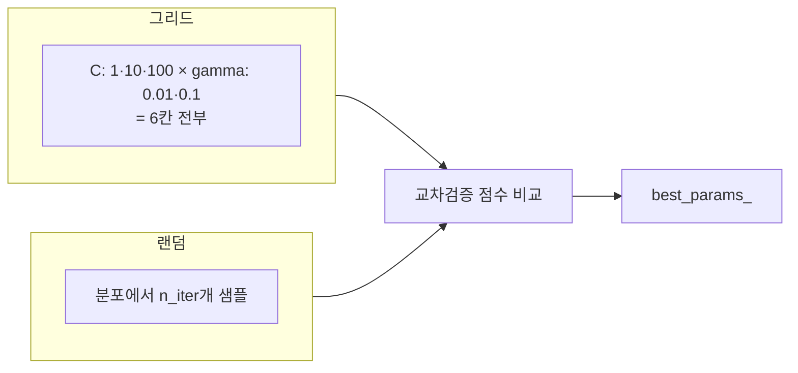

# 그리드·랜덤 탐색

> 그리드 탐색은 정해 둔 조합을 전부 시도하고, 랜덤 탐색은 지정한 횟수만큼 분포에서 무작위로 뽑아 시도하는 하이퍼파라미터 탐색 방식이다.

## 쉽게 말하면
맛집 찾기에서 지도를 칸칸이 전부 걸어 보는 것(그리드)과, 시간이 정해져 있어 무작위로 20곳만 찍어 가 보는 것(랜덤)의 차이다. 중요한 거리가 몇 개뿐이라면 무작위가 의외로 효율적이다.

## 자세히
scikit-learn 문서(2026-11 확인):
- **GridSearchCV**: `param_grid`의 모든 조합 평가. 예시 그리드는 선형 4개 + RBF 4×2 = 8개 = 12 후보. 파라미터가 늘면 비용이 **곱으로** 증가.
- **RandomizedSearchCV**: `n_iter`개를 분포(`loguniform` 등)나 리스트(균등)에서 샘플. 장점: ① **예산이 파라미터 수와 무관**(`n_iter`로 직접 결정) ② **무관한 파라미터가 효율을 해치지 않음**.
- 랜덤이 보통 유리: 연속 파라미터(C, gamma), 큰 공간에서 소수만 중요, 계산 예산 고정. 그리드는 작고 이산적인 공간에 적합. 근거로 Bergstra & Bengio(2012) 인용.
- **Successive halving**(`HalvingGridSearchCV`, `HalvingRandomSearchCV`, 실험적 기능): 모든 후보에 적은 자원으로 시작해 상위만 자원을 늘려 간다. `factor`(보통 3), `min_resources`, `aggressive_elimination`. 예: min_resources=3, factor=2, 후보 70 → 자원 3/6/12/24/48/96, 후보 70/35/17/8/4/2.
- 팁: 개발 분할에서 탐색하고 **본 적 없는 테스트 세트**로 평가, `n_jobs=-1`, 중첩 추정기는 `step__param` 문법, 일부 모델은 `LassoCV` 등 경로 기반 CV가 더 싸다.

## 그림으로 보기


## 예시
```python
RandomizedSearchCV(SVC(), {"C": loguniform(1,1e3), "gamma": loguniform(1e-4,1e-3)}, n_iter=50, cv=5)
```

## 헷갈리는 것과 비교
| 개념 | 차이 |
|---|---|
| 그리드 | 모든 조합, 비용 곱 증가 |
| 랜덤 | 예산 고정, 연속값에 유리 |
| 베이지안 최적화 | 이전 결과로 다음 후보 선택(별도 기법) |
| [하이퍼파라미터](#hyperparameter) | 탐색 대상 |

## 더 읽을거리
- [scikit-learn: Tuning hyper-parameters](https://scikit-learn.org/stable/modules/grid_search.html) — 코드·halving·팁.
