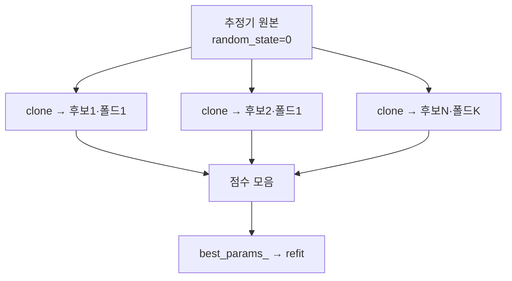

# GridSearchCV와 clone

> `GridSearchCV`는 후보 설정과 폴드마다 추정기를 `clone`해 새로 학습한다. 원본은 건드리지 않고, 정수 `random_state`는 그대로, `RandomState` 인스턴스는 **복사된 상태**로 전달되어 반복 실행 결과가 같아진다.

## 쉽게 말하면
요리 대회에서 심사 때마다 같은 레시피 카드를 복사해 새 주방에서 만든다. 원본 카드는 그대로 두므로, 대회를 몇 번 다시 열어도 같은 재료 순서로 진행된다.

## 자세히
- scikit-learn은 후보×폴드마다 `clone(estimator)`로 매개변수만 복사한 새 객체를 만든다(학습된 상태는 복사하지 않음). 정수 시드는 값이 그대로 들어가므로 **후보마다 같은 시드**를 쓴다. 인스턴스는 깊은 복사되어 각 복제본이 같은 상태에서 출발한다([RandomState 인스턴스 vs 정수](#randomstate-instance-vs-int)).
- **직접 실행**(scikit-learn 1.9.1, make_classification 600개, RandomForest 20그루, `max_depth` ∈ {3, 5, None}, `cv=KFold(5, shuffle=True, random_state=0)`, 2회 반복):

| `random_state` | 1회 mean_test_score | 2회 mean_test_score |
|---|---|---|
| 정수 0 | 0.8317, 0.8433, 0.8467 | 동일 |
| `RandomState(0)` | 0.8317, 0.8433, 0.8467 | 동일 |

  두 방식 모두 GridSearchCV를 다시 돌려도 같은 점수였다. `best_estimator_`의 `random_state`는 0 그대로였다.
- **주의점**: ① 후보 간 점수 차이에는 모델 시드 변동도 섞여 있다(같은 시드를 쓰면 일관되지만, 다른 시드에서는 순위가 바뀔 수 있음) → 점수 차가 작으면 시드를 바꿔 재확인, ② `refit=True`면 최적 설정으로 전체 데이터에 다시 학습한다, ③ 파이프라인 안의 여러 단계가 각자 시드를 가지면 모두 고정한다.
- 한계: 한 모델·한 데이터셋에서의 관찰이다.

## 그림으로 보기


## 예시
```python
gs = GridSearchCV(RandomForestClassifier(random_state=0),
                  {"max_depth": [3, 5, None]},
                  cv=KFold(5, shuffle=True, random_state=0)).fit(X, y)
print(gs.best_params_, gs.cv_results_["mean_test_score"])
```

## 헷갈리는 것과 비교
| 개념 | 차이 |
|---|---|
| `clone` | 매개변수만 복사한 새 추정기 |
| `copy.deepcopy` | 학습된 상태까지 복사 |
| [CV 분할기 시드 정책](#cv-splitter-seed-policy) | 폴드 구성 고정 |
| [RandomState 인스턴스 vs 정수](#randomstate-instance-vs-int) | 시드 종류별 동작 |

## 더 읽을거리
- [GridSearchCV API](https://scikit-learn.org/stable/modules/generated/sklearn.model_selection.GridSearchCV.html) — refit·cv_results_ 설명.
- [sklearn.base.clone](https://scikit-learn.org/stable/modules/generated/sklearn.base.clone.html) — clone의 동작.
