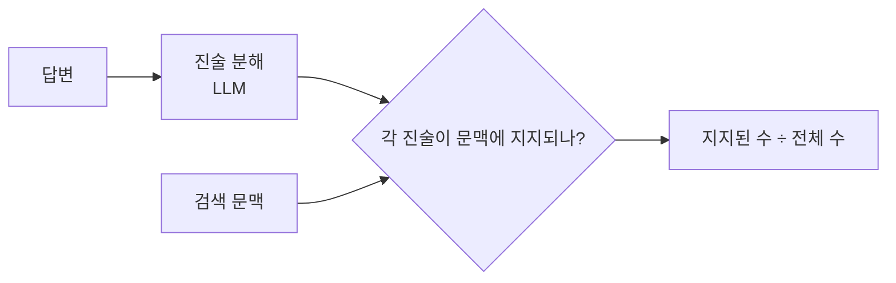
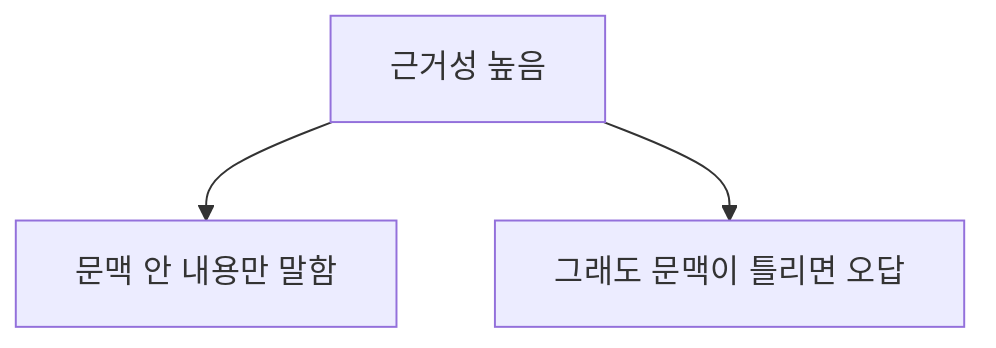

# 근거성(groundedness) 지표

> RAG 답변의 주장들 중 검색된 근거로 뒷받침되는 비율. 0~1 점수로, "답이 근거 문서 안에 있는 내용인가"를 재며 "세상의 진실"을 재는 것은 아니다.

## 쉽게 말하면
보고서의 각주 검사와 같다. 문장마다 "이 말의 출처가 첨부 자료에 있나?"를 체크해 있는 문장 수를 전체 문장 수로 나눈다. 첨부 자료 자체가 틀렸다면 각주가 다 맞아도 보고서는 틀린 것이다.

## 자세히
RAGAS 문서의 `faithfulness`(열람)를 기준으로 한다. 같은 개념을 도구에 따라 groundedness 또는 faithfulness로 부른다(이름 정의는 도구마다 조금 다를 수 있음).
- **식**: 근거로 뒷받침되는 주장 수 ÷ 응답의 전체 주장 수.
- **계산 순서**: LLM이 답변을 개별 진술(claim)로 나누고, 각 진술이 검색 문맥으로 지지되는지 이진 판정한다.
- **예(문서의 설명)**: 문맥에 출생일 1879년 3월 14일이 있는데 답이 "독일에서 1879년 3월 20일에 태어났다" → 출생지는 지지, 날짜는 미지지 → 1/2 = 0.5.
- **HHEM 변형**: 판정을 LLM 대신 Vectara의 HHEM-2.1-Open(T5 기반 환각 분류기, 작고 무료 오픈소스, 기본 CPU)으로 대체해 운영 환경에 맞춘 옵션.
- **한계**: 문맥과의 일관성만 보므로 문맥이 틀리면 틀린 답도 충실하게 나온다. 검색이 놓친 정보는 반영하지 않는다.
- **API 변경**: 이 문서 기준 구 API(`SingleTurnSample`)는 v0.4에서 폐기 예고되고 v1.0에서 제거. 컬렉션 API의 `Faithfulness(llm=llm)`를 쓰라고 안내한다.
- 한 논문(telecom RAG 지표 평가, arXiv 2407.12873)도 같은 식을 설명했다고 검색 요약에 나왔으나 PDF 본문을 읽지 못했다.

## 그림으로 보기

## 예시
- 사내 규정 챗봇 답변 5개 진술 중 4개가 규정 문서에 있고 1개는 없음 → 0.8. 없는 1개는 환각 후보로 검토.
- 교육 실습: 답변 한 단락을 진술로 쪼개 근거 문서에 줄 그어 대조해 보고 점수를 계산.

## 헷갈리는 것과 비교
| 개념 | 차이 |
|---|---|
| 근거성/충실도 | 답이 문맥에 지지되나 |
| 정확성 | 정답과 일치하나(문맥 틀리면 다름) |
| [주장 단위 출처 연결](#claim-level-attribution) | 점수 계산의 전제가 되는 연결 |
| [인용 UI 패턴](#citation-ui) | 근거를 사용자에게 보이는 방식 |

## 더 읽을거리
- [RAGAS: Faithfulness](https://docs.ragas.io/en/stable/concepts/metrics/available_metrics/faithfulness/index.md) — 식·예시·HHEM 변형(열람)
