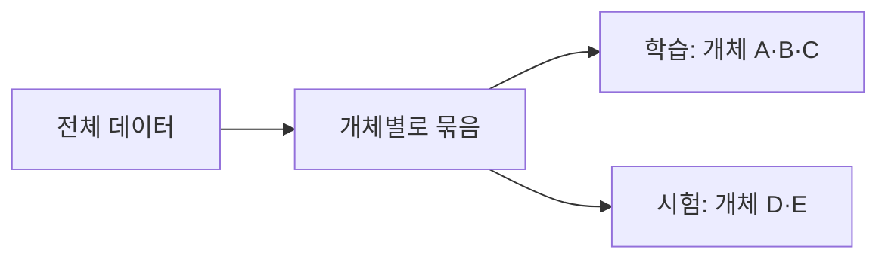

# 그룹 인식 분할

> 같은 환자·사용자·기기처럼 **한 개체의 데이터를 학습과 평가 중 한쪽에만 넣는** 분할 방식이다. 개체 고유 패턴을 외워 점수가 부풀려지는 것을 막는다.

## 쉽게 말하면
같은 학생의 문제를 연습문제와 시험에 둘 다 내면, 그 학생의 풀이 습관만 외워도 점수가 오른다. 학생 단위로 "연습용 학생"과 "시험용 학생"을 나눠야 진짜 실력이 나온다.

## 자세히
(TheoremPath의 "Train-test split and data leakage" 페이지를 직접 읽었다. 개인 학습 사이트라 1차 문헌은 아니며 라이브러리 함수·코드는 페이지에 없다.)
- **그룹 누수(페이지)**: 한 개체(환자·사용자·기기)의 여러 데이터가 **학습과 시험 양쪽에** 있으면 모델이 개체별 패턴을 학습한다.
- **처방(페이지)**: "한 개체의 모든 데이터가 같은 부분집합에 있도록 그룹 인식 분할을 쓴다."
- **함께 보는 누수(페이지)**: 중복·증강된 거의 같은 사본이 양쪽에 있으면 모델이 시험 데이터를 외운다.
- **구현(일반 지식, 이 글에서 미확인)**: scikit-learn의 GroupKFold 등이 쓰인다.

## 그림으로 보기

## 예시
- 상담 대화 요약 모델 평가: 같은 상담원의 대화는 한쪽에만 넣는다(제안).
- 교육 소재: "같은 학생의 문제가 연습·시험에 섞이면?" 토론.

## 헷갈리는 것과 비교
| 분할 | 나누는 단위 |
|---|---|
| 무작위 | 행 |
| 그룹 인식 | 개체 |
| [시간 순](#temporal-split) | 시점 |

## 더 읽을거리
- [TheoremPath — Train-test split and data leakage](https://theorempath.com/topics/train-test-split-and-data-leakage) — 직접 읽음.
