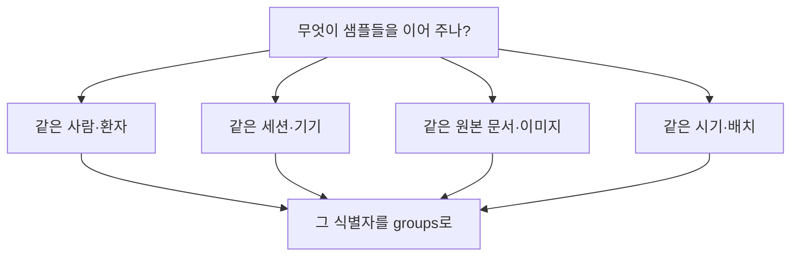

# 그룹 정의하기

> 그룹 단위 분할에서 "무엇을 같은 그룹으로 볼 것인가"를 정하는 일이다. 기준은 "학습과 시험 양쪽에 동시에 나타나면 안 되는 대상"이며, 가장 잘게 나눈 단위가 아니라 누수 위험을 만드는 단위로 정한다.

## 쉽게 말하면
같은 사람이 쓴 일기 100쪽을 연습/시험으로 갈라 놓으면 모델은 그 사람의 말버릇을 외운다. "일기 쪽"이 아니라 "사람"을 묶음으로 잡아야 한다. 어떤 끈으로 샘플들이 이어져 있는지를 찾는 것이 그룹 정의다.

## 자세히
- **원칙**: 학습·시험 양쪽에 나오면 안 되는 개체(환자, 사용자, 세션, 기기)를 그룹 ID로 쓴다. 한 사람이 여러 세션을 가졌는데 세션으로 묶으면 그 사람의 행동이 여전히 폴드를 넘나든다(Kanaries 문서, 열어 확인).
- **세분 단위가 정답은 아니다**: 가장 작은 단위가 아니라 **누수 위험을 정의하는 식별자**를 쓴다.
- **사례(논문 초록 확인)**: 알츠하이머 다중 모달 연구(arXiv 2610.10648)는 subject-grouped partitions를 쓴다. 검색 결과 요약에 따르면 한 사람의 모든 방문과 MRI 파일이 정확히 한 폴드에 들어가게 했다(초록은 "subject-grouped"만 확인, 세부는 본문 미확인).
- **여러 축(제안)**: 환자와 촬영 기관(site)·배치처럼 두 축이 모두 유사성을 만들면 두 축을 함께 묶어야 할 수 있다(검색 결과의 bioLeak 문서가 결합 모드를 언급한다고 했으나 페이지를 열지 못해 미확인).
- **빠진 값 금지**: 모든 행에 그룹 값이 있어야 하고(`groups`는 필수 인자), 환자 ID가 누락·불일치하면 누수가 되살아난다(제안).
- **사후 검증**: 분할 뒤 폴드 간에 겹치는 그룹이 0개인지 코드로 확인한다.
- **그룹으로 해결되지 않는 것**: 서로 다른 ID인데 같은 내용(복사본·개정판)은 [근접 중복 탐지](#near-duplicate-detection)가 필요하다. 시간 의존이면 [시간 기준 분할](#train-validation-test-split)을 고려한다.
- 분할 도구: [GroupKFold](#group-kfold), [StratifiedGroupKFold](#stratified-group-kfold), [Leave-One-Group-Out](#leave-one-group-out).

## 그림으로 보기

## 예시
- 상담 챗봇: 같은 고객의 여러 대화 → 고객 ID가 그룹(대화 ID로 묶으면 고객 말투 누수).
- 의료 영상: 환자 ID. 같은 환자의 여러 방문·여러 영상 파일 전부 한 쪽.
- 확인 코드: `assert set(groups[train_idx]).isdisjoint(groups[test_idx])`

## 헷갈리는 것과 비교
| 개념 | 차이 |
|---|---|
| 그룹 정의 | 무엇을 한 덩어리로 묶을지 결정 |
| [그룹 단위 분할](#group-wise-split) | 정해진 그룹대로 나누는 실행 |
| 층화 | 클래스 비율 균형. 그룹과 별개 선택 |
| [근접 중복 탐지](#near-duplicate-detection) | ID가 달라도 내용이 같은 샘플 찾기 |

## 더 읽을거리
- [Kanaries ML: Group-Aware Cross-Validation Splitters](https://ml.kanaries.net/docs/apis/utils/groupSplitters.md) — 그룹 선택 원칙(열어 확인).
- [arXiv 2610.10648: Leakage-Controlled Multimodal Learning (알츠하이머)](https://arxiv.org/abs/2610.10648) — subject-grouped 분할(초록 확인).
