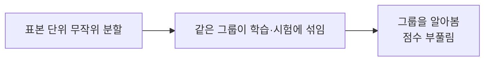
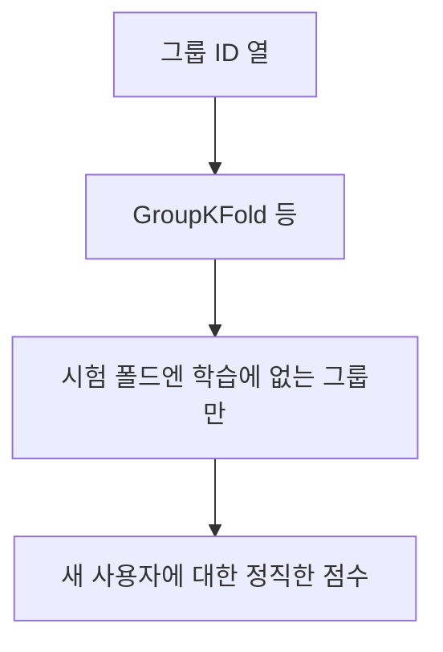

# 그룹 누수 방지

> 같은 환자·사용자·문서에서 나온 표본이 학습 세트와 검증 세트에 갈라져 들어가면 모델이 새로운 사람이 아니라 이미 본 그 사람을 알아보게 되어 점수가 부풀려진다. 그룹 단위로 분할하는 교차검증(GroupKFold 등)으로 막는다.

## 쉽게 말하면
같은 학생의 문제 풀이 기록 10개 중 7개로 공부시키고 나머지 3개로 시험을 보면 그 학생의 버릇을 외웠다는 것만 확인된다. 새로운 학생에게도 통할지는 학생 단위로 따로 떼어 내야 알 수 있다.

## 자세히
- **원리(scikit-learn 그룹 교차검증, 열람)**: 교차검증은 표본이 독립·동일 분포(i.i.d.)라고 가정한다. 환자·피험자별로 표본이 여럿이면 무작위로 나눌 때 그룹 고유 정보가 학습에서 검증으로 샌다. 모델이 사람 고유 특징을 배우면 "새 피험자에게 일반화하지 못할 수 있다"고 문서가 말한다. 그룹 인식 분할기는 검증 폴드에 짝지은 학습 폴드에 없는 그룹만 담는다. `groups` 인자로 그룹 식별자를 넘긴다.
- **도구 4가지(같은 문서)**: `GroupKFold`는 같은 그룹이 학습·시험에 동시에 없게 하고 테스트 폴드가 데이터를 완전히 나눈다(그룹 크기가 불균형하면 폴드 크기가 다름). `StratifiedGroupKFold`는 그룹을 한 분할에 두면서 클래스 비율도 유지하지만 완전한 셔플이 어렵고 배정이 탐욕적이라 차선일 수 있으며, 그룹마다 클래스 분포가 비슷하면 `GroupKFold`가 낫다고 한다. `LeaveOneGroupOut`은 한 그룹 전체를 빼는 분할(그룹 수만큼 폴드)로 여러 실험이나 수집 연도별 시간 분할에 맞는다. `GroupShuffleSplit`은 매번 무작위로 그룹 일부를 빼며 그룹이 너무 많아 모든 분할을 열거하기 어려울 때 쓴다. 단일 분할에는 `train_test_split`이 그룹을 못 다루므로 `GroupShuffleSplit`을 쓴다.
- **직접 해 본 실험(순수 파이썬, 시드 4)**: 그룹 40개×각 10표본, 각 그룹의 정답이 그룹 단위로 무작위(실제 신호 없음), 특징은 그룹 중심에서 작은 노이즈만 더한 값이다. 1-최근접이웃 분류기로 20번 반복하면 표본 단위 무작위 7:3 분할은 평균 정확도 **0.813**, 그룹 단위 분할(28개 그룹으로 학습, 12개로 시험)은 **0.496**이었다. 신호가 없는 데이터에서 무작위 분할이 0.81을 낸 것이 곧 그룹 누수다. 이 실험은 누수를 극단적으로 만든 합성 데이터이며 실제 데이터의 누수 크기는 그룹 내 유사도에 달렸다.
- **어떤 열이 그룹인가(해석)**: 환자 ID, 사용자·고객 ID, 같은 문서에서 만든 질문, 같은 대화의 여러 턴, 같은 장비·센서, 같은 촬영 세션. 모르면 "이 둘이 서로 닮았을 이유가 있는가?"를 묻는다.
- **함께 쓰는 점검(해석)**: [무작위 라벨 점검](#random-label-sanity-check)에서 정답을 그룹 단위로 섞어 점수가 우연 수준인지 확인한다.
- **군집 표본**: 그룹이 있으면 평가 점수의 신뢰구간도 [군집 표본의 신뢰구간](#clustered-samples-ci)처럼 보정이 필요하다.

## 그림으로 보기

## 예시
- 환자 200명, 환자당 영상 15장인 진단 모델: 환자 ID를 `groups`로 넘겨 `StratifiedGroupKFold(n_splits=5)`로 평가한다.
- 교육 활용: 같은 데이터를 무작위 분할과 그룹 분할로 평가해 점수 차이를 확인하는 실습.

## 헷갈리는 것과 비교
| 개념 | 차이 |
| --- | --- |
| [층화 그룹 K겹](#stratified-group-kfold) | 상위 주제. 그룹 누수 방지는 그 목적 |
| 일반 K겹 | 표본이 독립이라고 가정. 그룹이 있으면 부적합 |
| [최선 노력 층화](#best-effort-stratification) | 큰 그룹 때문에 정확한 층화가 어려울 때의 대응 |
| [전처리 누수](#preprocessing-leakage-pipeline) | 전처리 통계로 새는 누수. 그룹 누수는 표본 단위 분할로 새는 누수 |

## 더 읽을거리
- [scikit-learn: Cross-validation — Group-wise cross-validation](https://scikit-learn.org/stable/modules/cross_validation.html) — 그룹 분할기 4종과 주의
