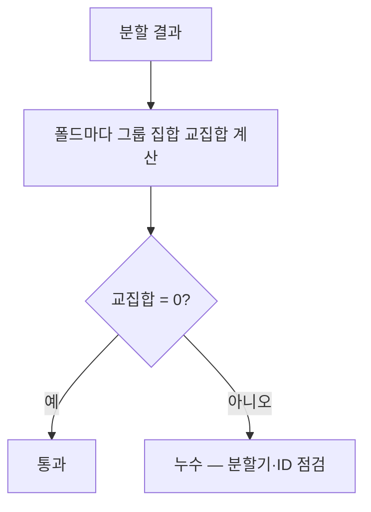
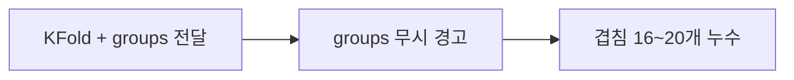

# 그룹 겹침 검증

> 분할을 끝낸 뒤 **학습 세트와 테스트 세트에 같은 그룹이 하나도 없는지 코드로 확인**하는 단계다. 분할기를 제대로 골랐다고 믿지 말고 겹침 수가 0인지 직접 센다.

## 쉽게 말하면
반 배정표를 만든 뒤 "형제자매가 같은 반에 있지 않은지" 명단을 한 번 훑어 확인하는 일이다. 규칙을 세웠어도 명단에 오타가 있으면 규칙은 깨진다.

## 자세히
- **핵심 코드**: 폴드마다 `len(set(groups[train]) & set(groups[test]))`를 센다. 값이 0이어야 한다. 단위 테스트나 데이터 파이프라인의 assert로 넣어 두면 좋다.
- **직접 실험(scikit-learn 1.9.1, 그룹 30개×4샘플)**: `GroupKFold(5)` 폴드별 겹친 그룹 수 `[0,0,0,0,0]`. `KFold(5, shuffle=True)`는 `[20,20,17,17,16]`이고 `The groups parameter is ignored by KFold` 경고가 뜬다. 그룹을 넘겨도 분할기가 무시하면 누수가 생기며, 경고가 유일한 단서다.
- **ID가 틀리면 검사도 소용없다**: 샘플의 30%에 그룹 ID가 없는데 각자 고유 ID(1000+i)를 붙이면, 분할기 기준 겹침은 0이지만 *진짜 그룹* 기준 겹침은 폴드마다 **8~9개**였다. 누락을 "unknown" 한 그룹으로 묶으면(32샘플) 분할기가 그 그룹을 통째로 한 폴드에 몰아 폴드 크기가 크게 어긋났고 진짜 겹침도 `[21,4,6,6,5]`로 남았다([ID 누락 문제](#missing-group-ids)).
- **추가 점검 목록**
  1. 폴드 수 = 기대치(예: 그룹 수 이상인가).
  2. 학습/테스트 샘플 수가 크게 치우치지 않았는가.
  3. 그룹별로 클래스 분포가 극단적이지 않은가.
  4. 다중 식별자(환자+기관)는 모든 식별자에 대해 겹침 0인지([다축 그룹](#multi-axis-grouping)).
  5. 경고(UserWarning)를 오류로 승격: `warnings.filterwarnings("error", message="The groups parameter is ignored")`.
- **보고서에 남기기**: "그룹 겹침 0 확인"을 실험 기록에 한 줄 남기면 재현성과 신뢰도가 올라간다.

## 그림으로 보기



## 예시
```python
for fold, (tr, te) in enumerate(cv.split(X, y, groups)):
    shared = set(groups[tr]) & set(groups[te])
    assert not shared, f"fold {fold}: 겹치는 그룹 {len(shared)}개"
```
- 환자 ID로 분할한 뒤 병원 ID로도 같은 점검을 돌려 이중 누수를 찾는다.

## 헷갈리는 것과 비교
| 개념 | 차이 |
|---|---|
| 그룹 겹침 검증 | 그룹 ID 기준 교집합 0 확인 |
| [분할 후 누수 점검](#split-leakage-audit) | 내용 유사도(해시·임베딩) 기준 |
| [GroupKFold](#group-kfold) | 겹침을 만들지 않는 분할기 |
| 단위 테스트 | 이 점검을 자동화하는 방법 |

## 더 읽을거리
- [scikit-learn 교차검증 가이드 — 그룹 데이터](https://scikit-learn.org/stable/modules/cross_validation.html) — 그룹이 서로 다른 학습/검증 폴드를 보장해야 한다는 원칙.
