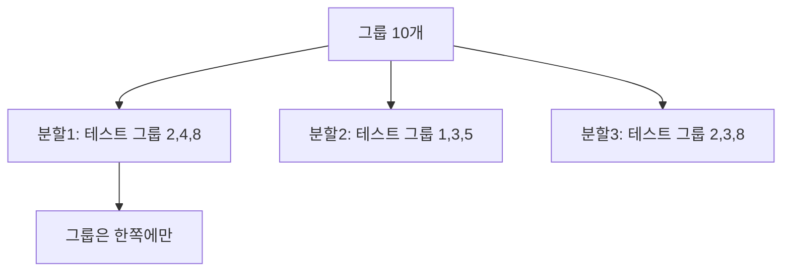
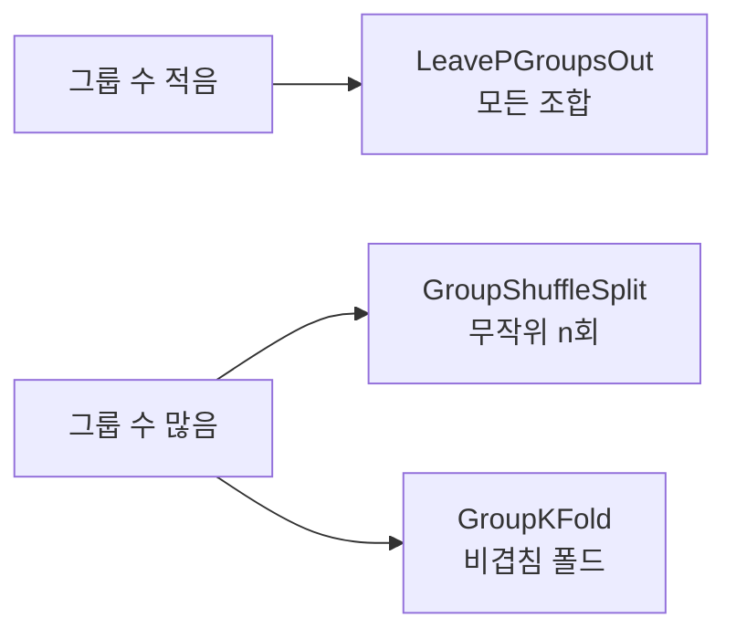

# GroupShuffleSplit

> **그룹 단위로 무작위 학습/테스트 분할을 원하는 횟수만큼 뽑는** scikit-learn 분할기다. 같은 그룹은 한 분할 안에서 학습과 테스트로 갈라지지 않는다. 모든 조합을 나열하는 Leave-P-Groups-Out보다 싸다.

## 쉽게 말하면
환자별 상자에 데이터를 담아 두고, 상자째 무작위로 몇 개를 시험용으로 뽑는 일을 여러 번 반복하는 것이다. 상자를 열어 일부만 시험에 쓰는 일은 없다.

## 자세히
(scikit-learn 1.9.1 공식 API 문서 + 직접 실행)
- **시그니처**: `GroupShuffleSplit(n_splits=5, test_size=None, train_size=None, random_state=None)`. `split(X, y, groups)`에 `groups`가 필수.
- **크기의 기준은 샘플이 아니라 그룹**: `test_size`가 실수면 그룹 비율(올림), 정수면 그룹 개수. 둘 다 None이면 0.2. `ShuffleSplit`은 샘플 기준이라는 점이 다르다.
- **직접 실행**: 그룹 10개(각 2샘플)에 `test_size=0.3`, 3분할 → 분할마다 테스트 그룹 3개(6샘플), 학습·테스트가 공유하는 그룹은 0개였다.
- **샘플 수는 들쭉날쭉**: 그룹 크기가 다르면 테스트 샘플 수가 분할마다 달라진다. 그룹 0이 10샘플, 나머지가 2샘플인 데이터에서 6분할의 테스트 크기는 `[4, 4, 12, 4, 4, 4]`로 한 분할만 12였다(직접 확인).
- **겹침**: 각 분할이 독립이라 서로 다른 분할의 테스트 그룹은 겹칠 수 있다. `GroupKFold` 같은 비겹침 보장이 없다(공식 문서, 큰 데이터셋에서는 큰 문제가 아니라고 설명).
- **비용 절감 예(공식 문서)**: `GroupShuffleSplit(test_size=10, n_splits=100)`은 `LeavePGroupsOut(p=10)`의 값싼 대안이다.
- 용도: 그룹이 수십~수백 개여서 [모든 조합](#leave-p-groups-out)이 불가능하고, 분할 횟수를 직접 통제하고 싶을 때. 분류의 클래스 비율 유지가 필요하면 [StratifiedGroupKFold](#stratified-group-kfold).

## 그림으로 보기



## 예시
```python
from sklearn.model_selection import GroupShuffleSplit
gss = GroupShuffleSplit(n_splits=20, test_size=0.2, random_state=0)
for tr, te in gss.split(X, y, groups=user_id):
    ...  # 사용자 20%를 통째로 시험에
```
- 사용자별 로그 분류 모델에서 신규 사용자 일반화를 20회 무작위로 평가.

## 헷갈리는 것과 비교
| 개념 | 단위 | 겹침 |
|---|---|---|
| ShuffleSplit | 샘플 | 있음 |
| GroupShuffleSplit | 그룹 | 있음 |
| GroupKFold | 그룹 | 없음 |
| [Leave-P-Groups-Out](#leave-p-groups-out) | 그룹 P개 전체 조합 | 있음 |

## 더 읽을거리
- [GroupShuffleSplit API](https://scikit-learn.org/stable/modules/generated/sklearn.model_selection.GroupShuffleSplit.html) — 파라미터, 그룹 기준 크기, LeavePGroupsOut 대안 설명.
