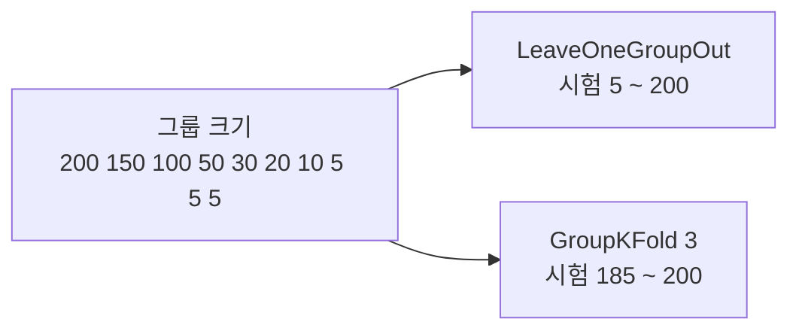
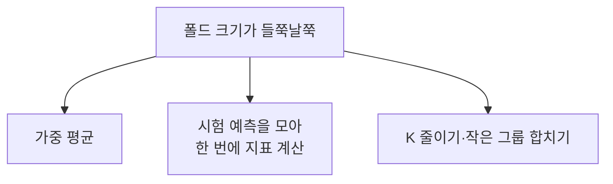

# 그룹 크기 불균형

> 그룹 단위 교차검증에서 그룹마다 표본 수가 크게 다르면 폴드(시험 조각)의 크기가 들쭉날쭉해진다. 큰 그룹 하나가 한 폴드를 통째로 차지하고, 작은 그룹의 폴드 점수는 표본이 적어 거의 믿을 수 없다.

## 쉽게 말하면
학교별로 시험 성적을 비교하는데 한 학교는 200명, 어떤 학교는 5명이다. 5명 학교의 평균은 한두 명이 바꿔 놓을 수 있고, 학교별 평균을 똑같이 한 표로 세면 작은 학교의 운이 결과를 흔든다.

## 자세히
- **분할기의 동작(scikit-learn 문서, 열람)**: `GroupKFold`는 같은 그룹이 학습과 시험에 동시에 있지 않게 한다. 폴드 크기는 정확히 같지 않을 수 있고(그룹이 불균형해서), 클래스 비율까지 맞추려면 `StratifiedGroupKFold`가 낫다. `shuffle=True`이면 그룹 수를 같게 두려 하지만 그룹 크기는 고려하지 않는다. `LeaveOneGroupOut`의 분할 수는 그룹 수와 같다.
- **직접 해 본 실험(그룹 10개, 크기 200·150·100·50·30·20·10·5·5·5, 총 575개)**: `LeaveOneGroupOut`의 시험 크기는 [200, 150, 100, 50, 30, 20, 10, 5, 5, 5]로 최대 200과 최소 5가 40배 차이였다. `GroupKFold(3)`의 시험 크기는 [200, 190, 185]로 비교적 고르게 나뉘었고, `GroupKFold(5)`는 [200, 150, 100, 65, 60]이었다. 가장 큰 그룹(200)은 어떤 K에서도 혼자 한 폴드를 차지했다. 그룹 수가 적을수록 폴드 수를 줄여야 균형이 맞는다는 뜻이다.
- **문제(해석)**: ① 표본 5개 폴드의 점수는 0%·20%·40% 같은 거친 값만 가능하다 ② 폴드 평균을 단순 평균하면 작은 그룹이 과대 대표된다 ③ 큰 그룹 하나가 학습에서 빠지면 그 폴드의 학습 데이터가 크게 줄어든다.
- **대처**: 폴드 점수는 표본 수로 가중 평균하거나, 모든 시험 표본을 모아 한 번에 지표를 계산(풀링)한다. K를 그룹 수보다 훨씬 작게 한다. 작은 그룹은 합치거나 제외하고 이유를 기록한다.

## 그림으로 보기

## 예시
- 병원 10곳 데이터에서 병원을 그룹으로 검증할 때 환자 수가 5명인 병원의 정확도는 참고만 하고, 전체 시험 예측을 합쳐 정확도를 구한다.
- 교육 활용: 그룹 크기를 임의로 만들어 `GroupKFold`가 만드는 시험 크기를 출력해 보는 실습.

## 헷갈리는 것과 비교
| 개념 | 차이 |
| --- | --- |
| `GroupKFold` | 그룹 비중첩, 폴드 크기 비슷하게 시도 |
| `LeaveOneGroupOut` | 그룹마다 한 번, 크기 그대로 |
| [LeavePGroupsOut](#leave-p-groups-out) | P개 조합, 조합 폭발 |
| [시간을 그룹으로 쓰기](#time-as-group) | 연도를 그룹으로 |

## 더 읽을거리
- [scikit-learn: Cross-validation](https://scikit-learn.org/stable/modules/cross_validation.html) — 그룹 분할기 설명과 폴드 크기 주의
