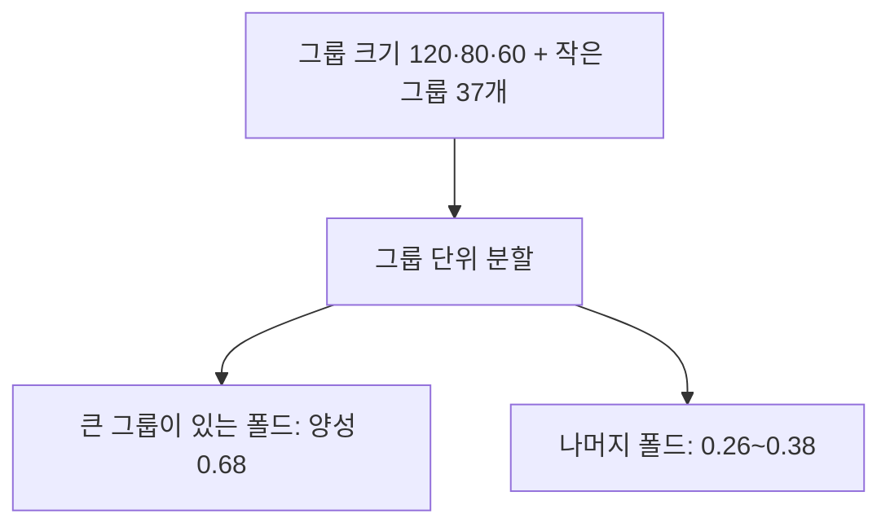

# 그룹 크기 편차

> 그룹 크기 편차는 같은 사용자·문서처럼 한 그룹으로 묶어야 하는 샘플들의 그룹별 크기가 크게 다를 때, 그룹 단위 분할(GroupKFold 등)이 폴드 크기와 클래스 비율을 고르게 못 맞추는 문제다.

## 쉽게 말하면
반 학생을 "가족 단위"로 한 조에 묶어야 한다면, 대가족 하나가 한 조의 인원을 크게 차지한다. 조마다 인원과 성별 비율을 맞추기 어렵다.

## 자세히
- **직접 실험(scikit-learn 1.9.1, 그룹 40개, 크기 120·80·60인 큰 그룹 3개와 3~11인 작은 그룹 37개, 총 526건, 그룹 0은 양성 비율 약 70%, 전체 양성 0.403, 5폴드)**:

| 분할기 | 폴드별 테스트 크기 | 폴드별 양성 비율 |
| --- | --- | --- |
| GroupKFold | 120, 103, 100, 102, 101 | 0.68, 0.35, 0.38, 0.30, 0.26 |
| StratifiedGroupKFold(shuffle) | 143, 104, 101, 87, 91 | 0.61, 0.38, 0.39, 0.25, 0.27 |

  큰 그룹 하나(양성 70%)가 통째로 한 폴드에 들어가면 그 폴드의 양성 비율이 0.68(전체 0.403)이 된다. 클래스 비율을 고려하는 StratifiedGroupKFold도 폴드 크기 87~143, 양성 비율 0.25~0.61로 폴드 간 편차가 남는다. 그룹이 분리되지 않는 한 그룹 안의 구성을 나눌 수 없기 때문이다. (한 번의 가상 실험이며 그룹 구성에 따라 달라진다.)
- **왜 그룹으로 묶는가(해석)**: 같은 사용자·같은 문서의 샘플이 학습·테스트에 갈리면 모델이 그 사용자의 특징을 외워 점수가 부풀려지는 누수가 생긴다. 그래서 그룹 단위로 나눠야 하지만, 이 제약이 균형을 해친다.
- **대응(해석)**: ① 큰 그룹은 따로 확인해 전체 분포와 다른지 본다 ② 폴드 수를 줄이거나 반복 분할(여러 시드)로 평균 ③ 큰 그룹을 학습 전용·테스트 전용으로 의도적으로 배정 ④ 분할 후 폴드별 크기·비율을 점검([분할 후 분포 점검](#post-split-distribution-check)) ⑤ 너무 큰 그룹이 있으면 그룹을 하위 단위(기간별)로 쪼갤 수 있는지 검토(누수 위험을 평가한 뒤).
- **보고(해석)**: 평가 결과를 폴드별로 보고하고, 폴드 편차가 크면 평균 점수만 믿지 않는다.

## 그림으로 보기

## 예시
- 사용자별 문의 로그를 그룹으로 나눌 때 상위 3명이 전체의 절반이면, 그 3명을 한 폴드에 몰지 않도록 폴드를 직접 배정하고 결과를 폴드별로 본다.
- 교육 활용: 그룹 크기 분포를 바꿔 폴드별 편차를 표로 만들어 본다.

## 헷갈리는 것과 비교
| 개념 | 차이 |
| --- | --- |
| 그룹 분할 | 같은 그룹을 한 폴드에 묶음 |
| 층화 분할 | 클래스 비율을 맞춤 |
| [분할 후 분포 점검](#post-split-distribution-check) | 결과 확인 |
| [조합 키 만들기](#combined-stratification-key) | 속성 비율을 맞추는 다른 방법 |

## 더 읽을거리
- [scikit-learn Cross-validation 가이드](https://scikit-learn.org/stable/modules/cross_validation.html) — 그룹·층화 교차 검증 분할기
