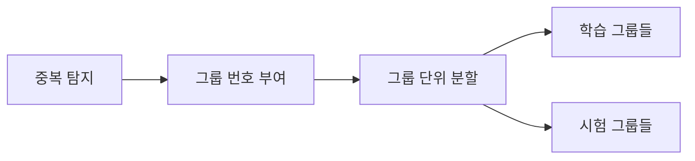
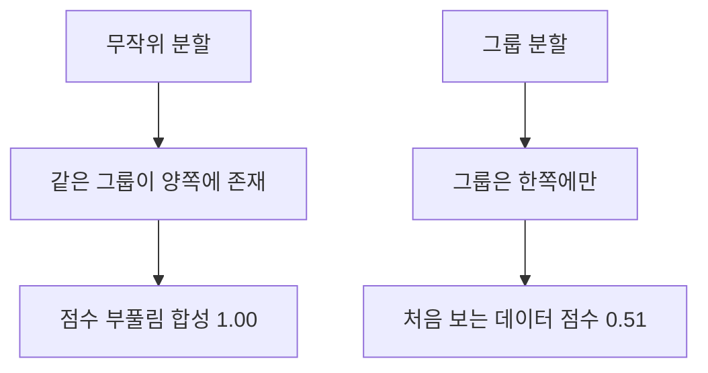

# 중복 제거 후 그룹 분할

> 중복·근접 중복 문서를 하나의 **그룹**으로 묶고, 그룹 전체를 학습·검증·시험 중 한쪽에만 넣는 분할 방식이다. 그래야 시험 점수가 "처음 보는 데이터"에 대한 점수가 된다.

## 쉽게 말하면
같은 문제의 숫자만 바꾼 변형 문제 8개가 있다고 하자. 그중 6개로 공부하고 2개로 시험을 보면 당연히 잘 푼다. 변형 문제 묶음 전체를 시험 쪽에 따로 빼 두어야 진짜 실력이 보인다.

## 자세히
- **문제**: 일반 무작위 분할은 데이터가 서로 독립이라 가정한다. 근접 중복이 있으면 같은 묶음이 학습과 시험에 나뉘어 들어가 모델이 묶음 특성을 외워 점수가 부풀려진다(scikit-learn 교차검증 문서 확인).
- **방법**: 중복 탐지([MinHash LSH](#minhash-lsh) 등)로 만든 군집 번호를 `groups`로 넘겨 **그룹 단위로 분할**한다. scikit-learn에는 GroupKFold(그룹이 두 쪽에 동시에 나오지 않음), StratifiedGroupKFold(클래스 비율을 유지하려 시도하지만 그룹을 탐욕적으로 배정해 불균형할 수 있음), GroupShuffleSplit(그룹을 무작위로 떼어 냄)이 있다.
- **직접 실행**(scikit-learn 1.9.1, 합성 데이터): 중심점 300개, 각 중심에서 잡음 0.05인 사본 8개씩, 라벨은 중심마다 무작위(진짜 신호 없음). 1-최근접 이웃 분류기를 10번 반복한 평균 정확도는 **무작위 분할 1.00, 그룹 분할 0.51**. 신호가 전혀 없는데도 무작위 분할은 만점이 나오는 완전한 누수다. 그룹 분할은 우연 수준(0.5)으로 내려간다. 단순화한 극단 예이며 실제 데이터의 차이는 더 작다.
- **순서(제안)**: ① 중복 탐지로 그룹 번호 부여 → ② 그룹 단위로 분할 → ③ 시험 세트와 학습 세트 사이에 남은 겹침을 다시 점검([오염 탐지](#train-test-contamination-lsh)).
- 주의: 그룹이 너무 크면(예: 한 템플릿이 데이터의 30%) 분할 비율이 틀어지므로 큰 그룹은 대표 일부만 남기는 것도 고려한다.

## 그림으로 보기

## 예시
- 고객 문의 요약 모델: 같은 템플릿 문의 묶음 번호로 `GroupShuffleSplit`을 써서 시험셋 분리.
- 교육: 합성 데이터 실험을 직접 돌려 무작위 분할의 1.00을 확인시키는 실습.

## 헷갈리는 것과 비교
| 개념 | 차이 |
|---|---|
| [학습-시험 겹침](#train-test-overlap) | 증상(겹침) |
| 그룹 분할 | 겹침을 만들지 않는 분할 방법 |
| [중복 제거](#training-data-deduplication) | 학습 데이터에서 중복을 지우는 작업, 분할과 별개 |
| 계층 분할(stratified) | 클래스 비율 유지. 그룹과 함께 쓰려면 StratifiedGroupKFold |

## 더 읽을거리
- [scikit-learn 교차검증 문서](https://scikit-learn.org/stable/modules/cross_validation.html) — 그룹 분할기들과 누수 설명(열어 확인).
