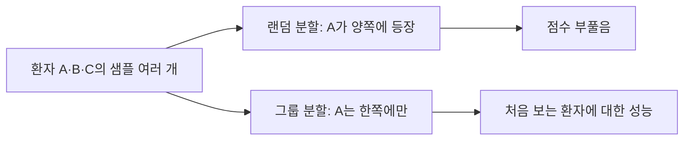
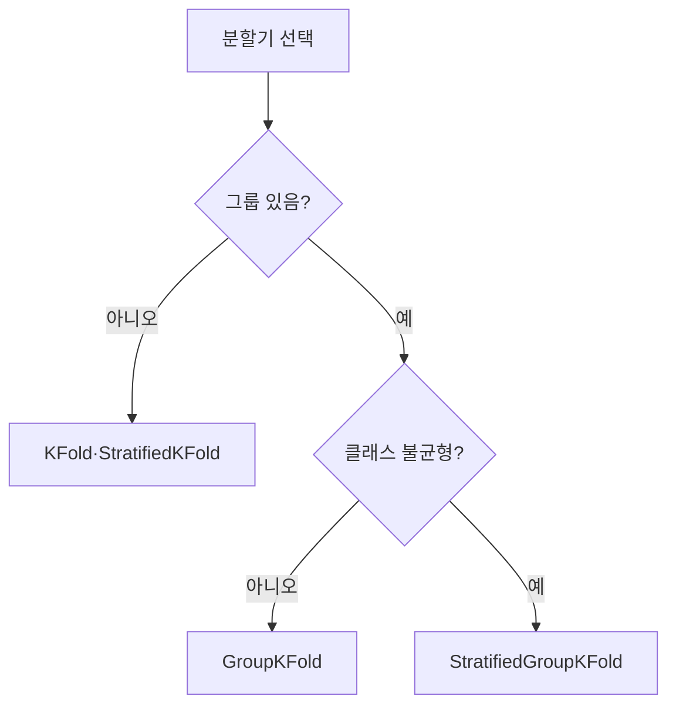

# 그룹 단위 분할

> 같은 사람·환자·문서에서 나온 샘플을 학습 세트와 시험 세트에 **갈라 넣지 않고** 한 그룹은 한쪽에만 두는 분할 방식이다. 그렇지 않으면 모델이 그 사람의 특징을 외워 점수가 부풀려진다.

## 쉽게 말하면
같은 반 학생이 낸 시험지 중 일부는 연습용으로, 일부는 본시험 채점용으로 섞어 두면, 필체(그 학생의 버릇)를 외운 채점기가 본시험도 잘 맞힌다. 진짜 실력을 보려면 "처음 보는 학생"의 시험지로만 채점해야 한다.

## 자세히
(scikit-learn 교차 검증 문서 직접 확인.)
- **문제**: 샘플이 환자·피험자·실험 같은 **그룹으로 묶여** 있을 때, 일반 KFold로 섞으면 한 환자의 샘플이 학습과 시험에 모두 들어간다. 모델이 환자 고유 특징을 배우면 점수가 부풀려진다. 문서의 의료 예: 환자 ID가 그룹이며 GroupKFold는 **처음 보는 환자**에게 일반화되는지를 검사한다.
- **GroupKFold(n_splits=5)**: 한 그룹의 모든 샘플이 같은 폴드에 있게 한다. 그룹 크기가 달라 폴드 크기도 달라진다. `split(X, y, groups)`처럼 `groups` 배열이 필요하다. 문서의 `shuffle=True` 옵션은 폴드당 **그룹 수**를 맞춘다.
- **StratifiedGroupKFold**: 그룹을 유지하면서 클래스 비율도 비슷하게 맞추려 한다. 알고리즘이 탐욕적이라 완벽한 층화가 가능한 경우에도 치우칠 수 있고, 각 그룹의 클래스 분포가 이미 전체와 비슷하면 GroupKFold를 권한다(문서).
- **LeaveOneGroupOut**: 매 분할마다 그룹 하나를 통째로 시험용으로 뺀다. `n_splits`가 고유 그룹 수인 GroupKFold와 같다. 실험 하나씩, 시간 기반 그룹이면 연도 하나씩 빼는 경우에 쓴다.
- **그룹이 뭔지 정하는 일이 핵심**: 사용자 ID, 환자 ID, 같은 원문서에서 쪼갠 조각, 같은 이미지의 증강본, 같은 고객 계약 등. 그룹을 놓치면 [데이터 누수](#data-leakage)가 생긴다(일반적 관점).
- **LLM 맥락(제안)**: 한 문서에서 만든 여러 질문-답 쌍을 학습·평가에 나눠 넣으면 평가가 낙관적으로 나온다. 원문서 단위로 분할한다.

## 그림으로 보기



## 예시
```python
from sklearn.model_selection import GroupKFold
gkf = GroupKFold(n_splits=3)
for train, test in gkf.split(X, y, groups=patient_ids):
    ...  # 같은 patient_id는 한쪽에만
```
고객 상담 로그에서 한 고객의 여러 대화를 같은 그룹으로 묶어 분할한다.

## 헷갈리는 것과 비교
| 개념 | 차이 |
|---|---|
| 그룹 단위 분할 | 그룹이 양쪽에 걸치지 않게 |
| [층화 분할](#stratified-k-fold) | 클래스 비율을 유지 |
| [시계열 분할](#time-series-split) | 시간 순서를 유지 |
| [k-겹 교차 검증](#k-fold-cross-validation) | 이 분할을 돌려 쓰는 틀 |

## 더 읽을거리
- [scikit-learn: Cross-validation](https://scikit-learn.org/stable/modules/cross_validation.html) — GroupKFold·StratifiedGroupKFold·LeaveOneGroupOut와 의료 예(직접 열어 확인).
