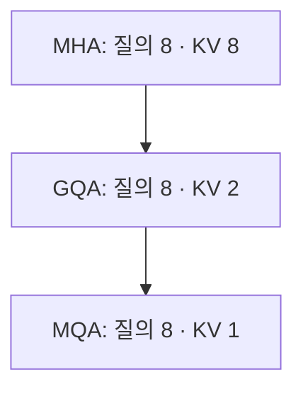
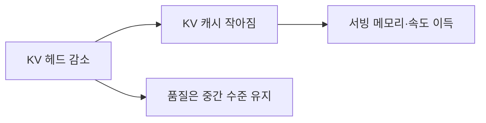

# 그룹 쿼리 어텐션(GQA)

> **GQA**는 어텐션에서 질의(query) 헤드 여러 개가 **키·값(KV) 헤드를 그룹별로 공유**하게 해, 멀티헤드 어텐션에 가까운 품질을 유지하면서 **KV 캐시와 추론 비용을 줄이는** 방식이다.

## 쉽게 말하면
학생 8명이 각자 참고서를 한 권씩 들고 있으면 책상이 꽉 찬다. 2명씩 한 권을 같이 보게 하면 책상이 덜 차고 거의 비슷하게 공부할 수 있다. 책 수가 KV 헤드 수다.

## 자세히
(Ainslie 외, arXiv 2305.13245, EMNLP 2023 초록 확인)
- **배경**: 멀티쿼리 어텐션(MQA)은 KV 헤드를 **하나만** 써 디코더 추론 속도를 높이지만 품질이 떨어질 수 있다. 멀티헤드(MHA)는 질의 헤드마다 KV 헤드가 있다.
- **GQA**: KV 헤드 수를 **1과 질의 헤드 수 사이의 중간 값**으로 둔다. 
- **업트레이닝**: 기존 멀티헤드 체크포인트를 **원래 사전학습 연산의 5%** 만으로 MQA/GQA 형태로 전환할 수 있다고 제안한다.
- **결과**: 업트레이닝한 GQA는 **MHA에 가까운 품질**과 **MQA에 견줄 속도**를 보인다. 초록에 구체적 속도 수치는 없다.
- 효과(일반 지식): KV 헤드가 적을수록 [KV 캐시](#kv-cache) 메모리가 줄어 긴 컨텍스트·많은 동시 요청에 유리하다.

## 그림으로 보기

## 예시
- 질의 헤드 32개, KV 헤드 8개인 모델 = 4개 질의가 KV 하나를 공유(GQA 그룹 크기 4).
- 모델 카드에 `num_key_value_heads`가 `num_attention_heads`보다 작으면 GQA(또는 MQA) 구조를 쓴다는 뜻으로 읽을 수 있다(일반 지식).

## 헷갈리는 것과 비교
| 방식 | KV 헤드 수 | 특징 |
|---|---|---|
| MHA | 질의 헤드와 같음 | 품질 높음, 캐시 큼 |
| GQA | 중간 | 절충 |
| MQA | 1 | 빠르고 작음, 품질 하락 가능 |
| [PagedAttention](#paged-attention) | 메모리 관리 기법 | GQA와 함께 쓰임 |

## 더 읽을거리
- [GQA: Training Generalized Multi-Query Transformer Models from Multi-Head Checkpoints](https://arxiv.org/abs/2305.13245)
