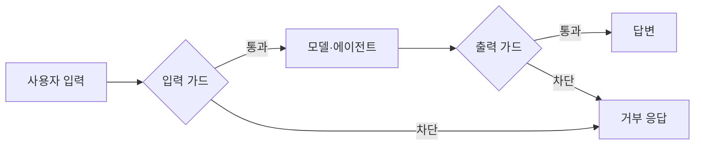
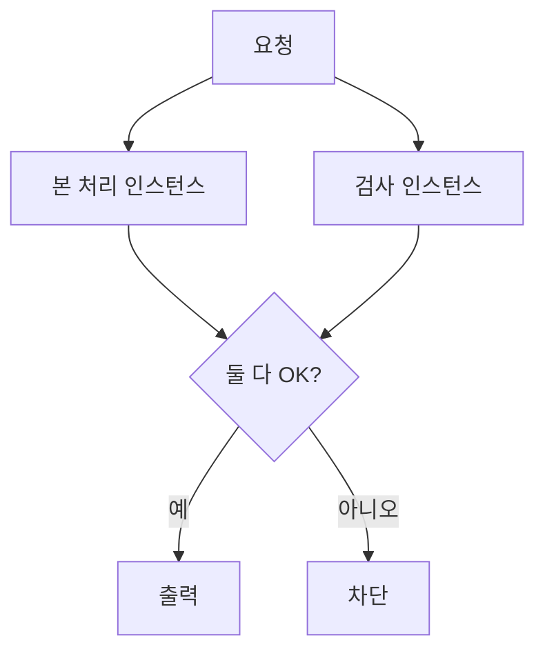

# 가드레일 (Guardrails)

> 가드레일은 AI 시스템의 입력·출력을 별도 검사로 감시해 부적절하거나 위험한 내용·행동이 통과하지 못하게 하는 안전장치다.

## 쉽게 말하면
고속도로 가드레일은 운전자를 대신 운전해 주지 않지만 도로 밖으로 나가는 사고를 막는다. AI 가드레일도 모델의 답을 대신 만들지 않고, 선을 넘는 것만 걸러 낸다.

## 자세히
Anthropic "Building effective agents"(2024-12, 2026-11 확인)의 설명:
- 가드레일은 **병렬화의 sectioning 변형**으로 구현할 수 있다. 한 모델 인스턴스가 사용자 질의를 처리하는 동안 다른 인스턴스가 부적절한 내용·요청을 검사한다. 한 번의 LLM 호출이 가드레일과 본 답변을 함께 하는 것보다 성능이 좋다고 한다.
- 자율성이 높은 에이전트는 비용이 커지고 오류가 누적될 수 있으므로 **샌드박스 테스트와 적절한 가드레일**이 권장된다.
- 종류(일반 분류): 입력 가드(금지 주제·개인정보·주입 시도 탐지), 출력 가드(유해 표현·유출·형식 검사), 행동 가드(도구 권한·승인 절차·허용 목록).
- 한계: 가드레일 자체도 모델이면 틀린다. 규칙 기반 검사(정규식·허용 목록)와 모델 기반 검사를 섞고, 중요한 행동에는 사람 승인을 둔다.

## 그림으로 보기

## 예시
- 고객 상담 봇: 주민번호 패턴이 답변에 들어가면 정규식으로 차단하고, 환불 처리 같은 도구 호출은 금액이 크면 사람 승인.
- 코딩 에이전트: `rm -rf` 같은 명령은 허용 목록 밖이면 실행 거부.

## 헷갈리는 것과 비교
| 개념 | 차이 |
|---|---|
| 가드레일 | 입출력·행동을 막는 외부 검사 |
| [프롬프트 주입](#prompt-injection) | 막아야 할 공격의 하나 |
| [허용 목록 검증](#allow-list-validation) | 가드레일을 만드는 규칙 기법 |
| [병렬화 패턴](#parallelization-pattern) | 가드레일을 구현하는 방식 |

## 더 읽을거리
- [Building effective agents](https://www.anthropic.com/engineering/building-effective-agents) — 가드레일을 병렬화 패턴으로 설명.
