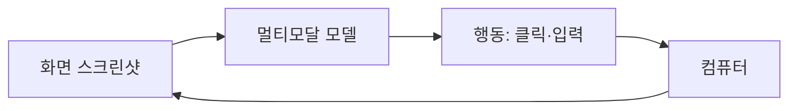
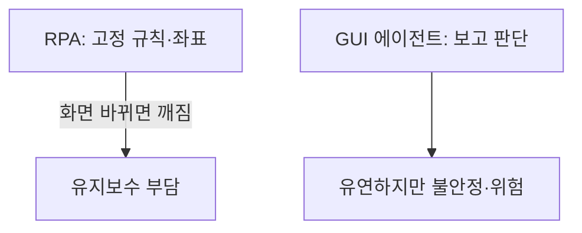

# GUI 에이전트

> **GUI 에이전트**는 화면(스크린샷)을 보고 마우스 클릭·키보드 입력으로 컴퓨터를 직접 조작하는 AI다. API가 없는 프로그램도 사람처럼 다룰 수 있어 "AI판 RPA"로 불린다.

## 쉽게 말하면
사람 직원 대신 화면을 보며 "저장 버튼을 누르고, 엑셀을 열어 붙여 넣는" 일을 하는 인턴이다. 규칙을 미리 짜 둔 매크로와 달리 화면이 조금 달라도 상황을 보고 판단하려 한다.

## 자세히
- **OSWorld**(Xie 외, arXiv 2404.07972 초록 확인): 멀티모달 에이전트를 평가하는 실제 컴퓨터 환경(Ubuntu·Windows·macOS). **369개 과제**(웹·데스크톱 앱, 파일 조작, 여러 앱에 걸친 작업).
- 발표 당시 결과: 사람은 **72.36% 이상** 성공, 최고 모델은 **12.24%**. 원인은 약한 **GUI 접지**(화면 요소 위치 인식)와 부족한 조작 지식이라고 분석했다.
- 이 수치는 2024년 4월 기준이라 현재 모델 점수는 훨씬 높을 수 있다. 최신 점수는 리더보드로 확인해야 한다(미확인).
- 루프: 스크린샷 관찰 → 다음 행동 결정(클릭 좌표·입력) → 실행 → 결과 관찰 반복.
- 위험(일반 지식): 잘못 클릭하면 되돌리기 어렵고, 화면의 악성 문구에 속는 **프롬프트 주입** 위험이 있다. 샌드박스·승인 단계를 둔다.

## 그림으로 보기

## 예시
- API 없는 사내 레거시 시스템에서 거래 내역을 조회해 스프레드시트로 옮기는 반복 업무.
- 안전하게 시험하려면 가상 머신에서 읽기 전용 과제부터 시킨다.

## 헷갈리는 것과 비교
| 개념 | 차이 |
|---|---|
| GUI 에이전트 | 화면을 보고 판단해 조작 |
| RPA | 미리 짠 규칙대로 반복 |
| API 연동 | 프로그램 호출, 가장 안정적 |
| 브라우저 에이전트 | 웹에 특화된 GUI 에이전트 |

## 더 읽을거리
- [OSWorld](https://arxiv.org/abs/2404.07972) — 실제 컴퓨터 환경 벤치마크.
