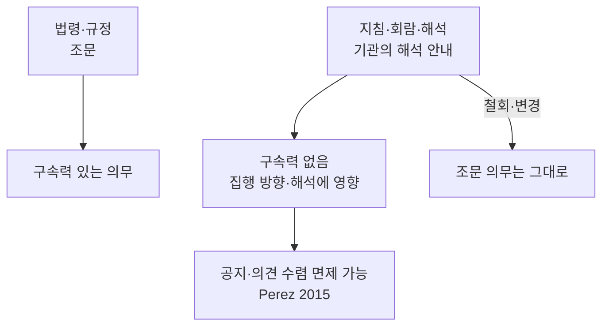

# 지침과 조문의 차이

> **조문**(법률·규정)은 구속력이 있는 규칙이고, **지침**(회람·해석 안내·정책 성명)은 기관이 법을 어떻게 읽는지 알리는 안내다. 지침이 철회되거나 바뀌어도 조문의 의무는 그대로다. 다만 지침은 기관의 집행 방향과 법원의 해석에 영향을 줄 수 있다. (법률 자문 아님)

## 쉽게 말하면
교통법규(조문)와 경찰의 "이렇게 단속하겠다"는 안내문(지침)의 차이다. 안내문이 사라져도 신호 위반은 여전히 위반이다. 다만 안내문이 있을 때는 어떻게 단속할지 예측하기 쉬웠다.

## 자세히
출처: Perez v. Mortgage Bankers Association 해설(Harvard 기업지배구조 블로그, 열어서 읽음), Venable의 CFPB 지침 철회 해설(열어서 읽음), FDA 지침 문서의 표기(앞서 읽은 PDF의 "Contains Nonbinding Recommendations").
- **입법적 규칙 대 해석적 규칙(Perez, 2015-03-09)**: 미국 연방 행정절차법(APA)은 **해석적 규칙**(기관이 법령과 자기 규정을 어떻게 해석하는지 밝히는 규칙)을 공지·의견 수렴 절차에서 면제한다. 대법원은 DC 순회 법원의 Paralyzed Veterans 원칙(기존의 명확한 해석을 크게 바꾸려면 공지·의견 수렴 필요)이 APA와 충돌한다며 기각했다. 규정에 대한 해석을 바꾸는 것은 규정 자체를 개정하는 것이 아니라는 이유다. 입법적 규칙은 공지·의견 수렴을 거쳐 법의 효력을 가진다(검색 요약).
- **남은 안전장치(Perez 해설)**: 자의적·변덕스러운 심사(arbitrary and capricious), 신뢰 이익이 클 때의 더 실질적인 정당화, 해석 변경 시 낮은 존중. 정부는 이전 해석에 따른 행위에 대한 집행이 소급 금지 원칙에 제한될 수 있음을 인정했다.
- **한계의 논쟁**: 스칼리아·토머스·알리토 대법관은 결과에는 동의했지만 기관 자기 규정 해석에 대한 존중(deference) 자체를 문제 삼았다. 존중 원칙의 현재 상태는 이후 판례를 확인해야 하며 이번에는 다루지 않았다.
- **CFPB 사례(2025)**: 지침 67건 철회 때 Venable 해설은 회람이 규칙이 아닌 지침이어서 **법령과 규정상 의무는 그대로**라고 설명한다. 공고는 철회가 반드시 최종은 아니라고 밝혔고, 철회된 입장도 다른 규제기관·소송 당사자·법원이 참조할 수 있다고 했다([CFPB 지침 철회 2025](#cfpb-guidance-withdrawal-2025)).
- **FDA 지침의 표기**: FDA 지침은 "Contains Nonbinding Recommendations"라 표시한다. 대안적 접근이 법 요건을 충족하면 허용될 수 있다는 취지가 CDS 지침에도 나온다([FDA 지침과 법률](#fda-guidance-vs-statute)).
- **실무**: 지침이 사라지면 조문 자체로 준수 근거를 다시 쓰고, 주 법이나 다른 기관의 요건도 확인한다.

## 그림으로 보기

## 예시
- CFPB 회람 철회 후에도 Reg B 1002.9의 구체적 주된 이유 제시 의무는 조문과 해설에 남아 있다([샘플 양식 체크리스트](#sample-forms-checklist)).
- 점검: 사내 정책의 근거로 인용한 문서가 조문인지 지침인지 표시하고 지침이면 철회 이력을 확인.

## 헷갈리는 것과 비교
| 개념 | 차이 |
|---|---|
| 조문(법령·규정) | 구속력, 공지·의견 수렴을 거친 입법적 규칙 포함 |
| 해석적 규칙·지침 | 기관의 해석, 법의 힘 없음 |
| [FDA 지침과 법률](#fda-guidance-vs-statute) | FDA 맥락의 같은 구분 |
| [CFPB 지침 철회 2025](#cfpb-guidance-withdrawal-2025) | 지침이 철회된 사례 |

## 더 읽을거리
- [Perez v. Mortgage Bankers Association (Harvard CorpGov, 2015-03-29)](http://corpgov.law.harvard.edu/2015/03/29/perez-v-mortgage-bankers-association/) — 해석적 규칙 판결 해설(열어서 확인)
- [CFPB Withdraws Guidance Documents (Venable, 2025-05)](https://www.venable.com/insights/publications/2025/05/cfpb-withdraws-guidance-documents-a-shift) — 철회의 법적 효과(열어서 확인)
