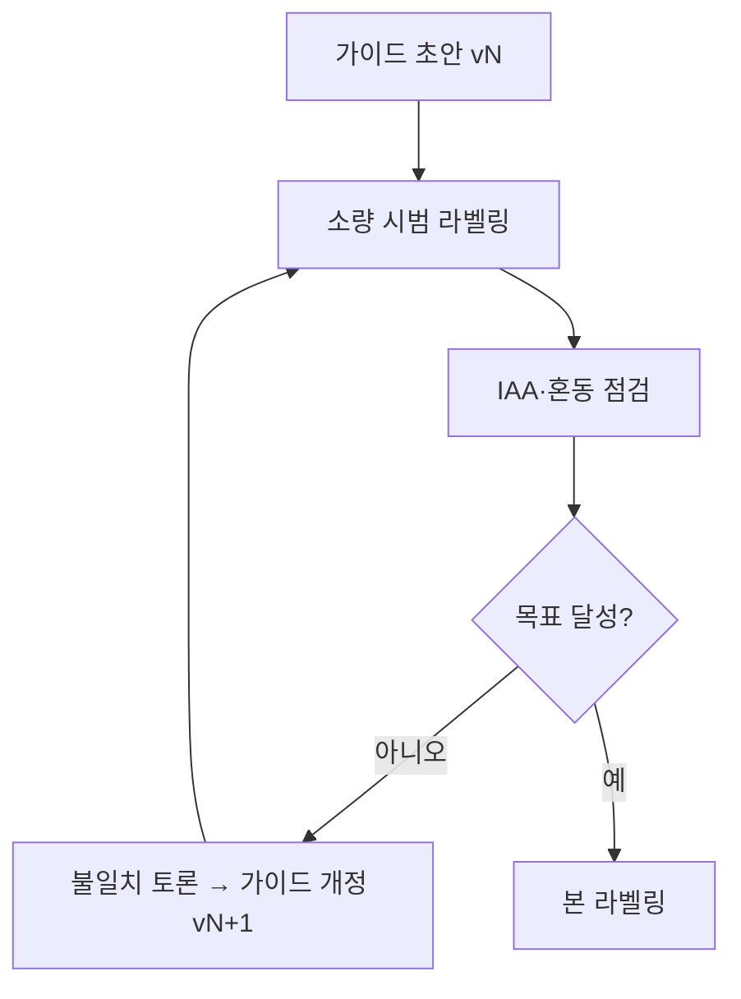
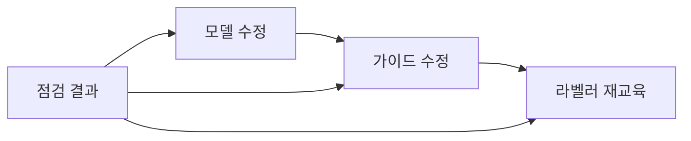

# 규칙서 반복 개발

> 라벨링 가이드(규칙서)를 한 번에 완성하려 하지 말고 **초안 → 소량 시범 라벨링 → 불일치 점검·토론 → 수정**을 돌려 가며 다듬는 방법이다. 언어 주석 분야에서는 MATTER 틀 안의 **MAMA 순환**(Model–Annotate–Model–Annotate)으로 알려져 있다.

## 쉽게 말하면
요리 레시피를 처음부터 완벽하게 쓰는 사람은 없다. 몇 번 만들어 보고 "소금 한 꼬집이 정확히 얼마지?" 같은 모호한 곳을 고쳐 가며 다듬는다. 라벨 규칙서도 시범으로 라벨링하며 모호한 곳을 고친다.

## 자세히
(Finlayson & Erjavec, "Overview of Annotation Creation: Processes & Tools", arXiv 1602.05753에서 열어 확인)
- **MATTER와 MAMA**: Pustejovsky·Stubbs의 MATTER 순환 안에 하위 순환 MAMA가 있고, 모델을 아직 개발하는 프로젝트 초기에 자주 일어난다. 모델을 제안해 규격과 가이드로 옮기고, 소수의 라벨러를 훈련해 **작은 데이터**에 라벨링한 뒤 데이터를 직접 보거나 IAA 지표로 점검한다. 중요한 범주가 빠졌거나 IAA가 너무 낮으면 **모델로 돌아가 수정**한다.
- **더 작은 순환**: 모델은 맞는데 규격·가이드가 부족하면 라벨링 단계 안에서 **가이드 문장을 더 명확하게 다시 쓴다**.
- **오류 점검 습관(같은 문서)**: MAMA 단계에서는 소량의 주석을 반복 검사하며 패턴을 찾고 ① 가이드 재작성 ② 라벨러 재교육 ③ 주석 모델 재설계 중 하나로 돌아간다. 프로젝트 끝에는 발견한 불일치를 한꺼번에 수정한다.
- **버전 관리**: 규격과 가이드가 여러 번 바뀌면 코퍼스의 일부는 옛 버전, 일부는 새 버전으로 공존한다. 문서는 어떤 버전이 쓰였는지 도구가 명확히 보여야 하고 버전 간 차이를 볼 수 있어야 한다고 말한다. 체크리스트에도 "가이드 버전 추적"과 "IAA 추적", "주석자·판정자 회의 일정"이 들어 있다.
- **라운드 설계(실무 관행, 위 문서의 순환을 풀어 쓴 것)**
  1. 초안: 클래스 정의, 포함/제외 규칙, 경계 사례 3~5개.
  2. 시범 라벨링: 라벨러 2~3명이 같은 50~200개를 독립적으로 라벨([목표 일치도](#target-agreement-setting) 먼저 설정).
  3. 진단: [낮은 일치도 진단](#low-agreement-diagnosis)으로 혼동 쌍을 찾는다.
  4. 토론: 불일치 샘플 20~30개를 놓고 이유를 적는다.
  5. 개정: 가이드에 판정 규칙·예시를 추가하고 버전(v0.2)을 올린다.
  6. 목표 일치도 달성 시 본 라벨링으로. 달성 못 하면 2번부터 반복.
- **종료 조건**: 목표 kappa 달성, 최근 2라운드 개정 폭이 작음, 새 범주 요구가 안 나옴.
- 숫자는 가이드가 아니라 일반 경험칙이며 과제 위험도에 따라 달라진다.

## 그림으로 보기

## 예시
- 고객 문의 분류 가이드 v0.1 → 시범 100건 kappa 0.45 → "환불 vs 결제" 경계 규칙 추가 v0.2 → 재시범 kappa 0.63 → 통과.
- 교육: 프롬프트 설계 수업에서 "지시문도 반복 개선하는 규칙서"라는 비유.

## 헷갈리는 것과 비교
| 개념 | 차이 |
|---|---|
| MAMA 순환 | 모델·주석을 반복해 규격을 다듬음 |
| MATTER | 모델링→주석→학습→테스트→평가→수정의 전체 순환 |
| [낮은 일치도 진단](#low-agreement-diagnosis) | 한 라운드 안에서 원인 찾기 |
| 가이드 1회 작성 | 시범 없이 본 라벨링 — 위험 |

## 더 읽을거리
- [Overview of Annotation Creation: Processes & Tools (arXiv 1602.05753)](https://arxiv.org/abs/1602.05753) — MATTER/MAMA, 가이드 버전 관리, 오류 점검.
- [Natural Language Annotation for Machine Learning, 10장](https://www.oreilly.com/library/view/natural-language-annotation/9781449332693/ch10.html) — MAMA 사례(TimeML), 검색 요약으로만 확인.
