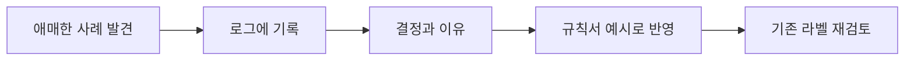
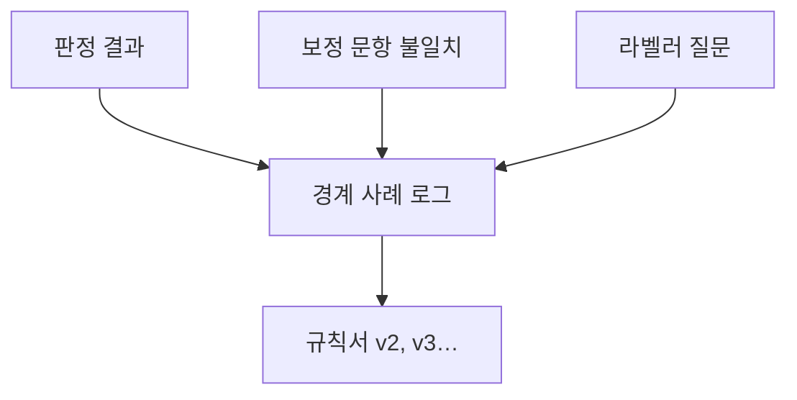

# 경계 사례 기록

> 라벨링 중 새로 발견된 애매한 사례와 그에 대한 결정을 날짜·근거와 함께 누적해 규칙서에 반영하는 기록이다. 같은 사례를 사람마다 다르게 판단하는 일을 막는다.

## 쉽게 말하면
법원 판례집과 같다. 법조문(규칙서)이 모든 경우를 예상하지 못하므로, "이런 사건은 이렇게 판단했다"를 쌓아 두고 다음 사건에서 참고한다.

## 자세히
(TRAM 위키와 Snorkel 가이드를 직접 열어 확인한 내용 + 제안.)
- 규칙서는 시범 라운드뿐 아니라 **본 라벨링 중에도 갱신**된다. 갱신은 보통 예시를 추가하고 경계 사례를 다루는 형태다(TRAM 위키). 위키는 별도의 "경계 사례 로그"를 따로 설명하지는 않고, 규칙서 안에서 경계 사례를 논의·구분해 추가하라고 한다. 따로 표로 관리하는 방식은 이 노드의 제안이다.
- **기록 항목(제안)**: ID, 날짜, 사례 원문, 후보 라벨, 결정과 이유, 결정자, 규칙서 반영 여부, 이미 라벨링된 데이터의 재검토 필요 여부.
- **효과**: 판정(adjudication)에서 나온 불일치([이중 라벨링과 판정](#double-annotation-adjudication))와 보정 문항([보정 문항](#calibration-items))에서 드러난 불일치가 같은 로그에 모인다.
- **규칙서 변경 후 처리**: 이전에 라벨링된 데이터에 영향이 있으면 해당 부분을 다시 라벨링하거나 버전을 구분해 둔다(제안).
- LLM 라벨링으로 가면 이 로그의 사례가 곧 few-shot 예시 후보가 된다([LLM 라벨러 프롬프트](#llm-labeler-guideline-prompt)).

## 그림으로 보기

## 예시
| ID | 사례 | 결정 | 이유 |
|---|---|---|---|
| E-014 | "환불은 되나요? 안 되면 화낼 거예요" | 문의 우선, 감정=불만 보조 태그 | 1차 목적이 질문 |
| E-015 | 이모지만 있는 메시지 | 라벨 없음 | 정보 부족 |

## 헷갈리는 것과 비교
| 개념 | 차이 |
|---|---|
| 경계 사례 기록 | 새 애매 사례와 결정의 누적 |
| 규칙서 | 현재 시점의 정리된 기준 |
| [시범 라운드](#annotation-pilot-round) | 초기 기준 정비 |

## 더 읽을거리
- [TRAM: Data Annotation Best Practices Guide](https://github.com/center-for-threat-informed-defense/tram/wiki/Data-Annotation-Best-Practices-Guide) — 규칙서가 본 작업 중에도 갱신됨(열어 확인).
- [Snorkel: Guideline goal](https://docs.snorkel.ai/docs/0.93/user-guide/best-practices/guideline-goal) — 불명확한 정의를 다음 초안에서 고치는 반복(열어 확인).
