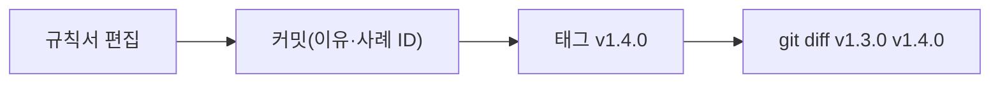
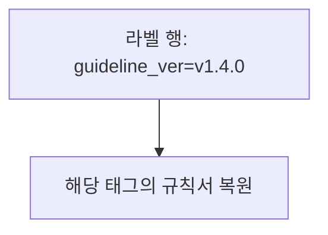

# 규칙서를 git으로 관리

> 라벨 규칙서를 git 저장소에 두고 버전마다 태그를 붙이면, 변경 이력과 두 버전 사이의 차이(diff)를 도구가 자동으로 만들어 준다. "v1.3과 v2.0에서 무엇이 바뀌었나"를 한 명령으로 확인할 수 있다.

## 쉽게 말하면
문서를 "다른 이름으로 저장"하며 `규칙서_최종_진짜최종.docx`를 만드는 대신, 저장 이력을 자동으로 남기고 두 시점을 겹쳐 비교하는 기능을 쓰는 것이다.

## 자세히
- **태그(Pro Git, Git Basics - Tagging)**: `git tag -a v1.4 -m "my version 1.4"`로 주석 태그(annotated tag)를 만든다. 주석 태그는 태그한 사람·이메일·날짜·메시지를 저장하는 객체다. `git show v1.4`로 태그와 가리키는 커밋을 보고, `git tag -l "v1.8.5*"`로 패턴 목록을 본다. 지난 커밋에도 체크섬으로 나중에 태그를 붙일 수 있다. `git push`는 태그를 기본으로 보내지 않으므로 `git push origin v1.5`나 `--tags`로 보낸다.
- **직접 실행한 예(임시 저장소, `guide.md`)**: v1.3.0 태그 후 "부정: 불만 표현"을 "부정: 불만 표현, 반어법"으로 고치고 v2.0.0 태그를 붙인 뒤 `git diff v1.3.0 v2.0.0`을 실행하자 해당 줄만 `-`/`+`로 표시됐다. `git log --oneline --decorate`에는 각 버전이 태그와 함께 한 줄씩 나왔다. 규칙서의 어떤 줄이 바뀌었는지를 별도 작성 없이 얻는다.
- **운영(해석)**: ① 규칙서는 텍스트(마크다운)로 둔다(diff가 잘 보임) ② 배포 시점마다 태그(`v1.4.1` 등, [의미 변경 vs 표현 보강 버전](#semantic-vs-patch-version)) ③ 커밋 메시지에 변경 이유와 근거(경계 사례 ID) ④ 라벨 데이터에는 규칙서 버전을 저장([라벨 메타데이터 기록](#annotation-metadata-tracking)) ⑤ 변경 요약은 사람용 문서로 별도 유지([규칙 변경 요약 양식](#change-summary-template)) ⑥ 비개발자 팀은 웹 UI(GitHub 등)로 비교 화면을 볼 수 있다.
- **한계(해석)**: diff는 줄 단위라서 문장 하나를 고쳐 쓰면 그 줄 전체가 바뀐 것으로 보인다. 의미 변경인지는 사람이 판단해야 한다. git에 개인정보가 들어간 사례 원문을 넣지 않는다([로그의 개인정보 마스킹](#pii-masking-in-logs)).

## 그림으로 보기

## 예시
- 명령: `git tag -a v1.5.0 -m "반어법 판정 추가"`, `git diff v1.4.1 v1.5.0 -- guide.md`.
- 교육 활용: 비개발자 팀원과 GitHub 웹에서 두 태그를 비교해 보며 변경 이력 읽는 법을 연습한다.

## 헷갈리는 것과 비교
| 개념 | 차이 |
| --- | --- |
| git 관리 | 변경 이력·diff 자동 |
| 파일명으로 버전 관리 | 차이를 직접 비교해야 함 |
| [규칙 변경 요약 양식](#change-summary-template) | 사람이 읽는 요약 |
| [버전 기준 학습 데이터 필터](#version-filtered-training) | 버전을 이용해 학습 데이터를 거름 |

## 더 읽을거리
- [Pro Git: Git Basics - Tagging](https://git-scm.com/book/en/v2/Git-Basics-Tagging) — 주석 태그와 공유 방법
