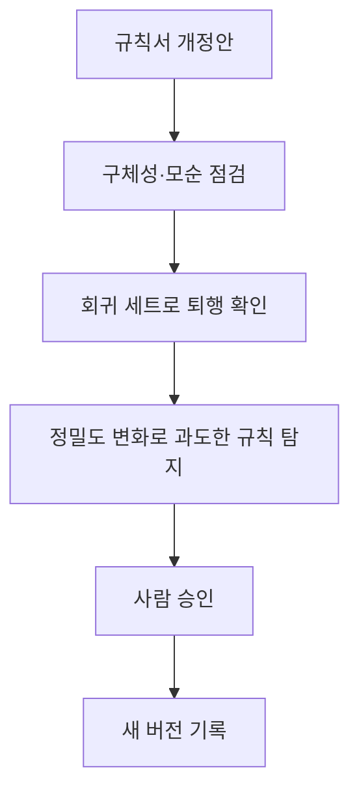
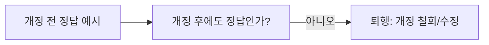

# 규칙서 품질 보증

> 라벨링 규칙서(가이드라인) 자체가 **충분히 구체적이고 서로 모순되지 않는지** 점검하는 일. 규칙서를 고치는 자동화가 늘고 있지만, 규칙서 문서를 평가하는 표준 절차는 아직 없다.

## 쉽게 말하면
채점 기준표에 오타나 모순이 있으면 채점자(사람·LLM)가 아무리 성실해도 점수가 흔들린다. 기준표를 고칠 때마다 이전에 맞던 문제가 틀리는 부작용(퇴행)도 생기므로, 기준표 자체를 검사하는 장치가 필요하다.

## 자세히
- **논문의 한계 진술(arXiv 2605.20809, 본문 확인)**: 규칙 정제 방법은 "불일치 기반 정제를 뒷받침할 만큼 **충분히 상세한 사람 작성 초기 규칙서**"가 필요하다. 많은 벤치마크·분야에는 공개 규칙서가 없거나 상위 수준의 과제 설명만 있다. 개정이 **부작용이나 퇴행**을 일으킬 수 있으며 "규칙서 문서 자체를 평가하는 **표준화된 품질 보증 절차는 현재 없다**"고 쓴다. 향후 과제로 예시·온톨로지·소량 큐레이터 입력에서 규칙서 생성, 규칙서 평가·QA(**일관성 검사, 지나치게 넓은 규칙 탐지**)를 제안한다.
- **실무에서 쓸 수 있는 점검 항목(권장, 표준 아님)**
  | 점검 | 방법 |
  |---|---|
  | 충분한 구체성 | 각 라벨에 정의·포함·제외·경계 예시 |
  | 모순 | 규칙 쌍이 같은 입력에 다른 라벨을 요구하는지 사례로 시험 |
  | 과도하게 넓은 규칙 | 규칙 적용 시 거짓 양성이 늘어나는지(개정 전후 정밀도 비교) |
  | 퇴행 | 개정 전에 맞던 개발 세트 예시가 개정 후 틀리지 않는지 회귀 세트로 확인 |
  | 재현성 | 두 라벨러(또는 두 LLM)가 같은 규칙서로 같은 라벨을 붙이는 일치도 |
  | 개정 이력 | 버전·변경 사유·승인자 기록 |
- **회귀 세트 운영**: "골든 예시 30~50개"를 고정해 두고 개정마다 정답 유지를 확인. 정제에 쓴 작은 세트(논문은 10문서)에서만 확인하면 과적합 위험.
- **일치도로 규칙서 품질 추정**: 규칙서만 바꿔 같은 문서를 새 라벨러가 라벨링했을 때 일치도(κ)가 오르면 모호함이 줄었다는 신호.
- **사람 검토 단계**: LLM이 제안한 개정안은 사람이 승인하고 버전 관리한다(논문의 중재 흐름에 대한 실무 시사).
- **연결**: 규칙서가 명확할수록 [엄격 F1](#strict-span-type-f1)이 높아지고 [오류 유형](#discrepancy-categories-ner)이 단순해진다.

## 그림으로 보기

## 예시
- 점검 스크립트 아이디어: `regression_set`(골든 50개)에 개정 전·후 규칙서로 LLM 라벨링을 돌려 `flipped = [x for x in set if before_ok(x) and not after_ok(x)]`를 출력.
- 사내 콘텐츠 검수 규칙서를 매월 개정할 때 회귀 세트와 일치도 점검을 체크리스트로 포함.

## 헷갈리는 것과 비교
| 개념 | 대상 |
|---|---|
| 데이터 품질 검사 | 라벨 데이터 |
| 규칙서 품질 보증 | 라벨 규칙 문서 |
| 모델 평가 | 모델 성능 |
| [중재 기반 규칙서 정제](#moderation-guideline-refinement) | 규칙서를 자동 개정하는 절차 |

## 더 읽을거리
- [arXiv 2605.20809 (HTML)](https://arxiv.org/html/2605.20809) — 한계 절의 QA 부재 진술(열어 확인). 위 점검 항목 표는 이 글의 권장안.
