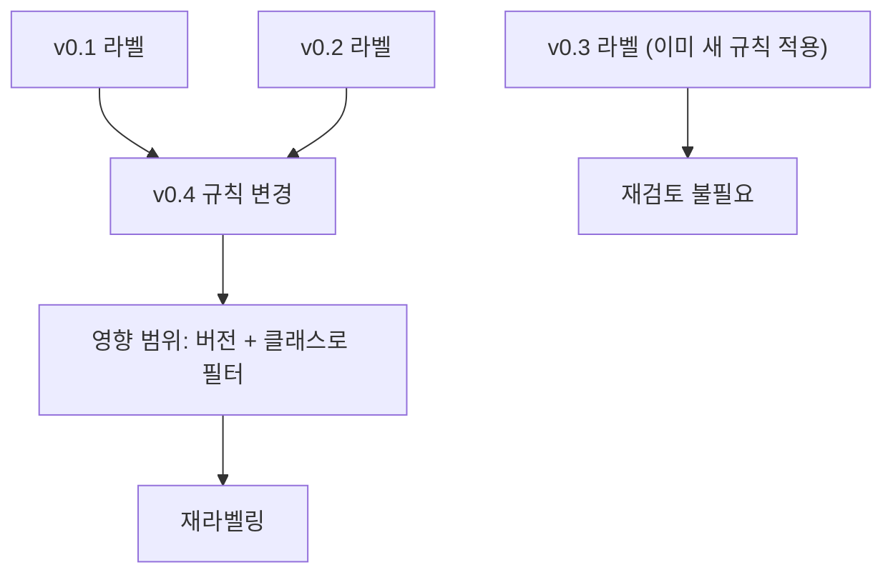
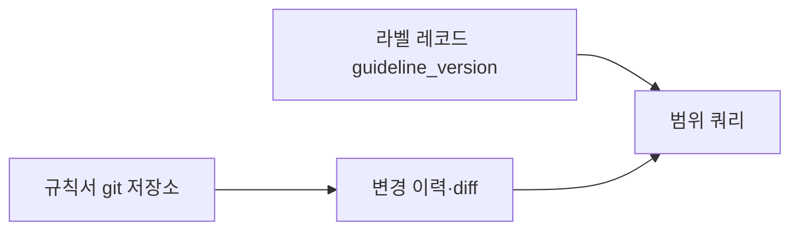

# 규칙서 버전 관리

> 라벨 규칙서를 고칠 때마다 **버전 번호를 매기고, 각 라벨 레코드에 "어느 버전 규칙으로 달았는지"를 함께 저장**하는 관리 방식이다. 그래야 규칙이 바뀐 뒤 어떤 라벨을 다시 봐야 하는지 범위를 정할 수 있다.

## 쉽게 말하면
법이 개정될 때 "몇 년 개정법으로 처리한 사건인지"를 서류에 적어 두면, 개정 후 영향받는 사건만 골라 다시 볼 수 있다. 적어 두지 않으면 전부 다시 봐야 한다.

## 자세히
- **근거(Finlayson & Erjavec, arXiv 1602.05753)**: 주석 프로젝트에서는 규격과 가이드가 여러 번 바뀌고, 새 규격이 적용된 코퍼스 일부와 옛 규격으로 만든 일부가 **공존**한다. 문서는 도구가 지금 어떤 버전이 쓰이는지 분명히 보여 주고 버전 간 차이를 볼 수 있어야 한다고 말하며, 체크리스트에도 "가이드 버전 추적"이 들어 있다.
- **무엇을 기록하나(제안)**
  1. 규칙서 문서에 `v0.3` 같은 버전과 변경 요약(날짜·무엇이 바뀌었나·왜).
  2. 각 라벨 레코드에 `guideline_version`, 라벨러 ID, 날짜.
  3. [경계 사례 로그](#edge-case-log-template)의 `guideline_version_added`로 어느 사례가 어느 버전에서 반영됐는지 연결.
  4. 가이드를 저장소(git)로 두면 변경 이력과 차이를 그대로 볼 수 있다(제안).
- **재검토 범위 계산(장난감 예: 라벨 300건, v0.1 80·v0.2 120·v0.3 100건, 새 규칙이 '결제'·'환불' 경계에 영향)**: 영향 가능 라벨은 166건(v0.1 42, v0.2 64, v0.3 60). 만약 v0.3부터 이미 새 규칙을 적용했다면 재검토 대상은 **106건(전체의 35%)**으로 줄어든다. 버전을 기록하지 않았다면 구분할 방법이 없어 166건 모두, 즉 **57%** 이상을 봐야 한다(이 수치는 설명용 가상 데이터).
- **버전 번호 규칙(경험칙)**: 의미가 바뀌는 변경(클래스 정의·경계)은 **마이너 이상**으로 올려 재라벨링 대상임을 표시하고, 표현·예시 보강은 패치로 올려 재라벨링 불필요임을 표시한다.
- **운영**: 변경은 모든 라벨러가 동시에 새 버전을 쓰도록 공지·확인([규칙 변경 전파](#rule-change-propagation)). 시험 데이터를 만들 때는 같은 버전 규칙의 라벨만 모아 평가해 혼합을 피한다.
- 모델 학습 시 `guideline_version`을 특성이 아니라 **분할·필터 기준**으로 쓴다(필요하면 최신 버전 라벨만 학습).

## 그림으로 보기



## 예시
```sql
-- v0.4 경계 규칙이 영향을 주는 기존 라벨만 추림
SELECT id FROM labels WHERE guideline_version < 'v0.3' AND label IN ('결제','환불');
```
- 의도 분류 가이드 v0.3→v0.4에서 "환불 vs 교환" 규칙이 바뀌면 v0.3 이하 라벨 중 두 클래스만 재검토.

## 헷갈리는 것과 비교
| 개념 | 차이 |
|---|---|
| 규칙서 버전 관리 | 규칙의 변경 이력과 적용 범위 |
| [경계 사례 로그](#guideline-edge-case-log) | 결정과 이유를 쌓는 기록 |
| 데이터셋 버전 | 라벨 결과물 스냅샷의 버전 |
| [재라벨링](#relabel-after-rule-change) | 버전 기록으로 범위를 정한 뒤 수행 |

## 더 읽을거리
- [Overview of Annotation Creation (arXiv 1602.05753)](https://arxiv.org/abs/1602.05753) — 규격·가이드 버전 공존과 추적.
