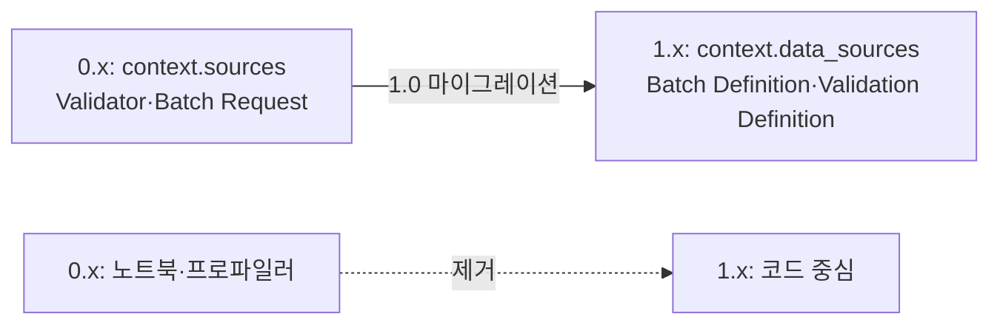
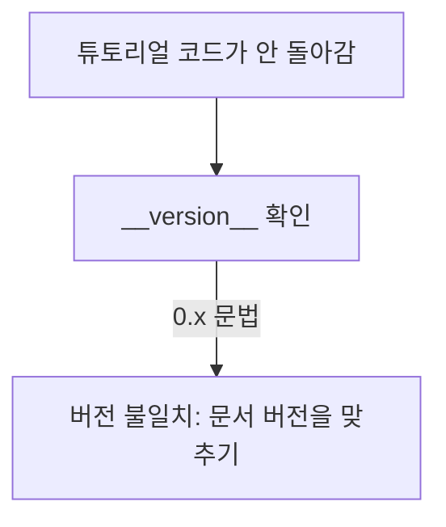

# GX 0.x와 1.x API 차이

> Great Expectations는 1.0에서 API가 크게 바뀌어, 인터넷의 옛 튜토리얼(0.x)을 그대로 따라 하면 **1.x에서는 동작하지 않는다**. 어느 버전 문서인지 먼저 확인해야 한다.

## 쉽게 말하면
같은 앱인데 설정 메뉴 이름·위치가 통째로 바뀐 신버전이 나온 것이다. 옛 블로그의 "설정 → 소스 추가"를 신버전에서 찾으면 메뉴가 없다.

## 자세히
(공식 마이그레이션 가이드를 읽고, 이 세션에서 **0.18.22와 1.25.0을 각각 설치해 확인**했다.)
- **직접 확인한 차이**
  - 0.18.22: `context.sources.add_pandas(...)` 존재. `read_dataframe(df)`로 Validator를 만들고 `v.expect_column_values_to_be_unique("customer_id")`처럼 호출하는 방식(이 세션의 일회성 시도에서 결과 객체의 success는 False로 출력, 중복 `[3,3]`이 있는 데이터).
  - 1.25.0: `context.sources`가 **없고** `context.data_sources`가 있다(`hasattr` 확인).
- **공식 가이드의 변경 요약**
  - **Checkpoint**: `validations` 목록 대신 `validation_definitions`. `StoreValidationResultAction`·`StoreEvaluationParametersAction` 제거(결과는 항상 저장). `UpdateDataDocsAction`은 기본으로 안 붙으니 명시해야 한다. 한 Checkpoint의 모든 Validation Definition은 같은 batch 파라미터를 받아야 한다.
  - **Validation Definition(신규)**: 데이터·배치 정의·Suite를 묶은 객체. `gx/validation_definitions/`에 저장.
  - **Validator·Batch Request**: `get_validator(batch_request=...)`·`save_expectation_suite()` 흐름이 사라지고 Suite에 Expectation을 직접 추가. `build_batch_request()` 제거, 배치는 batch definition과 batch parameter로.
  - **Expectation이 클래스**: `context.suites.add(gx.ExpectationSuite(...))`, `gxe.ExpectColumnValuesToBeBetween(...)`. `evaluation_parameters`는 `suite_parameters`로, `expectation_type`은 `type`으로.
  - **Datasource → Data Source**: `context.sources.add_*` → `context.data_sources.add_*`. 파티셔닝은 asset이 아니라 `batch_definitions`로.
  - **제거된 기능**: 임의 정규식 배치와 시간 외 분할(연·월·일과 전체만 지원), 프로파일러, 노트북, 파일시스템 외 저장소(DB·S3·GCP·Azure)는 사용자가 직접 처리, 설정 `config_version`은 4.0.
- **대응법(제안)**: 튜토리얼의 import와 `context.` 메서드가 위 목록에 보이면 0.x 자료이므로 설치 버전과 맞는지 `great_expectations.__version__`을 확인한다. 이 글은 두 버전의 전체를 비교하지 않았고 일부만 실행으로 확인했다.

## 그림으로 보기

## 예시
- 옛 블로그의 `context.sources.add_pandas`를 1.25.0에서 실행하면 속성이 없어 실패 → `data_sources`로 바꿔 시작.
- 교육 소재: "AI 도구 튜토리얼이 틀려 보일 때 버전부터 확인"이라는 습관을 설명.

## 헷갈리는 것과 비교
| 개념 | 0.x | 1.x |
|---|---|---|
| 소스 추가 | context.sources | context.data_sources |
| 실행 단위 | Validator·Batch Request | Validation Definition·Batch Definition |
| Expectation 정의 | 메서드·dict | 클래스 |
| 관련 | [GX Checkpoint와 Action](#gx-checkpoint-actions) | [Great Expectations](#great-expectations) |

## 더 읽을거리
- [GX 마이그레이션 가이드](https://docs.greatexpectations.io/docs/reference/learn/migration_guide/) — 0.x → 1.0 변경 목록(직접 확인).
