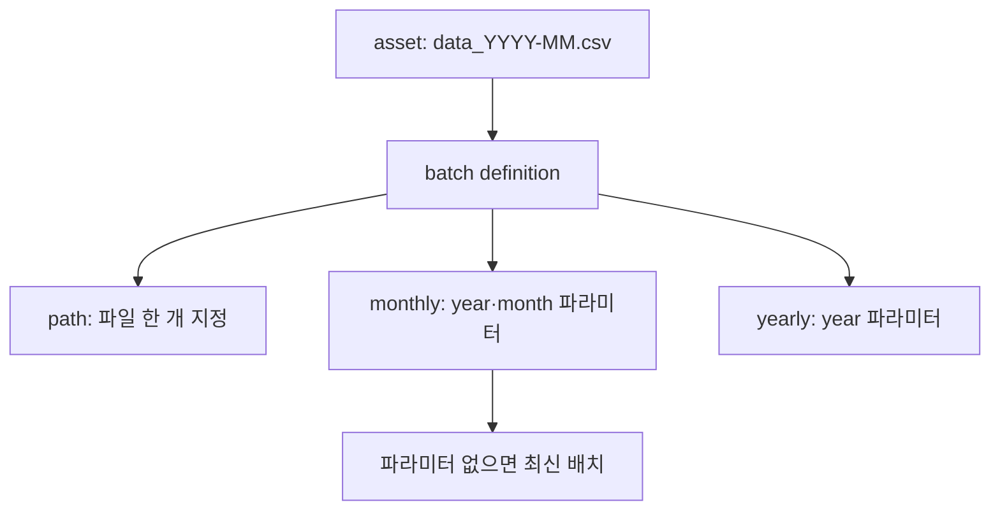
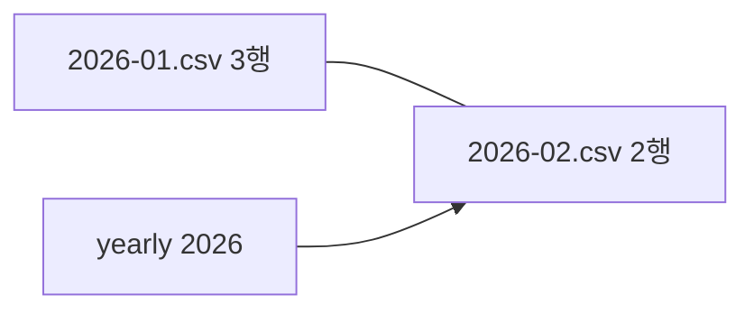

# GX Batch Definition

> Great Expectations에서 **"데이터 자산(asset)에서 어떤 조각(배치)을 읽을지"를 정하는 정의**다. 전체 DataFrame, 특정 파일 경로, 연·월·일 단위 파일 등으로 나눌 수 있고, 검증은 이 배치 단위로 실행된다.

## 쉽게 말하면
월별로 쌓이는 매출 파일이 있을 때 "2월 파일만 검사해"라고 지정하는 지시서다. 어떤 조각을 집을지 정해 두면, 매달 같은 규칙으로 해당 달 파일을 검증할 수 있다.

## 자세히
(이 세션에서 great_expectations **1.25.0**으로 CSV 파일 2개(`data_2026-01.csv` 3행, `data_2026-02.csv` 2행)를 만들어 **직접 실행**한 결과. 공식 문서 본문은 열리지 않았다. 버전·소스 종류에 따라 다를 수 있다.)
- **만드는 메서드(실행 결과)**: 파일시스템 CSV asset에서 `add_batch_definition`, `add_batch_definition_path`, `add_batch_definition_daily`, `add_batch_definition_monthly`, `add_batch_definition_yearly`가 보였다. (pandas DataFrame asset은 `add_batch_definition_whole_dataframe`를 썼다.)
- **관찰(실행 결과)**
  | 정의 | 호출 | 읽힌 행 수 |
  |---|---|---|
  | `path` | `path="data_2026-01.csv"` | 3 (1월 파일) |
  | `monthly` | `batch_parameters={"year":"2026","month":"02"}` | 2 (2월 파일) |
  | `monthly` | `{"year":"2026","month":"01"}` | 3 (1월 파일) |
  | `monthly` | 파라미터 없음 `get_batch()` | 2 → **가장 최근(2월) 파일** |
  | `yearly` | `{"year":"2026"}` | 2 → 1·2월을 합친 5행이 아니라 **마지막(2월) 파일 하나** |
- **해석**: 월·연 단위 정의는 파일명에서 정규식 그룹(`year`, `month`)을 뽑아 **어느 파일을 고를지** 결정한다. 파라미터를 생략하면 가장 최근 배치를 고른다. 연 단위로 여러 파일이 겹쳐도 합쳐지지 않고 **하나만 선택**되는 것으로 관찰돼, "연 전체 합산 검증"을 기대하면 틀릴 수 있다(이번 실험 한정).
- **검증과의 관계**: Batch Definition은 스위트와 묶여 **validation definition**이 되어 실행된다. → [GX 파일 데이터 컨텍스트](#gx-file-data-context)
- **한계**: 날짜별(daily)·디렉터리 단위 정의, SQL 소스의 배치는 시험하지 않았다.

## 그림으로 보기

## 예시
- 월별 매출 CSV에서 `monthly` 정의를 만들고 매달 `month`만 바꿔 같은 스위트로 검증.
- 교육 활동: 파일 3개를 만들어 `path`, `monthly`, `yearly`로 읽어 행 수를 표로 비교.

## 헷갈리는 것과 비교
| 개념 | 차이 |
|---|---|
| Batch Definition | 읽을 조각의 규칙 |
| Batch | 정의에서 실제로 꺼낸 데이터 조각 |
| [GX Suite 파라미터](#gx-suite-parameters) | 규칙 안의 값을 실행 때 주입 |
| [GX 파일 데이터 컨텍스트](#gx-file-data-context) | 설정을 폴더에 저장 |

## 더 읽을거리
- [Great Expectations 문서](https://docs.greatexpectations.io/docs/) — 개요(이 노드의 표는 직접 실행 결과이며 문서 본문은 근거 아님).
