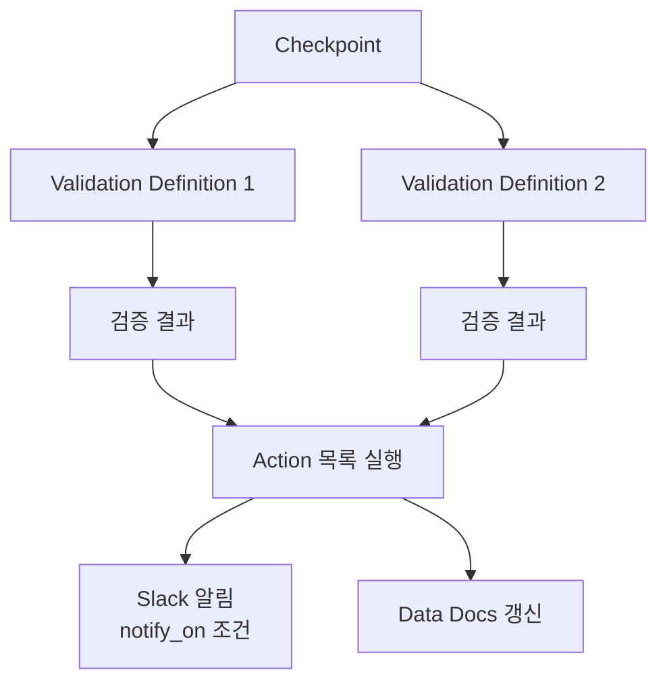
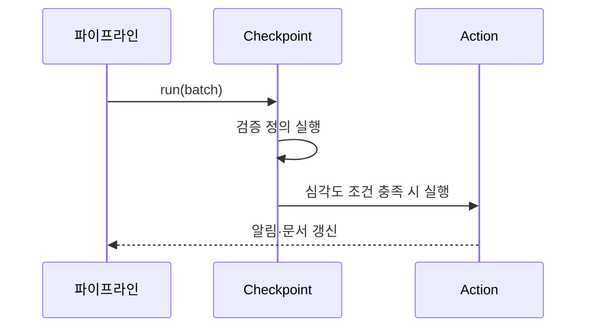

# GX Checkpoint와 Action

> Great Expectations(GX Core)의 **Checkpoint**는 하나 이상의 검증 정의(Validation Definition)를 실행한 뒤, 결과에 따라 **Action**(알림·문서 갱신 등)을 수행하는 운영용 실행 단위다. "검사"를 "자동 파이프라인 단계"로 바꿔 준다.

## 쉽게 말하면
입고 검수표(Expectation)로 부품을 검사하는 일을 매번 사람이 하지 않고, "정해진 시각에 검수 → 불합격이면 담당자 채팅방에 알림 → 결과 페이지 갱신"까지 묶어 놓은 자동 검수 담당자가 Checkpoint다.

## 자세히
(공식 문서 docs.greatexpectations.io와 GitHub를 읽고, 이 세션에서 great_expectations 1.25.0을 설치해 **Checkpoint를 직접 실행**해 확인했다.)
- **정의(공식 문서)**: Checkpoint는 Validation Definition들을 실행하고, 각 Validation Definition의 결과에 따라 Action 목록을 **정의마다 한 번씩** 실행한다. 요구 환경은 Python 3.10~3.14. GX Core는 Fivetran의 오픈소스(Apache-2.0, 별 약 11.9k, 확인 시점)이며 `pip install great_expectations`.
- **만드는 법(문서 예)**: `gx.Checkpoint(name, validation_definitions=[...], actions=[...], result_format=...)`를 만들고 `context.checkpoints.add(checkpoint)`로 저장, `context.checkpoints.get("my_checkpoint")`로 불러온다. 문서가 다루는 Action은 `SlackNotificationAction`(토큰·채널을 `${...}` 환경변수 치환으로, `notify_on`, `show_failed_expectations`)과 `UpdateDataDocsAction`. 문서는 EmailAction 언급이 없어 API 레퍼런스 확인이 필요하다. 사용자 정의 Action도 가능하다.
- **notify_on(문서)**: `all`, `success`, `failure`(심각도 무관), `critical`, `warning`, `info`. **가장 높은 심각도**가 우선해서 warning+info 실패 혼합이면 warning·failure·all Action은 실행되지만 info Action은 실행되지 않는다. `result_format` 기본은 `SUMMARY`(기대별 통과/실패 + 일부 관측값), 예시는 `COMPLETE`.
- **직접 실행한 결과(이 세션, 1.25.0, 로컬 ephemeral)**: DataFrame `customer_id=[1,2,3,3,5]`, `age=[25,41,130,29,None]`에 두 Expectation을 넣은 Suite를 Validation Definition → Checkpoint(Action은 `UpdateDataDocsAction`)로 묶어 `checkpoint.run(batch_parameters={"dataframe": df})` 실행.
  - 전체 `success=False`
  - `expect_column_values_to_be_unique` → 실패, 위반 2건, `[3, 3]`
  - `expect_column_values_to_be_between(0~120)` → 실패, 위반 1건, `[130.0]`(결측 None은 위반 집계에서 제외됨)
  - Slack 알림은 웹훅이 없어 실행하지 않았다.
- **막히는 지점(해석)**: Action 비밀값은 코드에 쓰지 않고 환경변수로. 알림 피로를 줄이려면 `notify_on="critical"`처럼 심각도 기준을 둔다.

## 그림으로 보기

## 예시
- 매일 새벽 적재 후 Checkpoint를 실행해 critical 실패면 Slack 알림, 성공 시 Data Docs만 갱신.
- 교육 소재: 같은 데이터로 notify_on을 바꿔 가며 어떤 Action이 실행되는지 표로 비교.

## 헷갈리는 것과 비교
| 개념 | 차이 |
|---|---|
| Expectation | 개별 검증 조건 |
| Validation Definition | 데이터 + Suite 연결 |
| Checkpoint | 검증 실행 + Action |
| Action | 결과에 따른 후속 작업 |
| 관련 | [Great Expectations](#great-expectations) |

## 더 읽을거리
- [GX: Create a Checkpoint with Actions](https://docs.greatexpectations.io/docs/core/trigger_actions_based_on_results/create_a_checkpoint_with_actions) — 생성·notify_on(직접 확인).
- [great-expectations/great_expectations (GitHub)](https://github.com/great-expectations/great_expectations) — 설치·라이선스(직접 확인).
